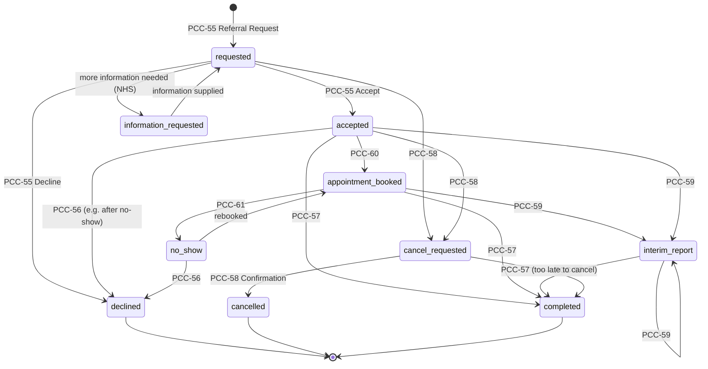
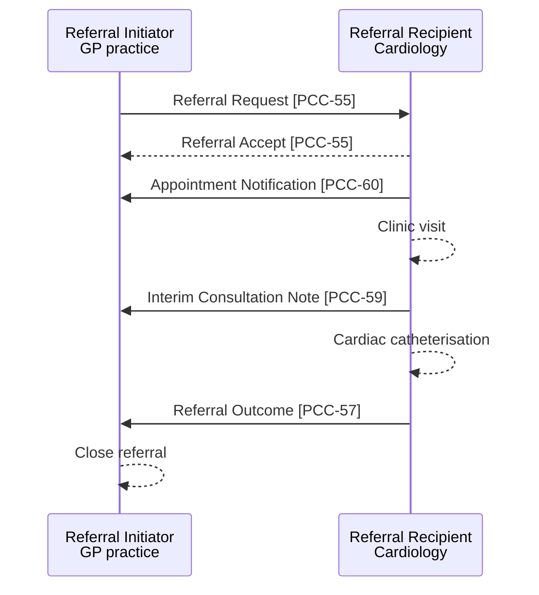

<b>Proof of concept.</b> This implementation guide is a demonstration only. It is
<b>not</b> an authoritative source, is not endorsed by NHS England, IHE or HL7, and
must not be used for implementation or clinical purposes.

IHE **360 Exchange Closed Loop Referral (360X)** lets providers on different systems
exchange a referral request and its result, from within their own workflow, "when the
expectation is that the patient will eventually return to the referring provider for
continued care" (PCC TF-1 X).

### References

- [IHE PCC 360X supplement](https://www.ihe.net/uploadedFiles/Documents/PCC/IHE_PCC_Suppl_360X.pdf) (Rev. 1.2 Trial Implementation, 2021-04-14)
- [Virtually Healthcare - 360X](https://virtually-healthcare.github.io/360X.html) - the same pattern as referral and discharge
- [NW GMSA - Genetic Referrals](https://nw-gmsa.github.io/en/GeneticReferrals.html) - the pattern applied to clinical genetics

### Actors and Transactions

| Actor | Description | Typical NHS system |
|---|---|---|
| Referral Initiator | Sends the referral request; receives accept or decline, appointments, consultation notes and the outcome | GP system, EPR, community system, care coordination hub |
| Referral Recipient | Receives the referral; accepts or declines it; sends appointments, consultation notes and the outcome | EPR / PAS of the receiving trust, community or virtual ward system |
{:.grid}

| Transaction | Referral Initiator | Referral Recipient | Page |
|---|---|---|---|
| Referral Request [PCC-55] - request, accept, decline | R (send request, receive accept / decline) | R (receive request, send accept / decline) | [PCC-55](PCC-55.html) |
| Referral Decline [PCC-56] - decline after acceptance | R (receive) | O (send) | [PCC-56](PCC-56.html) |
| Referral Outcome [PCC-57] | R (receive) | R (send) | [PCC-57](PCC-57.html) |
| Referral Cancellation [PCC-58] | O (send request, receive confirmation) | O (receive request, send confirmation) | [PCC-58](PCC-58.html) |
| Interim Consultation Note [PCC-59] | R (receive) | O (send) | [PCC-59](PCC-59.html) |
| Appointment Notification [PCC-60] | O (receive) | O (send) | [PCC-60](PCC-60.html) |
| No-Show Notification [PCC-61] | O (receive) | O (send) | [PCC-60](PCC-60.html#no-show-notification-pcc-61) |
{:.grid}

R = required, O = optional (PCC TF-1 Table X.1-1). [PCC-56] or [PCC-57] received by the
Referral Initiator ends the referral. Receiving an optional transaction that is not
supported must not be treated as an error.

### State Transitions

360X defines the referral states from each actor's point of view (PCC TF-1 X.4.1).
Combined, and coded in [Referral Workflow Status](CodeSystem-referral-workflow-status.html):

Points that matter for implementers:

- A **decline can arrive at any time**, not only as the first response. The
  Referral Initiator must handle a "delayed" decline after an acceptance.
- A **cancellation request may not be honoured**. The Referral Recipient may reply with
  the next workflow step (for example a Referral Outcome) instead of a confirmation.
- After a decline a new referral needs a **new Referral ID**.
- `information-requested` is not in 360X. It is added for the eRS and BaRS
  "return to referrer" step.
- Without the Scheduling Option the Referral Recipient can report a no-show as the
  reason for a Referral Decline [PCC-56].

### Identifiers

360X requires two identifiers in **every** message, in both directions (PCC TF-1 X.1.3):

| Identifier | Rule | HL7 v2 | FHIR |
|---|---|---|---|
| Patient identifier | Set by the Referral Initiator in the request, used unchanged in every later message. The Referral Recipient may add its own | PID-3 | `Patient.identifier` - NHS Number where traced, plus local MRN |
| Referral ID | Unique, assigned by the Referral Initiator, used unchanged in every later message | ORC-2 (and OBR-2 in the request) | `ServiceRequest.identifier` ([Referral Identifier](StructureDefinition-ReferralIdentifier.html)); `basedOn` in Task, Appointment, Composition |
{:.grid}

In England the NHS Number is the shared patient identifier. Where the referral was
made through eRS, the **UBRN** is a second referral identifier known to both sides.

### Options

| 360X option | 360X definition | This guide |
|---|---|---|
| Scheduling Option | Appointment [PCC-60] and No-Show [PCC-61] notifications | Kept. eRS and BaRS already book appointments; the notification is still needed when booking is done locally |
| XDM transport (required base) | ZIP over email (Direct in the US) | Replaced by **MESH** or **HL7 v2 over MLLP** - see [Exchange Options](Transport.html) |
| XDR Option | XDR Document Source / Recipient (SOAP) | Optional - only where an XDS / XDR infrastructure exists |
| MHD Option | MHD Document Source / Recipient (FHIR) | Kept as the FHIR equivalent, aligned to the EU Health Data API |
| XDS-MS Referral Summary and XPHR content | CDA documents | Replaced by FHIR Documents |
| C-CDA content | US C-CDA | Replaced by [HL7 Europe HDR](https://hl7.eu/fhir/hdr/) and the [Consultation Note](StructureDefinition-ConsultationNote.html) |
{:.grid}

360X's own **message** content is HL7 v2 (`OMG^O19`, `OSU^O51`, `SIU`), with a clinical
document alongside. This guide keeps that split - a small workflow message and a
document - and gives each a FHIR equivalent (`ServiceRequest` / `Task` and a FHIR Document).

### Use Cases

#### GP to Specialist

360X Use Case #1 restated for the NHS (example resources in brackets):

1. Mr Packton, 58, sees Dr Allen, his GP, with shortness of breath. BMI 30, non-smoker,
   no chest pain, family history of coronary artery disease.
2. Dr Allen refers him to cardiology, asking "Determine the origin of Mr Packton's
   shortness of breath", to be seen within a week. The referral carries the findings,
   history and results ([Referral Request](ServiceRequest-CardiologyReferral.html)). In
   England this would usually go through eRS.
3. The cardiology service triages and accepts the referral
   ([Accepted](Task-CardiologyReferralAccepted.html)), or declines it with a reason
   ([Declined](Task-CardiologyReferralDeclined.html)).
4. The service books an appointment and notifies the GP
   ([Appointment](Appointment-CardiologyAppointment.html)).
5. Dr Brown sees the patient, diagnoses coronary artery disease and books a cardiac
   catheterisation. The clinic letter answers the referral question
   ([Interim Consultation Note](Composition-CardiologyInterimNote.html)).
6. After the catheterisation Dr Brown sends a final letter with a plan of care and
   discharges the patient to the GP ([Referral Outcome](Composition-CardiologyOutcomeNote.html),
   [Completed](Task-CardiologyReferralCompleted.html)).
7. Dr Allen reviews the notes and closes the referral.

#### Public Health to Specialist

360X Use Case #2 is newborn hearing screening: a public health programme (or the GP)
refers a baby who did not pass screening to audiology, and the audiology result updates
the hearing plan of care. The NHS equivalent is the
[NHS Newborn Hearing Screening Programme](https://www.gov.uk/guidance/newborn-hearing-screening-programme-overview),
whose national IT system is not covered here - **Open**. The pattern is the same, with a
care plan as the outcome (see [Dynamic Care Planning](DCP.html)).

#### Virtual Ward

A GP or community team refers a patient to a virtual ward instead of an acute admission;
the outcome is a discharge report. See [Virtual Wards](VirtualWards.html).

### Secondary Referrals and End of Care

- 360X treats a specialist-to-specialist (secondary) referral as a **new referral**. The
  original Referral Initiator is told about it through an Interim Consultation Note or the
  Referral Outcome, usually as part of the plan of care.
- The loop is closed at **End of Care**. For referrals for continued care (for example
  long-term specialist follow-up) the loop can be closed by accepting the referral and
  sharing a care plan as the outcome.

### Cross Profile Considerations

| Profile | Relationship |
|---|---|
| IHE ROL (Referral / Order Linking) | Extra information (e.g. new results) from the initiator before the patient is seen - in FHIR, an update to `ServiceRequest.supportingInfo` or a `Communication` |
| IHE XBeR-WD | Cross-enterprise basic eReferral using XDW workflow documents. 360X chose HL7 v2 instead because XDW is not supported by existing systems; the same reasoning applies in England |
| IHE DCP | Shared care plans for ongoing, multi-provider care - see [Dynamic Care Planning](DCP.html) |
| IHE LTW, SWF.b | The same order / report pattern - see [Order and Report Workflow Pattern](WorkflowPatterns.html) |
{:.grid}
