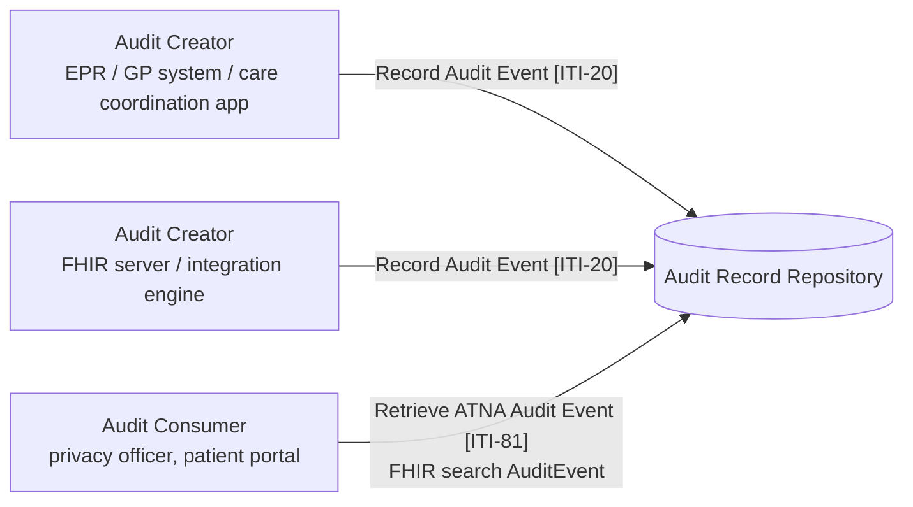

<b>Proof of concept.</b> This implementation guide is a demonstration only. It is
<b>not</b> an authoritative source, is not endorsed by NHS England, IHE or HL7, and
must not be used for implementation or clinical purposes.

**Audit [BALP]** - recording and querying who did what to a patient's information,
across organisations. IHE [Basic Audit Log Patterns (BALP)](https://profiles.ihe.net/ITI/BALP/index.html)
defines FHIR `AuditEvent` patterns for each kind of access; IHE
[Audit Trail and Node Authentication (ATNA)](https://profiles.ihe.net/ITI/TF/Volume1/ch-9.html)
defines how the events are sent to and retrieved from an audit repository.

<b>Recommended good practice.</b> Audit is a <b>mandatory requirement for GP system
providers</b>, but the GP audit trail is <b>not exposed through an API</b> - another
organisation cannot see who accessed a patient's record outside its own system.
Providers working in a care coordination ecosystem <b>SHOULD</b> implement BALP audit
events and make them available through the ATNA audit API, so that access to a patient's
information can be traced across organisations.

### References

- [IHE ITI Basic Audit Log Patterns (BALP)](https://profiles.ihe.net/ITI/BALP/index.html) 1.1.4 (2025-10-31, checked 2026-11-02) - [content and patterns](https://profiles.ihe.net/ITI/BALP/content.html), [artifacts](https://profiles.ihe.net/ITI/BALP/artifacts.html)
- [IHE ITI Audit Trail and Node Authentication (ATNA)](https://profiles.ihe.net/ITI/TF/Volume1/ch-9.html) - [Record Audit Event [ITI-20]](https://profiles.ihe.net/ITI/TF/Volume2/ITI-20.html), [Retrieve ATNA Audit Event [ITI-81]](https://profiles.ihe.net/ITI/TF/Volume2/ITI-81.html)
- [FHIR AuditEvent](https://hl7.org/fhir/R4/auditevent.html)

### Why It Matters for Care Coordination

This guide recommends sharing data through APIs ([EU Health Data API](HealthDataAPI.html),
[Query Existing Data [PCC-44]](QEDm.html), [Document Sharing [MHD]](MHD.html)) rather than
copying it in messages. The more data is read in place by other organisations, the more
important it is that each read is recorded where the patient, the data controller and an
investigator can see it:

- **Patients** can ask who has looked at their record, in every organisation involved in
  their care - not only the one that holds it.
- **Data controllers** can check that access by partners (for example a virtual ward
  team reading the GP record) matched a legitimate relationship.
- **Shared records** (shared care records, the Single Patient Record) need an audit trail
  that covers everyone who can read them.

Today each system keeps its own audit log, in its own format, without an API. BALP gives
a common `AuditEvent` format and ATNA a common way to send and query it.

### Actors and Transactions

| Actor | Role | NHS example |
|---|---|---|
| Audit Creator | Records an `AuditEvent` for each access, following a BALP pattern | EPR, GP system, virtual ward platform, FHIR facade, Trust Integration Engine |
| Audit Record Repository | Stores audit events; supports search | Regional or organisation audit service - **To confirm** |
| Audit Consumer | Searches audit events, e.g. all access to one patient | Information governance team; patient access to "who has seen my record" |
{:.grid}

`Record Audit Event [ITI-20]` can use syslog or, with the ATNA FHIR feed option, a FHIR
`create` of the `AuditEvent`. `Retrieve ATNA Audit Event [ITI-81]` is a FHIR search on
`AuditEvent`, for example by patient and date.

### Audit Patterns for This Guide's Interactions

Each interaction in this guide maps to a BALP pattern. Both sides record an event: the
client (requester) and the server (responder).

| Interaction | BALP pattern |
|---|---|
| Referral Request [PCC-55] received (`$process-message`, create `ServiceRequest` / `Task`) | [Create (with Patient)](https://profiles.ihe.net/ITI/BALP/StructureDefinition-IHE.BasicAudit.PatientCreate.html) |
| Status updates [PCC-55] to [PCC-60] (update `Task`, `Appointment`) | [Update (with Patient)](https://profiles.ihe.net/ITI/BALP/StructureDefinition-IHE.BasicAudit.PatientUpdate.html) |
| Referral and outcome documents sent to another organisation (FHIR Message, `MDM^T02`, MESH, GP Connect Send Document) | [Privacy Disclosure at Source](https://profiles.ihe.net/ITI/BALP/StructureDefinition-IHE.BasicAudit.PrivacyDisclosure.Source.html) and [at Recipient](https://profiles.ihe.net/ITI/BALP/StructureDefinition-IHE.BasicAudit.PrivacyDisclosure.Recipient.html) |
| Query Existing Data [PCC-44]; Health Data API resource search; GP Connect / IM1 record reads | [Query (with Patient)](https://profiles.ihe.net/ITI/BALP/StructureDefinition-IHE.BasicAudit.PatientQuery.html) |
| Read a resource or document (MHD Retrieve Document [ITI-68], Health Data API read) | [Read (with Patient)](https://profiles.ihe.net/ITI/BALP/StructureDefinition-IHE.BasicAudit.PatientRead.html) |
| Find Document References [ITI-67] | [Query (with Patient)](https://profiles.ihe.net/ITI/BALP/StructureDefinition-IHE.BasicAudit.PatientQuery.html) |
| Provide Document Bundle [ITI-65] (publish an outcome document) | [Create (with Patient)](https://profiles.ihe.net/ITI/BALP/StructureDefinition-IHE.BasicAudit.PatientCreate.html) |
| Access with an OAuth token (CIS2, SMART on FHIR) | [OAuth Access Token Use](https://profiles.ihe.net/ITI/BALP/StructureDefinition-IHE.BasicAudit.OAUTHaccessTokenUse.Minimal.html) (Minimal, Opaque or Comprehensive) |
| Access permitted by a consent decision | [Authorization Permit by Consent](https://profiles.ihe.net/ITI/BALP/StructureDefinition-IHE.BasicAudit.AuthZconsent.html) |
{:.grid}

HL7 v2 has no audit message: the system or Trust Integration Engine that sends or
receives an HL7 v2 message records the BALP event (Privacy Disclosure for a message
carrying clinical information).

### Recommendations

- Care coordination providers **SHOULD** record BALP `AuditEvent`s for the interactions
  above, identifying the patient (NHS Number), the user (`agent`, with the professional
  identifier and organisation ODS code) and the purpose of use.
- They **SHOULD** expose them through `Retrieve ATNA Audit Event [ITI-81]` (FHIR search
  on `AuditEvent`) to authorised consumers, or send them to a shared Audit Record
  Repository with `Record Audit Event [ITI-20]`.
- GP system providers already audit as a mandatory requirement; exposing that audit
  through the same API is recommended so that access to the GP record by other
  organisations can be traced - **Open** how this is commissioned.
