<b>Proof of concept.</b> This implementation guide is a demonstration only. It is
<b>not</b> an authoritative source, is not endorsed by NHS England, IHE or HL7, and
must not be used for implementation or clinical purposes.

A detailed review of the **Booking and Referral Standard (BaRS)** against IHE 360X and
the general standards (HL7 v2, FHIR Workflow, FHIR Messaging). It replaces a summary
judgement with evidence from the BaRS implementation guide and API specification. Each
finding quotes the source; points not checked are marked **To confirm**.

### References

- [BaRS implementation guide](https://simplifier.net/guide/nhsbookingandreferralstandard) - Guide v1.12.1, Core v1.6.0, Package v1.42.0 (checked 2026-11-02). The guide still says it "is currently under development"
- [Booking and Referral FHIR API v1.0.7](https://digital.nhs.uk/developer/api-catalogue/booking-and-referral-fhir/v1.0.7#post-/$process-message) - OpenAPI "Booking and Referral API" 1.0.0 (checked 2026-11-02)
- BaRS Core 1.6.0: [Standard Pattern For Composites](https://simplifier.net/guide/nhsbookingandreferralstandard/Home/Core/1-6-0/Standard-Pattern-Composite-Messages/Standard-Pattern-For-Composites), [Message Headers](https://simplifier.net/guide/nhsbookingandreferralstandard/Home/Core/1-6-0/Standard-Pattern-Composite-Messages/Message-Headers), [Use Case Categories](https://simplifier.net/guide/nhsbookingandreferralstandard/Home/Core/1-6-0/Standard-Pattern-Composite-Messages/Use-Case-Categories), [Journey ID](https://simplifier.net/guide/nhsbookingandreferralstandard/Home/Core/1-6-0/BaRS-FHIR-Usage/Journey-ID)
- BaRS Applications (guide v1.12.1): [1 Bookings and Referrals into UEC](https://simplifier.net/guide/nhsbookingandreferralstandard/Home/Applications/BaRS-Applications/Applications/BaRS-APP1), [4 Referral into UEC for Validation](https://simplifier.net/guide/nhsbookingandreferralstandard/Home/Applications/BaRS-Applications/Applications/BaRS-APP4), [5 Referrals into Pharmacy](https://simplifier.net/guide/nhsbookingandreferralstandard/Home/Applications/BaRS-Applications/Applications/BaRS-APP5)
- [FHIR Workflow - Request / Task / Event](https://hl7.org/fhir/R4/workflow.html) and [FHIR Messaging](https://hl7.org/fhir/R4/messaging.html)
- [HL7 Europe Hospital Discharge Report (HDR)](https://hl7.eu/fhir/hdr/) 1.0.0 and [HL7 Europe Patient Summary (EPS)](https://hl7.eu/fhir/eps/1.0.0-ballot/) 1.0.0-ballot (package `hl7.fhir.eu.eps`, 2026-06-06; [CI build](https://build.fhir.org/ig/hl7-eu/eps/))
- [PRSB standards](PRSB.html) - the requirements behind the BaRS data models
- [Domain-Driven Design - Anti-Corruption Layer](https://learn.microsoft.com/en-us/azure/architecture/patterns/anti-corruption-layer)

### Summary

| # | Question | Finding | This guide |
|---|---|---|---|
| - | Is BaRS close to 360X? | **Yes, in shape.** Asynchronous request and response messages, with sender and receiver swapping roles, cover request, accept / reject, cancel, booking, did not attend and a final outcome - the 360X loop. Application 4 (validation) is the closest | Map each BaRS message to a 360X transaction - [below](#message-model-compared-with-360x) |
| 1 | Are the message payloads strictly defined? | **No.** A MessageDefinition lists every resource in the Bundle as a `focus`, and conformance is "a manual, business logic, check" | One MessageDefinition per event, one focus, validatable profiles |
| 2 | Is the referral a ServiceRequest or a Task? | Workflow state is spread over `ServiceRequest.status`, `Encounter.status` and `CarePlan.status`. Application 5 adds a `Task`, but as the instruction to the receiver (what to do, by when), not as the fulfilment of the ServiceRequest | 360X workflow state belongs in a `Task` that fulfils the `ServiceRequest`; what is requested is `ServiceRequest.code` - **Open** whether PCC-55 should focus on the Task |
| 3 | What is the BaRS CarePlan? | The **sender's assessment outcome** (triage disposition codes and consultation narrative), `status` fixed `completed` - closer to a referral form than a care plan | Referral supporting information; `CarePlan` is kept for "who is doing what" ([DCP](DCP.html)) |
| 4 | How is a patient without an NHS Number identified? | A "Local patient identifier" with no type or assigning organisation | MRN with identifier type `MR` and the assigning organisation (ODS code) |
| 5 | Are payloads proportionate? | Organisations, practitioners, locations and services are sent as full resources, many "MUST" | Identifier references (ODS, professional codes) unless more is needed |
| 6 | Can an implementer tell what each message contains? | **With difficulty.** The meaning of a message comes from combinations of codes and statuses, and receivers may define their own MessageDefinitions | Explicit event and status codes |
| 7 | Is the referral payload in line with existing practice? | **No** (Application 5). The referral is mixed with the sender's consultation: Encounter, Condition, CarePlan, Task and MedicationStatement each carry part of the request | `ServiceRequest` with `code`, `reasonCode`, `requester` (PractitionerRole), `encounter` (Visit Number); the consultation as `supportingInfo` - [below](#7-application-5-referral-mixed-with-the-consultation) |
| 8 | How should a system adopt BaRS? | - | Behind an **anti-corruption layer**, so BaRS models stay at the edge - [below](#adopting-bars-an-anti-corruption-layer) |
{:.grid}

### What BaRS Does Well

- **FHIR Messaging, both ways.** "All implementers (senders or receivers) of BaRS must
  build a `$process-message` endpoint to be able to support the asynchronous workflows"
  (API v1.0.7). This is the same transport as this guide's FHIR route
  ([Exchange Options](Transport.html)).
- **Service discovery and routing** through a national Endpoint Catalogue and API proxy -
  something 360X leaves to the transport (Direct addresses in the US).
- **Booking separated from referral**: "A referral can be made independent of booking
  but, where a booking is made as part of the same workflow, they must be linked"
  (Application 1). This matches the 360X Scheduling Option and the
  [Appointment Booking](360X.html#appointment-booking) flow.
- **Transactional integrity** (retries, duplicate detection on `X-Request-Id`) and
  defined error responses (`OperationOutcome`).
- **Clinically endorsed content** for 111 to emergency department referrals - "PRSB have
  defined and endorsed an information model" (Application 1); see [PRSB Standards](PRSB.html).

### Message Model Compared with 360X

A BaRS message is identified by `MessageHeader.eventCoding` (`servicerequest-request`,
`servicerequest-response`, `booking-request`), `MessageHeader.reason` (`new`, `update`)
and the MessageDefinition it claims. The MessageDefinitions in the API specification
include `bars-message-servicerequest-request-referral`, `-request-validation`,
`-request-cancelled`, `-response-referral`, `-response-referral-short`,
`-response-validation-interim`, `-response-validation-full`, `bars-message-booking-request`
and `-booking-request-cancelled`.

| 360X | HL7 v2 (360X) | BaRS | How BaRS signals it |
|---|---|---|---|
| Referral Request [PCC-55] | `OMG^O19` ORC-1 `NW` | `servicerequest-request`, reason `new` | `ServiceRequest.status` `active`; `ServiceRequest.category` referral type and use case |
| Accept [PCC-55] | `OSU^O51` `OK` / `IP` | Interim Validation Response (Application 4) | Responder's `Encounter.status` `in-progress` |
| Decline [PCC-55] | `OSU^O51` `UA` / `CA` | Interim Validation Response, rejected (Application 4) | Responder's `Encounter.status` `cancelled` with a reason |
| Later decline [PCC-56] | `OSU^O51` | - **To confirm** | |
| Cancellation [PCC-58] | `OSU^O51` `CA` / `CR` | `servicerequest-request`, reason `update` | `ServiceRequest.status` `revoked` (or `entered-in-error` if sent to the wrong endpoint). No cancel confirmation found - **To confirm** |
| Interim Consultation Note [PCC-59] | `OSU^O51` `SC` / `A` + document | - | No clinical document; the interim response is a status |
| Referral Outcome [PCC-57] | `OSU^O51` `SC` / `CM` + document | Validation Response (full) (Application 4) | `ServiceRequest.status` `completed`, Encounter `triaged` / `complete` |
| Appointment [PCC-60] | `SIU^S12` | `booking-request`, reason `new` (sender books) | `Appointment.status` `booked`, linked to the referral |
| Appointment cancelled / changed | `SIU^S15` / `S13` | `booking-request`, reason `update` | `Appointment.status` `cancelled` / `booked` |
| No-Show [PCC-61] | `SIU^S26` | `servicerequest-response` "Safeguarding DNA response (noshow)" | `ServiceRequest.status` `revoked`, reason `new` |
| Referral ID in every message | ORC-2 | `MessageHeader.response.identifier` = the original `Bundle.id`; Journey ID = an `EpisodeOfCare` reference | No referral business identifier found in the payload guidance - **To confirm** |
{:.grid}

So BaRS **does** cover most of the closed loop, and is closer to 360X than this guide
first said. The differences are in how it is defined, below.

### 1. Message Definitions Are Loose

The BaRS MessageDefinition example in the API specification (`BARS Message Definition
ServiceRequest - Request CaseTransfer`) lists 15 entries in `focus`, each `min 1`,
`max 1`: Bundle, MessageHeader, ServiceRequest, Patient, Encounter, Location,
Organization, Practitioner, PractitionerRole, Observation, Flag, MedicationStatement,
AllergyIntolerance, QuestionnaireResponse and Consent.

- In FHIR, [`MessageDefinition.focus`](https://hl7.org/fhir/R4/messagedefinition-definitions.html#MessageDefinition.focus)
  identifies the resource(s) that are the subject of the event - the same as
  `MessageHeader.focus` - not every resource in the Bundle. Listing the Bundle and the
  MessageHeader as a focus is not meaningful, and `max 1` for Observation or Flag does
  not fit a referral with several findings.
- BaRS says so itself: "payload conformance to MessageDefinitions is not checked as part
  of FHIR validation" and the check "is a manual, business logic, check and not
  something which is supported through standard FHIR validation of the payload"
  (Message Headers).
- Receivers may define their own: "The MessageDefinitions will principally be defined
  by BaRS, at a national level (although bespoke definitions can be used through BaRS)".
  A sender must "GET the message definition" for each receiver and service before
  sending.

In 360X each transaction is one HL7 v2 message structure with a fixed `ORC-1` / `ORC-5`
pair. In this guide each event is a MessageDefinition with one focus
([Referral Order (O19)](MessageDefinition-referral-order.html),
[Referral Order Status (O51)](MessageDefinition-referral-order-status.html)) and the
contents are profiles that a validator can check.

### 2. ServiceRequest or Task

In Applications 1 and 4 there is no `Task`. The workflow state of a referral is spread over three resources:
`ServiceRequest.status` (`active`, `revoked`, `completed`), the sender's and responder's
`Encounter.status` (`triaged`, `in-progress`, `finished`, `cancelled`) and
`CarePlan.status`. `ServiceRequest.intent` is fixed to `plan`.

In [FHIR Workflow](https://hl7.org/fhir/R4/workflow.html) these are different things:

| | ServiceRequest | Task |
|---|---|---|
| What it is | The order - what is wanted and why (the referral letter) | A request to a specific performer to act on the order, and the state of that work |
| Who owns the status | The requester (`active`, `revoked`, `completed`) | The performer (`requested`, `accepted`, `rejected`, `in-progress`, `completed`) plus `businessStatus` |
| 360X | The referral content | Accept, decline, cancel, interim, outcome - `ORC-1` / `ORC-5` |
{:.grid}

A 360X `OMG^O19` both creates the order and asks a named recipient to act, so its FHIR
equivalent is a `ServiceRequest` **and** a `Task` (`status` `requested`, `focus` the
ServiceRequest). The [HL7 Physical Activity IG](https://build.fhir.org/ig/HL7/physical-activity/workflow.html)
does the same. Using `Encounter.status` to say whether a referral was accepted mixes the
referral workflow with the recipient's own patient administration.

Application 5 does include a `Task`, but not in this role - see
[section 7](#7-application-5-referral-mixed-with-the-consultation).

This guide's [Referral Order (O19)](MessageDefinition-referral-order.html) currently has
the ServiceRequest as its focus and [O51](MessageDefinition-referral-order-status.html)
the Task. Whether O19 should also carry the Task, so every message has the Task as its
focus, is **Open** - see `notes/research.md`.

### 3. CarePlan Is the Assessment, Not a Plan

In Application 1 the BaRS `CarePlan` is the sender's triage result:

- `CarePlan.status` "MUST be populated with 'completed' - FIXED VALUE"; `intent` fixed `plan`;
- `CarePlan.period.start` is "the date/time the triage Disposition was identified";
- `CarePlan.activity.outcomeCodeableConcept` carries "the triage outcome codes" (NHS
  Pathways symptom group, symptom discriminator and disposition codes), and its `text`
  "MUST be populated with the clinical narrative" (the consultation summary);
- `ServiceRequest.basedOn` references the CarePlan.

This is the **assessment that justifies the referral** - in this guide, referral
supporting information: the reason (`ServiceRequest.reasonCode`), the findings
(`Observation`) and any form ([Referral Forms](ReferralForms.html),
`QuestionnaireResponse`). FHIR R4 also has `ClinicalImpression` for an assessment. A
`CarePlan` in [Dynamic Care Planning](DCP.html) and the [Clinical Process](ClinicalProcess.html)
says who is doing what, for an ongoing plan that several teams update - a different
use. Receiving systems that file a BaRS CarePlan as a care plan would mislead users.

<b>A common mistake in the NHS.</b> In the NHS "care plan" is very often the name for a
<b>care assessment</b> - a form completed about the patient (in FHIR, a
<code>QuestionnaireResponse</code> or <code>ClinicalImpression</code>). In social care a care
plan is much closer to the FHIR <code>CarePlan</code>: the agreed activities, who carries
them out and when. Check which is meant before mapping a "care plan" to
<code>CarePlan</code>.

### 4. Patient Identification

BaRS Application 1 guidance for `Patient.identifier`:

- `system` `https://fhir.nhs.uk/Id/nhs-number`; `value` "MUST be populated with the NHS
  number when available. If no NHS number is available this SHOULD be populated with the
  Local patient identifier";
- the NHS Number is sent only with verification status "Number present and verified" or
  "Number present but not traced" - "else no NHS number MUST be sent";
- "The booking Receiver must accept potential patients who do not have a national
  validated identifier".

The guidance gives no system, identifier type or assigning organisation for the local
identifier, and places it under an element whose system is the NHS Number. Without
them, a receiver cannot tell whose number it is, so it cannot match the patient or send
the identifier back. Urgent and emergency care is exactly where patients are often
untraced.

General practice, and this guide (see [Patient Administration](PatientAdministration.html)):

| | HL7 v2 | FHIR |
|---|---|---|
| NHS Number | PID-3 `9737383397^^^NHS^NH` | `system` `https://fhir.nhs.uk/Id/nhs-number`, verification status extension |
| Hospital number (MRN) | PID-3 `B6789012^^^R0A^MR` - assigning authority and identifier type | `type` `MR`, `system` naming the organisation, `assigner.identifier` the ODS code |
{:.grid}

Recommendation: when there is no verified NHS Number, send the sender's MRN (or other
local identifier) **with** its type and assigning organisation, and return it in every
response, as 360X requires for the patient identifier.

### 5. Payload Size and References

BaRS sends the parties as full resources: `MessageHeader.sender` and
`destination.receiver` "MUST be populated with the full url to the Receiving
Organisation resource", and that Organization "MUST" have an identifier (ODS code) and a
name. Practitioner, PractitionerRole, Location and HealthcareService are also listed in
the MessageDefinition, each with `min 1`.

Most standards identify organisations by code: HL7 v2 `MSH-4` / `MSH-6` (ODS code),
FHIR `Reference.identifier` with a `display`, as in this guide's
[Referral Order message](Bundle-ReferralOrderMessage.html) example and the NW GMSA
messages. A resource adds nothing when it only repeats the ODS code and name, and every
extra resource is something the receiver must validate and reconcile with its own
directory (ODS). Send a resource only when it carries information the receiver cannot
look up.

### 6. Hard to Tell What Each Message Contains

The receiver works out what it has been sent from a combination of values. The BaRS
pseudo-code for `$process-message` (Standard Pattern For Composites) decides, for
example:

- a new referral: `eventCoding` `servicerequest-request`, reason `new`,
  `ServiceRequest.status` `active`, category "Referral", `CarePlan.status` `completed`
  and `Encounter.status` `triaged` or `finished`;
- an interim validation response: `servicerequest-response`, reason `new`,
  `ServiceRequest.status` `active`, focus Encounter `in-progress`;
- a did-not-attend: `servicerequest-response`, category "Referral",
  `ServiceRequest.status` `revoked`, reason `new`.

`revoked` therefore means both "cancelled by the sender" and "the patient did not attend",
told apart only by the event code. The payload also depends on the receiver's own
MessageDefinitions, the use case category and the Application. This liberal approach is
an **anti-pattern** for interoperability: every pair of systems has to agree the detail,
which is the point-to-point integration that a standard is meant to remove.

360X and this guide make the event explicit: one order control code (`ORC-1`) and order
status (`ORC-5`) per transaction in HL7 v2, and one `Task.businessStatus` from
[Referral Workflow Status](CodeSystem-referral-workflow-status.html) in FHIR.

### 7. Application 5: Referral Mixed with the Consultation

[Application 5](https://simplifier.net/guide/nhsbookingandreferralstandard/Home/Applications/BaRS-Applications/Applications/BaRS-APP5?version=1.12.1)
(Referrals into Pharmacy, v1.2.1; live use case Primary Care to Community Pharmacy -
Pharmacy First) describes its payload as a narrative: "the assessment performed by the
Sender (Encounter), identifying a 'problem' (Condition) which a plan of care (CarePlan)
is established to address. The Sender is unable to support the plan of care so
transitions responsibility, via a referral (ServiceRequest), while directing the next
requested action (Task)." Against existing practice (HL7 v2 `OMG^O19` / `REF_I12`, eRS,
FHIR Workflow):

| What is needed | BaRS Application 5 | Existing practice / this guide |
|---|---|---|
| What is requested | `Task.code` - "the action ... the Sender is requesting of the Receiver", e.g. SNOMED CT 2140231000000104 "Referral to Community Pharmacy Pharmacy First Service (procedure)". `ServiceRequest.code` has no guidance | `ServiceRequest.code` - normally mandatory (OBR-4 in HL7 v2) |
| By when | `Task.restriction.period` ("within twenty-four hours") | `ServiceRequest.occurrence[x]`, `priority` (BaRS also gives `ServiceRequest.occurrencePeriod`) |
| Why | `Condition` (presenting complaint, `code.text` free text) referenced from `CarePlan.addresses`. `ServiceRequest.reasonCode` "will ONLY be populated in a cancellation message with the reason for cancellation" | `ServiceRequest.reasonCode` - a code (DG1 in HL7 v2); a `Condition` reference only where the problem is recorded as such. A cancellation reason is not the reason for the referral |
| Who is asking | `ServiceRequest.requester` "MUST be populated with a reference to the Practitioner resource"; the organisation only in `MessageHeader.sender` and an `Organization` resource | `requester` = `PractitionerRole` (practitioner and organisation identifiers - GMC / SDS and ODS); see [Referral Request](StructureDefinition-ReferralRequest.html) |
| Where the referral was made | An `Encounter` resource, "the container for their assessment", with the sender's reference in `Encounter.identifier`; a second "planned" Encounter returned by the receiver for the referral's human readable reference | `ServiceRequest.encounter` - the Visit Number (or Hospital Spell / Account Number) as an identifier; the receiver's reference is a `ServiceRequest.identifier` (filler order number) - see [Patient Administration](PatientAdministration.html#identifiers) |
| The plan | `CarePlan` (`status` `completed`) linking the Condition to the Task | Not needed - the ServiceRequest is the plan's request |
| Fulfilment | `Task` `status` `requested`, `intent` `order`, referenced from `CarePlan.activity.reference`; no guidance for `Task.basedOn` / `focus` to the ServiceRequest | A `Task` is the receiver's work **on** the ServiceRequest (`basedOn` / `focus` the ServiceRequest), owned and updated by the receiver |
| Medicines | `MedicationStatement` - "new medication prescribed at the encounter. This SHOULD NOT be used to carry Medication History"; for the New Medicines Service the Task `focus` is a MedicationStatement | Content of the consultation - `supportingInfo` |
{:.grid}

The SNOMED CT code above could not be checked on tx.fhir.org, whose UK Edition is older
than the code - **To confirm**.

**Task is misused.** In [FHIR Workflow](https://hl7.org/fhir/R4/workflow.html) a Task
"fulfils" a request: `Task.basedOn` is "a higher-level authorization that triggered the
creation of the task", such as a ServiceRequest. Application 5's Task instead carries
the request itself (its code and timeframe), duplicating what `ServiceRequest.code` and
`occurrence` are for, and is linked from a CarePlan rather than to the ServiceRequest.

**The CarePlan is unnecessary.** It only connects the Condition (why) to the Task (what);
both belong on the ServiceRequest (`reasonCode` / `reasonReference`, `code`).

#### Referral, Consultation Note or Patient Summary?

Much of the confusion comes from putting the **referral** and the sender's
**consultation** into one request. The Application 5 requirements ask the sender to
include "medications administered or prescribed during the latest assessment and not
available on existing records", "new allergies, established during the latest
assessment", the patient's "Body Mass Index (BMI)", the blood pressure "service type",
and current oral contraception for repeat supply. These are the record of the
consultation that led to the referral, and of the patient's background - not the
referral.

In existing practice the referral (`ServiceRequest`) stays small and points to the
supporting information with `ServiceRequest.supportingInfo`. eRS works this way: the
referral carries the clinical information and patient summaries as attachments
(HL7 v3 or PDF) referenced from `ServiceRequest.supportingInfo`. The supporting
information can be:

| Option | Contents | Fits when | FHIR Document |
|---|---|---|---|
| **Clinical document** for the episode | What happened at the consultation or stay that made the referral: findings, vital signs, new medicines and allergies, the referral reason | Always - it is the referrer's account of this episode | [HL7 Europe HDR](https://hl7.eu/fhir/hdr/) - for outpatient and primary care encounters a `Composition` with the HDR section codes (HDR itself allows only inpatient encounters); vital signs as `Observation` ([Vital Signs](Questionnaire-VitalSigns.html)) |
| **Patient summary** | Problems, current medicines, allergies, vital signs, immunisations - the background, not the episode | The receiver has no access to the patient's record (e.g. a community pharmacy) | [HL7 Europe Patient Summary (EPS)](https://hl7.eu/fhir/eps/1.0.0-ballot/), the European profile of the International Patient Summary (IPS). NHS England equivalents are GP Connect Access Record and the shared care records |
| **Query the record** | Whatever the receiver needs, when it needs it | The receiver can query an API | Preferred - see [EU Health Data API](HealthDataAPI.html) and [Query Existing Data [PCC-44]](QEDm.html). BaRS itself asks only for what is "not available on existing records", which assumes the receiver can read them |
{:.grid}

Suggested approach for this guide: the `ServiceRequest` carries the request (`code`,
`reasonCode`, `requester`, `encounter`, `occurrence`); `supportingInfo` references a
**clinical document** (HDR structure) for the episode, plus a **patient summary (EPS)**
only where the receiver cannot query the record. Whether the clinical document or the
patient summary should be the default for referrals to services without record access
(such as community pharmacy) is **Open**.

Keeping the referral separate from its supporting documents is also **future proof**.
NHS England shared care records - and the Single Patient Record - are expected to hold
patient summaries and discharge reports. When they do, the referral does not change:
`supportingInfo` references the published document (by `DocumentReference` or URL, see
[Document Sharing [MHD]](MHD.html) and [EU Health Data API](HealthDataAPI.html)) instead
of carrying a copy. The receiver then retrieves the documents through an API when it
needs them, so they **no longer need to be in the message payload** at all - the
message carries only the workflow (the referral and its status). A payload that embeds
the consultation in the referral bundle, as BaRS does, has to be redesigned for that.

#### PRSB Standards and FHIR Documents

The BaRS data models come from PRSB standards: Application 1 from the PRSB 111 referral
work ("PRSB have defined and endorsed an information model"), Application 5 from "the
Community Pharmacy Standard v3.0 as defined and endorsed by the Professional Records
Standards Body (PRSB)". PRSB standards are headings for a **document** - what a
clinician needs to read - so they map more naturally onto FHIR Documents than onto a
BaRS message bundle:

| PRSB standard | BaRS | FHIR Document |
|---|---|---|
| [111 Referral Standard](https://theprsb.org/standards/111referralstandard) | Application 1 (111 to emergency care) | Clinical document for the 111 assessment (HDR structure), referenced from `supportingInfo` |
| [Community Pharmacy Standard](https://theprsb.org/standards/communitypharmacy/) | Application 5 (Pharmacy First) | Referral: clinical document for the GP consultation. Pharmacy consultation returned to the GP: clinical document [PCC-57] |
| [Clinical Referral Information Standard](https://theprsb.org/standards/clinical-referral-information-standard/) | - | The referral letter (`ServiceRequest` + clinical document) |
| [Outpatient Letter Standard](https://theprsb.org/standards/outpatientletterstandard) | - | `Composition` with the HDR section codes |
| [Transfer of Care - Acute Inpatient Discharge Standard](https://theprsb.org/standards/edischargesummary) and [Emergency Care Discharge Standard](https://theprsb.org/standards/emergencycaredischarge) | - | [HL7 Europe HDR](https://hl7.eu/fhir/hdr/) |
| [Core Information Standard](https://theprsb.org/standards/core-information-standard/) | - | [HL7 Europe Patient Summary (EPS)](https://hl7.eu/fhir/eps/1.0.0-ballot/) |
{:.grid}

See [PRSB Standards](PRSB.html) for the full list and where each fits in the clinical
process. The PRSB to HDR / EPS section mappings are **To confirm**.

### Adopting BaRS: an Anti-Corruption Layer

A system that supports referrals generally - [IHE 360X](360X.html),
[IHE Dynamic Care Planning](DCP.html),
[IHE Dynamic Care Team Management (DCTM)](https://www.ihe.net/uploadedFiles/Documents/PCC/IHE_PCC_Suppl_DCTM.pdf),
HL7 v2, FHIR Workflow and FHIR Documents - should not let one national standard's
model shape its core. The domain-driven design **anti-corruption layer** is the usual
answer: a translation layer at the edge that converts between the external model (BaRS)
and the system's own model, so BaRS concepts never enter the core.

```mermaid
flowchart LR
    subgraph EXT [External - BaRS]
        B1[BaRS $process-message<br/>ServiceRequest, Encounter,<br/>CarePlan, Task, Condition ...]
    end
    subgraph ACL [Anti-corruption layer]
        T1[Translate message<br/>to 360X event]
        T2[Map payload to<br/>general model]
        T3[Assemble BaRS<br/>responses]
    end
    subgraph CORE [Referral system - general model]
        C1[ServiceRequest + Task<br/>360X state]
        C2[FHIR Documents<br/>HDR, EPS]
        C3[Appointment, Encounter<br/>Patient Administration]
        C4[CarePlan, CareTeam<br/>DCP / DCTM]
    end
    B1 --> T1 --> C1
    B1 --> T2 --> C2
    T2 --> C3
    C1 --> T3 --> B1
    C2 --> T3
```

Tips for the layer:

| Concern | BaRS (external) | General model (core) |
|---|---|---|
| Event | `eventCoding` + `reason` + resource statuses (see [section 6](#6-hard-to-tell-what-each-message-contains)) | One 360X transaction and [Referral Task](StructureDefinition-ReferralTask.html) `businessStatus` - decide the event once, in the layer |
| What is requested | `Task.code`, `Task.restriction` (Application 5) | `ServiceRequest.code`, `occurrence`, `priority` |
| Why | `Condition`, `CarePlan.activity.outcomeCodeableConcept` | `ServiceRequest.reasonCode` / `reasonReference` |
| Requester | `Practitioner`; organisation in `MessageHeader.sender` | `PractitionerRole` with practitioner and organisation (ODS) identifiers |
| Patient | NHS Number, or an untyped local identifier | NHS Number plus MRN with type and assigning organisation; keep the BaRS value as received for replies |
| Encounter | Sender's assessment Encounter; receiver's "planned" Encounter | Visit Number / Spell identifier ([Patient Administration](PatientAdministration.html)); the receiver's reference as a filler identifier on the ServiceRequest |
| Clinical content | CarePlan, Condition, Observation, MedicationStatement, AllergyIntolerance, Flag, QuestionnaireResponse | `supportingInfo`: a clinical document (HDR structure), patient summary (EPS), forms (`QuestionnaireResponse`) |
| Correlation | Original `Bundle.id` (`MessageHeader.response.identifier`), Journey ID | Referral ID (`ServiceRequest.identifier`), with the BaRS ids kept as additional identifiers |
| Outcome | Status in a response | Clinical document [PCC-57] - sent by another route (e.g. MESH, GP Connect Send Document) if BaRS cannot carry it |
{:.grid}

- **Keep it at the edge.** Only the layer knows BaRS profiles, MessageDefinitions, use
  case categories and the Endpoint Catalogue. The core sees 360X events and the general
  resources.
- **Translate both ways.** Inbound BaRS messages become core events; core events (accept,
  decline, cancel, outcome) are turned into BaRS responses only for partners that use
  BaRS. Other partners get HL7 v2 or FHIR Messages from the same core events
  ([Exchange Options](Transport.html)).
- **Keep the original.** Store the received BaRS bundle unchanged for audit and
  re-processing; the translated resources reference it (`Provenance`).
- **One layer per external standard.** eRS, BaRS and HL7 v2 each get their own
  translator into the same core. This puts BaRS on the same footing as **eRS**, whose
  referral is a `ServiceRequest` with the clinical information and patient summary
  attached through `supportingInfo`.
- **Documents by reference when they are shared.** Store the clinical document and
  patient summary as documents in the core, so they can be published to a shared care
  record and referenced, rather than rebuilt from BaRS resources each time.
- **Report gaps, don't absorb them.** Where BaRS cannot carry something the core needs
  (a referral identifier, a typed patient identifier, the outcome document), the layer
  fills it from configuration or another route and records the gap, rather than
  changing the core model.

### Using BaRS with This Guide

### Using BaRS with This Guide

In summary, where BaRS is the route (for example NHS 111 to an emergency department):

- map each BaRS message to the 360X transaction in the [table above](#message-model-compared-with-360x)
  and record the state as a [Referral Task](StructureDefinition-ReferralTask.html);
- carry the BaRS CarePlan, Condition, Observations, MedicationStatements and
  QuestionnaireResponses as referral supporting information, not as a care plan;
- take what is requested from `Task.code` (Application 5) into `ServiceRequest.code`, and
  the requesting practitioner and organisation into a `PractitionerRole`;
- keep a Referral ID and the sender's patient identifier (with type and assigning
  organisation) on both sides;
- send the outcome as a clinical document ([HL7 Europe HDR](https://hl7.eu/fhir/hdr/),
  or a `Composition` with the HDR section codes for outpatient encounters) where BaRS has
  no equivalent;
- do all of this in an [anti-corruption layer](#adopting-bars-an-anti-corruption-layer).
