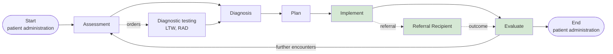

<b>Proof of concept.</b> This implementation guide is a demonstration only. It is
<b>not</b> an authoritative source, is not endorsed by NHS England, IHE or HL7, and
must not be used for implementation or clinical purposes.

A referral is one step in a clinical process. This page places the closed loop
referral in that process, following the
[Virtually Healthcare clinical process](https://virtually-healthcare.github.io/#clinical-process),
which is aligned with the nursing process (ADPIE: Assessment, Diagnosis, Planning,
Implementation, Evaluation).

### References

- [Virtually Healthcare - Clinical Process](https://virtually-healthcare.github.io/#clinical-process)
- [NW GMSA - How To Engineer Interoperability](https://nw-gmsa.github.io/en/HowToEngineerInteroperability.html) - clinical pathway, workflow requirements and information requirements
- [IHE PCC 360X](https://www.ihe.net/uploadedFiles/Documents/PCC/IHE_PCC_Suppl_360X.pdf) and [IHE PCC Dynamic Care Planning (DCP)](https://www.ihe.net/uploadedFiles/Documents/PCC/IHE_PCC_Suppl_DCP.pdf)

### The Process

| Phase | What happens | Workflow | FHIR resources |
|---|---|---|---|
| Start | Register the patient, start an encounter or episode | IHE PAM, HL7 v2 ADT; PDS | Patient, Encounter |
| Assessment | Observations, questionnaires, clinical decision support; order tests | IHE LTW ([NW GMSA](https://nw-gmsa.github.io/en/LTW.html)), IHE SWF.b ([Imaging](https://kevinmayfield.github.io/Imaging/en/SWF.html)) | Observation, QuestionnaireResponse, ServiceRequest, DiagnosticReport |
| Diagnosis | Record the problem or diagnosis | - | Condition |
| Plan | Agree the care or treatment plan | IHE DCP ([Dynamic Care Planning](DCP.html)) | CarePlan, Goal, CareTeam |
| Implement | Carry out the plan: **referrals**, prescriptions, tasks | **IHE 360X (this guide)**, eRS, BaRS, EPS | ServiceRequest, Task, MedicationRequest |
| Evaluate | Review the results that come back: **referral outcome**, consultation notes, discharge reports | IHE 360X, Transfer of Care, HDR, QEDm, MHD | Composition (document), DocumentReference |
| End | Discharge, close the episode | IHE PAM, HL7 v2 ADT A03 | Encounter |
{:.grid}

The referral is the **Implement** step and its outcome feeds **Evaluate**. Without
the outcome the referrer cannot evaluate, which is why the loop has to be closed.

### Encounters

Each phase happens in one or more encounters. Inside an encounter the clinician
follows SOAP:

| SOAP | Clinician | Referral relevance |
|---|---|---|
| Subjective | Views the record (EPR, shared care record, Health Data API) and talks to the patient | Referral Recipient reads the referral and its clinical information |
| Objective | Records observations | Results for the consultation note |
| Assessment | Records conditions | Answer to the referral question |
| Plan | Creates tasks, orders, referrals, prescriptions | Onward (secondary) referral, plan of care in the outcome |
{:.grid}

The end of an encounter is itself a reporting event: an outpatient letter, an
emergency department attendance summary or a discharge summary (see
[Referral Outcome Reports](Reports.html)).

### Where This Guide Fits

| Clinical step | Order and report pattern | This guide |
|---|---|---|
| Order a laboratory test | LAB-1 / LAB-3 | [NW GMSA LTW](https://nw-gmsa.github.io/en/LTW.html), [Cancer Pathology Report](https://kevinmayfield.github.io/CancerPathologyReport/LTW.html) |
| Order an imaging examination | RAD-2 / RAD-128 | [Enterprise Imaging](https://kevinmayfield.github.io/Imaging/en/SWF.html) |
| Refer for advice, assessment or treatment | PCC-55 / PCC-57 | [Closed Loop Referral (360X)](360X.html) |
| Refer to a virtual ward | PCC-55 / PCC-57, with a care plan | [Virtual Wards](VirtualWards.html) |
| Prescribe | PHARM-5 / PHARM-8 (IHE MPD); EPS prescription / dispense notification | [NHS England - EPS](NHSEngland.html#electronic-prescription-service-eps) |
| Coordinate care across a care team | Shared CarePlan and Task | [Dynamic Care Planning](DCP.html) |
{:.grid}
