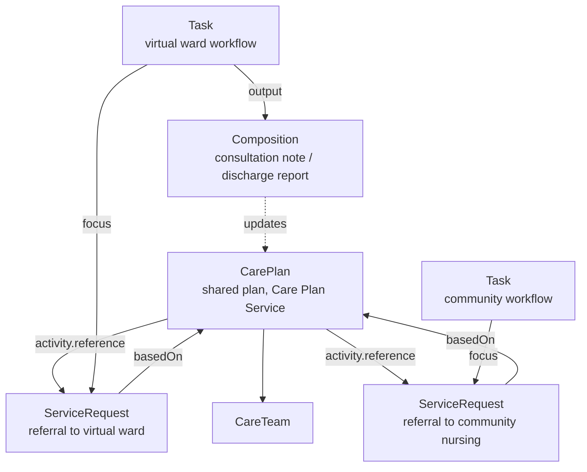

<b>Proof of concept.</b> This implementation guide is a demonstration only. It is
<b>not</b> an authoritative source, is not endorsed by NHS England, IHE or HL7, and
must not be used for implementation or clinical purposes.

360X is a conversation between two providers about one referral. When several
providers care for the patient over time - a virtual ward, community nursing, the GP,
a specialist - they need a **shared care plan** that each can read and update. IHE
**Dynamic Care Planning (DCP)** defines this.

### References

- [IHE PCC Dynamic Care Planning (DCP)](https://www.ihe.net/uploadedFiles/Documents/PCC/IHE_PCC_Suppl_DCP.pdf) (Rev. 3.1 Trial Implementation, 2019-09-27; FHIR R4)
- [FHIR CarePlan](https://hl7.org/fhir/R4/careplan.html), [CareTeam](https://hl7.org/fhir/R4/careteam.html), [Task](https://hl7.org/fhir/R4/task.html)
- [FHIR Workflow Management Communication Patterns](https://hl7.org/fhir/R4/workflow-management.html)

### Actors and Transactions

| DCP actor | Description (PCC TF-1 X.1.1) | In this guide |
|---|---|---|
| Care Plan Contributor | Reads, creates and updates care plans held by a Care Plan Service; applies plan definitions | Each provider's system: GP, virtual ward, community, specialist |
| Care Plan Service | Manages care plans as a whole (versioned), and provides updates to subscribers | Shared care record or care coordination platform |
| Care Team Contributor | Reads, creates and updates the care team | As Care Plan Contributor |
| Care Team Service | Manages the care team and notifies subscribers | As Care Plan Service |
| Care Plan Definition Service | Holds plan definitions (order sets, protocols, pathways) | Pathway or protocol library - **Open** |
{:.grid}

| Transaction | Purpose |
|---|---|
| Update Care Plan [PCC-37] | Create or update a care plan |
| Retrieve Care Plan [PCC-38] | Read a care plan |
| Subscribe to Care Plan Updates [PCC-39] | Subscribe to changes (option) |
| Provide Care Plan [PCC-40] | Notify subscribers of an updated care plan |
| Search for Care Plan [PCC-41] | Find care plans for a patient |
| Update / Search / Retrieve / Subscribe / Provide Care Team [PCC-45] to [PCC-49] | The same for the care team |
| Plan and Activity Definition [PCC-63] to [PCC-70] | Manage and apply plan definitions |
{:.grid}

Contributors **SHALL** read the latest version, change only their own parts and write
it back, handling a version conflict (usually by retrying) - FHIR
[transactional integrity](https://hl7.org/fhir/R4/http.html#transactional-integrity).

### How Referrals and Care Plans Fit Together

| Concept | 360X only | With DCP |
|---|---|---|
| Who knows the plan | Referral Initiator receives it in the outcome | Every care team member reads the shared CarePlan |
| A new referral | New Referral Request | A CarePlan activity, carried out by a Referral Request (`ServiceRequest.basedOn` the CarePlan) |
| Progress | Status messages to the initiator | `Task` status, also visible to the care team; CarePlan `activity.progress` |
| Outcome | Referral Outcome document | Document, and the CarePlan updated |
| Continued care with no end of care | Outcome is a care plan (PCC TF-1 X.4.2) | The CarePlan is the outcome |
{:.grid}

DCP needs a **Care Plan Service** that every contributor can reach - a shared care
record or platform with FHIR REST APIs. Contributors update the **shared care plan**
held by that service; they do not write into each other's records. Clinical results and
documents still travel by the general patterns (HL7 v2 `ORU^R01`, FHIR / CDA Documents). Where that does not exist, the care plan
is sent in the documents (the HDR plan of care section) and 360X messaging carries the
workflow. This is the step from Document Messaging to Conversational Workflow in the
[integration layers](WorkflowPatterns.html#integration-layers).

### Task-based Workflow

The [Referral Task](StructureDefinition-ReferralTask.html) is the FHIR form of the 360X
status messages. With a shared FHIR server it can be used as a **conversation**:

| Communication pattern | How | Example |
|---|---|---|
| Push messages (360X) | Each status change is a message to the other party | HL7 v2 `OSU^O51`, FHIR Message |
| Shared Task | Initiator creates the Task; the recipient updates `status` / `businessStatus`; the initiator subscribes or polls | eRS worklists, GOMS, HL7 AU eRequesting |
| Request more information | Recipient sets `businessStatus` `information-requested`, with a `Communication` or `Questionnaire` | eRS / BaRS return to referrer |
{:.grid}

See [FHIR Workflow Management Communication Patterns](https://hl7.org/fhir/R4/workflow-management.html)
options for creating and polling Task resources.

### Use Cases

| Use case | Care plan |
|---|---|
| Virtual ward | Monitoring, visits, escalation; contributors: virtual ward, community nursing, GP - see [Virtual Wards](VirtualWards.html) |
| Long-term condition | GP-led plan with specialist and allied health activities (DCP chronic conditions use case) |
| Pregnancy | Maternity plan across GP, midwife and hospital (DCP pregnancy use case) |
| Newborn hearing screening | Hearing plan of care updated by audiology (360X Use Case #2) |
| Cancer | Treatment plan from the MDT - see [Cancer Pathology Report - Cancer Pathway](https://kevinmayfield.github.io/CancerPathologyReport/CancerPathway.html) |
{:.grid}
