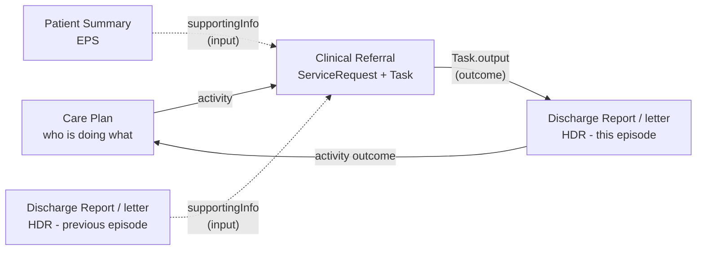
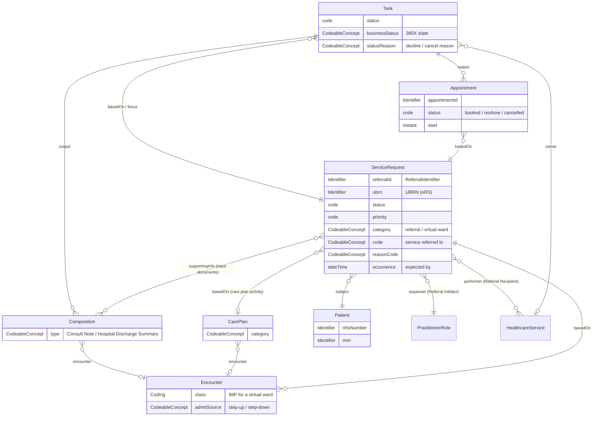

<b>Proof of concept.</b> This implementation guide is a demonstration only. It is
<b>not</b> an authoritative source, is not endorsed by NHS England, IHE or HL7, and
must not be used for implementation or clinical purposes.

The information models and FHIR resources for a closed loop referral and the care it
belongs to.

### Information Models

Four logical models describe the information, independent of how it is exchanged. Each
model's **Mappings** tab shows its elements in FHIR (and HL7 v2 where used).

| Model | What it is | FHIR | Based on |
|---|---|---|---|
| [Clinical Referral](StructureDefinition-Referral.html) | The request and its workflow: who refers whom, for what and why; status; appointments; links to the documents | `ServiceRequest` + `Task`, `Appointment` ([profiles below](#profiles)) | IHE 360X, FHIR Workflow, HL7 v2 orders; UBRN from eRS |
| [Discharge Report](StructureDefinition-DischargeReport.html) | The **outcome**: discharge summary or clinic letter that closes the referral - and an input to the next one | FHIR Document - [HL7 Europe HDR](https://hl7.eu/fhir/hdr/), used as published | HDR sections; PRSB discharge and outpatient letter standards |
| [Patient Summary](StructureDefinition-PatientSummary.html) | The patient's background, for a recipient without the record | FHIR Document - [HL7 Europe Patient Summary (EPS)](https://hl7.eu/fhir/eps/1.0.0-ballot/) / IPS | EPS / IPS sections; PRSB Core Information Standard |
| [Care Plan and Execution](StructureDefinition-CarePlanModel.html) | Who is doing what, for which needs and goals - and the referrals, tasks and encounters that carry it out | `CarePlan` ([Care Plan](StructureDefinition-PatientCarePlan.html)), `CareTeam`, `Goal`; activities reference `ServiceRequest` / `Task` | IHE DCP, FHIR CarePlan, social care plans; PRSB Personalised Care and Support Plan |
{:.grid}

The referral itself stays small; the clinical content travels as documents, which can
also be published to a shared care record and retrieved by API instead of being sent
(see [EU Health Data API](HealthDataAPI.html)).

**Not modelled on BaRS.** None of these models takes its structure from BaRS. In
particular: the referral's request, reason and requester are on the `ServiceRequest`
(not a `Task`, `Condition` and `Practitioner` as in BaRS Application 5); workflow state
is a `Task`, not a combination of `ServiceRequest`, `Encounter` and `CarePlan` statuses;
a `CarePlan` is a plan, not an assessment; and the patient's local identifier always has
a type and assigning organisation. See the [BaRS review](BaRS.html).

### References

- [FHIR Workflow](https://hl7.org/fhir/R4/workflow.html), [ServiceRequest](https://hl7.org/fhir/R4/servicerequest.html), [Task](https://hl7.org/fhir/R4/task.html)
- [HL7 Europe Hospital Discharge Report](https://hl7.eu/fhir/hdr/), [HL7 Europe Patient Summary](https://hl7.eu/fhir/eps/1.0.0-ballot/) and [HL7 Europe Base](https://hl7.eu/fhir/base/)
- [IHE Dynamic Care Planning](DCP.html) and FHIR [CarePlan](https://hl7.org/fhir/R4/careplan.html)
- [NW GMSA - Genetic Referrals: Target Referral Model](https://nw-gmsa.github.io/en/GeneticReferrals.html#target-referral-model)

### Resource Model

### Profiles

| Profile | Base | Use | 360X |
|---|---|---|---|
| [Referral Request](StructureDefinition-ReferralRequest.html) | ServiceRequest | The referral | PCC-55 `OMG^O19` |
| [Referral Task](StructureDefinition-ReferralTask.html) | Task | Workflow state and status updates | PCC-55 to PCC-59 `OSU^O51` |
| [Referral Appointment](StructureDefinition-ReferralAppointment.html) | Appointment | Appointments and no-shows | PCC-60, PCC-61 `SIU` |
| [HL7 Europe HDR](https://hl7.eu/fhir/hdr/) (used as published) | Composition / Bundle (`composition-eu-hdr`, `bundle-eu-hdr`) | Outcome after an inpatient or virtual ward stay; section codes also used for outpatient letters | PCC-57, PCC-59 (document) |
| [Care Plan](StructureDefinition-PatientCarePlan.html) | HL7 Europe HDR CarePlan | Care plan for any episode (e.g. a virtual ward treatment plan); activities reference referrals and tasks | - (DCP) |
| `Questionnaire` / `QuestionnaireResponse` (core) | - | Referral forms, in `supportingInfo` or `Task.input` / `output` - see [Referral Forms](ReferralForms.html) | OBX (ask at order entry) |
| [Observation](StructureDefinition-Observation.html) | Observation | Clinical observations, e.g. vital signs; target of the [Vital Signs](Questionnaire-VitalSigns.html) item definitions | OBX |
| [Patient](StructureDefinition-Patient.html) | HL7 Europe Patient | Patient (NW GMSA conventions) | PID |
| Core NHS patient administration - Organization, Practitioner, PractitionerRole, RelatedPerson, Location, HealthcareService, Encounter, Hospital Spell, Visit, Episode Of Care, Schedule, Slot | NW GMSA / Interweave | See [Patient Administration](PatientAdministration.html) | PID, PV1, SCH |
{:.grid}

Identifier profiles: [Referral Identifier](StructureDefinition-ReferralIdentifier.html)
and [UBRN](StructureDefinition-UniqueBookingReferenceNumber.html); the NW GMSA
identifier data types (NHS Number, MRN, ODS code and others) are copied from the
[NW GMSA IG](https://nw-gmsa.github.io/en/).

### Identifiers

| Identifier | HL7 v2 | FHIR | Assigned by |
|---|---|---|---|
| Referral ID | ORC-2, OBR-2, SCH-26 | `ServiceRequest.identifier:referralId` (type `PLAC`); referenced from `Task.basedOn`, `Appointment.basedOn`, `Encounter.basedOn`, `DocumentReference.context.related` (documents are linked through `Task.output`) | Referral Initiator |
| UBRN | Not in 360X | `ServiceRequest.identifier:ubrn` (`https://fhir.nhs.uk/Id/UBRN`) | eRS |
| NHS Number | PID-3 | `Patient.identifier:nhsNumber` | NHS (PDS) |
| Local patient identifier | PID-3 | `Patient.identifier:MedicalRecordNumber` | Each organisation |
| Appointment ID | SCH-2 | `Appointment.identifier` | Referral Recipient |
| Document ID | TXA-12 | `Composition.identifier`, `Bundle.identifier` | Referral Recipient |
| Account / Spell Number | PV1-19 (CX.5 `AN`; HL7 v2 PID-18) | `Encounter.identifier` type `AN` ([Hospital Spell](StructureDefinition-HospitalSpell.html)) | Referral Recipient |
| Visit Number | PV1-19 (CX.5 `VN`) | `Encounter.identifier` type `VN` ([Visit](StructureDefinition-Visit.html)) | Referral Recipient |
{:.grid}

References to the referral **SHOULD** carry the Referral ID as `Reference.identifier`
as well as (or instead of) a literal reference, because the Referral Recipient
usually does not hold the Referral Initiator's `ServiceRequest` on a shared server.

### Referral Status

The 360X HL7 v2 status codes, the [Referral Workflow Status](CodeSystem-referral-workflow-status.html)
(`Task.businessStatus`) and the FHIR status elements:

| 360X transaction | ORC-1 / ORC-5 (or SIU trigger) | Task.businessStatus | Task.status | ServiceRequest.status | Appointment.status |
|---|---|---|---|---|---|
| Referral Request [PCC-55] | NW / - | `requested` | `requested` | `active` | - |
| More information (NHS) | - | `information-requested` | `on-hold` | `active` | - |
| Referral Accept [PCC-55] | OK / IP | `accepted` | `accepted` | `active` | - |
| Deferred (NHS) | OH / HD (indicative) | `deferred` | `on-hold` | `active` | `cancelled` (if any) |
| Redirected (NHS) | RU / RP (indicative) | `redirected` | `rejected` | `revoked` (replaced by the new referral) | `cancelled` (if any) |
| Referral Decline [PCC-55, PCC-56] | UA / CA | `declined` | `rejected` | `revoked` | `cancelled` (if any) |
| Appointment [PCC-60] | S12, S13 | `appointment-booked`, `appointment-rescheduled` | `in-progress` | `active` | `booked` |
| Appointment cancelled [PCC-60] | S15 | `appointment-cancelled` | `in-progress` | `active` | `cancelled` |
| No-Show [PCC-61] | S26 | `no-show` | `in-progress` | `active` | `noshow` |
| Interim Consultation Note [PCC-59] | SC / A | `interim-report` | `in-progress` | `active` | - |
| Cancel Request [PCC-58] | CA / CA | `cancel-requested` | unchanged | unchanged | - |
| Cancel Confirmation [PCC-58] | CR / CA | `cancelled` | `cancelled` | `revoked` | `cancelled` |
| Referral Outcome [PCC-57] | SC / CM | `completed` | `completed` | `completed` | `fulfilled` |
{:.grid}

`Task.status` follows the [FHIR Task state machine](https://hl7.org/fhir/R4/task.html#statemachine);
`businessStatus` carries the 360X detail. **Open:** ORC-5 to `Task.status` is not a
one-to-one mapping (e.g. `IP` covers both accepted and in progress).

### Examples

| Scenario | Resources |
|---|---|
| GP to cardiology (360X Use Case #1) | [Patient](Patient-Patient-Tameside.html), [Referral](ServiceRequest-CardiologyReferral.html), [Accepted](Task-CardiologyReferralAccepted.html), [Declined](Task-CardiologyReferralDeclined.html), [Appointment](Appointment-CardiologyAppointment.html), [Interim note](Composition-CardiologyInterimNote.html), [Outcome note](Composition-CardiologyOutcomeNote.html), [Completed](Task-CardiologyReferralCompleted.html) |
| GP to exercise on referral, with forms | [Referral](ServiceRequest-ExerciseReferral.html), [referrer's form](QuestionnaireResponse-ExerciseReferralFormResponse.html), [blood pressure](Observation-ExerciseReferralBloodPressure.html), [form requested](Task-ExerciseReferralFormRequested.html), [patient's form](QuestionnaireResponse-ExercisePreParticipationResponse.html), [activity baseline](Observation-ExerciseVitalSignBaseline.html), [in progress](Task-ExerciseReferralInProgress.html) |
| GP to respiratory virtual ward (step-up) | [Patient](Patient-Patient-Manchester.html), [Referral](ServiceRequest-VirtualWardReferral.html), [Accepted](Task-VirtualWardReferralAccepted.html), [Stay](Encounter-VirtualWardStay.html), [Care plan](CarePlan-VirtualWardPlan.html), [SpO2](Observation-VirtualWardSpO2.html), [Discharge report](Bundle-VirtualWardDischargeReport.html), [Completed](Task-VirtualWardReferralCompleted.html) |
{:.grid}
