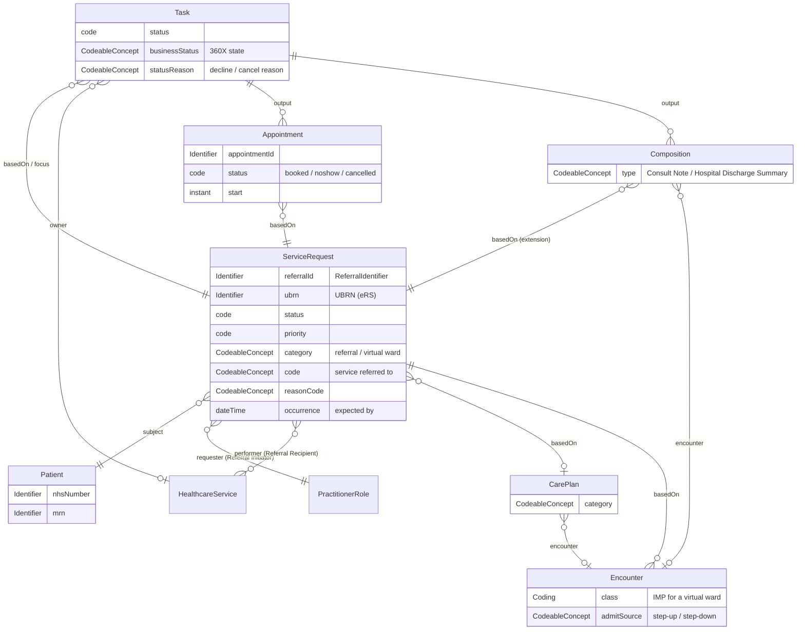

<b>Proof of concept.</b> This implementation guide is a demonstration only. It is
<b>not</b> an authoritative source, is not endorsed by NHS England, IHE or HL7, and
must not be used for implementation or clinical purposes.

The FHIR resources for a closed loop referral. The information content is described by
the [Referral](StructureDefinition-Referral.html) logical model, whose **Mappings** tab
shows each item in HL7 v2 (360X) and FHIR.

### References

- [FHIR Workflow](https://hl7.org/fhir/R4/workflow.html), [ServiceRequest](https://hl7.org/fhir/R4/servicerequest.html), [Task](https://hl7.org/fhir/R4/task.html)
- [HL7 Europe Hospital Discharge Report](https://hl7.eu/fhir/hdr/) and [HL7 Europe Base](https://hl7.eu/fhir/base/)
- [NW GMSA - Genetic Referrals: Target Referral Model](https://nw-gmsa.github.io/en/GeneticReferrals.html#target-referral-model)

### Resource Model

### Profiles

| Profile | Base | Use | 360X |
|---|---|---|---|
| [Referral Request](StructureDefinition-ReferralRequest.html) | ServiceRequest | The referral | PCC-55 `OMG^O19` |
| [Referral Task](StructureDefinition-ReferralTask.html) | Task | Workflow state and status updates | PCC-55 to PCC-59 `OSU^O51` |
| [Referral Appointment](StructureDefinition-ReferralAppointment.html) | Appointment | Appointments and no-shows | PCC-60, PCC-61 `SIU` |
| [Consultation Note](StructureDefinition-ConsultationNote.html) | Composition | Interim note; outpatient outcome | PCC-59, PCC-57 (document) |
| [Discharge Report](StructureDefinition-DischargeReport.html) / [Document](StructureDefinition-DischargeReportDocument.html) | HL7 Europe HDR Composition / Bundle | Outcome after an inpatient or virtual ward stay | PCC-57 (document) |
| [Virtual Ward Encounter](StructureDefinition-VirtualWardEncounter.html) | HL7 Europe HDR Encounter | Virtual ward stay | - |
| [Virtual Ward Care Plan](StructureDefinition-VirtualWardCarePlan.html) | HL7 Europe HDR CarePlan | Virtual ward treatment plan | - (DCP) |
| [Patient](StructureDefinition-Patient.html) | HL7 Europe Patient | Patient (NW GMSA conventions) | PID |
{:.grid}

Identifier profiles: [Referral Identifier](StructureDefinition-ReferralIdentifier.html)
and [UBRN](StructureDefinition-UniqueBookingReferenceNumber.html); the NW GMSA
identifier data types (NHS Number, MRN, ODS code and others) are copied from the
[NW GMSA IG](https://nw-gmsa.github.io/en/).

### Identifiers

| Identifier | HL7 v2 | FHIR | Assigned by |
|---|---|---|---|
| Referral ID | ORC-2, OBR-2, SCH-26 | `ServiceRequest.identifier:referralId` (type `PLAC`); referenced from `Task.basedOn`, `Appointment.basedOn`, `Composition` `basedOn`, `Encounter.basedOn` | Referral Initiator |
| UBRN | Not in 360X | `ServiceRequest.identifier:ubrn` (`https://fhir.nhs.uk/Id/UBRN`) | eRS |
| NHS Number | PID-3 | `Patient.identifier:nhsNumber` | NHS (PDS) |
| Local patient identifier | PID-3 | `Patient.identifier:MedicalRecordNumber` | Each organisation |
| Appointment ID | SCH-2 | `Appointment.identifier` | Referral Recipient |
| Document ID | TXA-12 | `Composition.identifier`, `Bundle.identifier` | Referral Recipient |
| Spell / visit number | PV1-19 | `Encounter.identifier` | Referral Recipient |
{:.grid}

References to the referral **SHOULD** carry the Referral ID as `Reference.identifier`
as well as (or instead of) a literal reference, because the Referral Recipient
usually does not hold the Referral Initiator's `ServiceRequest` on a shared server.

### Referral Status

The 360X HL7 v2 status codes, the [Referral Workflow Status](CodeSystem-referral-workflow-status.html)
(`Task.businessStatus`) and the FHIR status elements:

| 360X transaction | ORC-1 / ORC-5 (or SIU trigger) | Task.businessStatus | Task.status | ServiceRequest.status | Appointment.status |
|---|---|---|---|---|---|
| Referral Request [PCC-55] | NW / - | `requested` | `requested` | `active` | - |
| More information (NHS) | - | `information-requested` | `on-hold` | `active` | - |
| Referral Accept [PCC-55] | OK / IP | `accepted` | `accepted` | `active` | - |
| Referral Decline [PCC-55, PCC-56] | UA / CA | `declined` | `rejected` | `revoked` | `cancelled` (if any) |
| Appointment [PCC-60] | S12, S13 | `appointment-booked`, `appointment-rescheduled` | `in-progress` | `active` | `booked` |
| Appointment cancelled [PCC-60] | S15 | `appointment-cancelled` | `in-progress` | `active` | `cancelled` |
| No-Show [PCC-61] | S26 | `no-show` | `in-progress` | `active` | `noshow` |
| Interim Consultation Note [PCC-59] | SC / A | `interim-report` | `in-progress` | `active` | - |
| Cancel Request [PCC-58] | CA / CA | `cancel-requested` | unchanged | unchanged | - |
| Cancel Confirmation [PCC-58] | CR / CA | `cancelled` | `cancelled` | `revoked` | `cancelled` |
| Referral Outcome [PCC-57] | SC / CM | `completed` | `completed` | `completed` | `fulfilled` |
{:.grid}

`Task.status` follows the [FHIR Task state machine](https://hl7.org/fhir/R4/task.html#statemachine);
`businessStatus` carries the 360X detail. **Open:** ORC-5 to `Task.status` is not a
one-to-one mapping (e.g. `IP` covers both accepted and in progress).

### Examples

| Scenario | Resources |
|---|---|
| GP to cardiology (360X Use Case #1) | [Patient](Patient-PatientPackton.html), [Referral](ServiceRequest-CardiologyReferral.html), [Accepted](Task-CardiologyReferralAccepted.html), [Declined](Task-CardiologyReferralDeclined.html), [Appointment](Appointment-CardiologyAppointment.html), [Interim note](Composition-CardiologyInterimNote.html), [Outcome note](Composition-CardiologyOutcomeNote.html), [Completed](Task-CardiologyReferralCompleted.html) |
| GP to respiratory virtual ward (step-up) | [Patient](Patient-PatientJones.html), [Referral](ServiceRequest-VirtualWardReferral.html), [Accepted](Task-VirtualWardReferralAccepted.html), [Stay](Encounter-VirtualWardStay.html), [Care plan](CarePlan-VirtualWardPlan.html), [SpO2](Observation-VirtualWardSpO2.html), [Discharge report](Bundle-VirtualWardDischargeReport.html), [Completed](Task-VirtualWardReferralCompleted.html) |
{:.grid}
