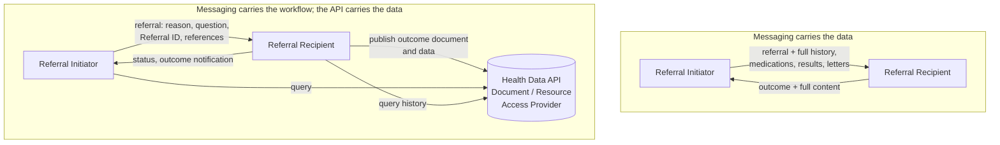

<b>Proof of concept.</b> This implementation guide is a demonstration only. It is
<b>not</b> an authoritative source, is not endorsed by NHS England, IHE or HL7, and
must not be used for implementation or clinical purposes.

<b>Sharing data through an API is highly recommended.</b> When the patient's record can
be queried through an API, a referral or report does not need to carry it. This
significantly reduces the amount of data passed around in messages, and leaves
messaging to do what it is good at: <b>workflow</b> - the request, accept or decline,
status, and the notification that a result is ready - rather than transferring data.

The [EU Health Data API](https://hl7.eu/fhir/health-data-api/1.0.0-ballot/en/) defines
FHIR APIs for accessing and exchanging health data in the European Health Data Space,
built on IHE MHD (documents), IHE QEDm / HL7 IPA (resources) and IHE PDQm (patient
identity). This guide uses it as the **data sharing** side of the closed loop; the 360X
interactions are the **workflow** side.

### References

- [EU Health Data API](https://hl7.eu/fhir/health-data-api/1.0.0-ballot/en/) - 1.0.0-ballot (2026-03-13)
- [IHE ITI Mobile access to Health Documents (MHD)](https://profiles.ihe.net/ITI/MHD/index.html) - 4.2.5 - see [Document Sharing [MHD]](MHD.html)
- [IHE PCC Query for Existing Data for Mobile (QEDm)](https://profiles.ihe.net/PCC/QEDm/index.html) - 3.0.0 (2024-12-12) - see [Query Existing Data [PCC-44]](QEDm.html)
- [HL7 International Patient Access (IPA)](https://hl7.org/fhir/uv/ipa/), [IHE PDQm](https://profiles.ihe.net/ITI/PDQm/index.html)
- [NW GMSA - Health Data API](https://nw-gmsa.github.io/en/HIE.html), [Resource Access](https://nw-gmsa.github.io/en/QEDm.html), [Document Exchange](https://nw-gmsa.github.io/en/MHD.html)
- GOV.UK [Health Bill: single patient record fact sheet](https://www.gov.uk/government/publications/health-bill-single-patient-record-fact-sheet/health-bill-single-patient-record-fact-sheet) (published 19 May 2026)

### Messaging and Sharing

| | Messaging (360X, HL7 v2, FHIR Messaging) | Data sharing (Health Data API) |
|---|---|---|
| Purpose | Workflow: ask, accept, decline, update, notify | Access to the record: documents and structured data |
| Carries | Referral ID, patient, reason and question, status, references | The patient's history, results, letters, discharge reports |
| Direction | Push between the two parties | Query by anyone with a legitimate relationship |
| Copies | One copy per recipient, filed in each system | One source, read when needed, always current |
| Fits | Point-to-point workflow, organisations without shared infrastructure | Regions and nations with shared records |
{:.grid}

Both are needed. A shared record does not tell the Referral Recipient that it has been
asked to see a patient, and it does not tell the referrer that the outcome is ready -
that is workflow. Messages that carry whole records are hard to keep consistent and
duplicate data in every system they reach.

### Actors

The Health Data API actors (capabilities from the 1.0.0-ballot CapabilityStatements):

| Health Data API actor | Capabilities | IHE / HL7 | In the closed loop |
|---|---|---|---|
| Document Publisher | Create `DocumentReference`; find `Patient` | MHD Document Source | Referral Recipient publishes the consultation note or discharge report |
| Document Access Provider | Read / search `DocumentReference`, read `Binary`, find `Patient`; optional submission (create) | MHD Document Responder (and Recipient) | Shared care record, EDMS, the Single Patient Record |
| Document Consumer | Read / search `DocumentReference`, read `Binary` | MHD Document Consumer | Referral Initiator reads the outcome; recipient reads earlier letters |
| Resource Access Provider | Read / search `Patient`, `Condition`, `AllergyIntolerance`, `Observation`, `DiagnosticReport`, `MedicationRequest`, `MedicationDispense`, `MedicationStatement`, `Immunization`, `Encounter`; read `Practitioner`, `Organization` (IPA server) | QEDm Clinical Data Source, IPA | Shared care record, data platform, the Single Patient Record |
| Resource Consumer | The same, as client | QEDm Clinical Data Consumer | Recipient triaging a referral; virtual ward; GP reviewing an outcome |
{:.grid}

### Data Sharing in the Closed Loop

| Step | Without an API | With the Health Data API |
|---|---|---|
| Referral Request [PCC-55] | The referral carries the history, medications, results and letters | The referral carries the reason, the question, the referral form and **references**; the Recipient queries the record ([PCC-44](QEDm.html), [ITI-67 / ITI-68](MHD.html)) |
| Triage | Recipient relies on what was sent | Recipient reads current problems, medications and recent results |
| Monitoring (e.g. virtual ward) | Readings sent as messages to each party | Observations available to the care team by query |
| Interim note [PCC-59], outcome [PCC-57] | The full document is pushed to each recipient | The document is **published** ([ITI-65 / ITI-105](MHD.html)) and its data made available; the status message notifies the referrer, who reads it |
| Later care | Each organisation holds its own copy | Anyone with a legitimate relationship finds it |
{:.grid}

The Referral ID still links everything: the published document references the referral
it answers, and the status message references the published document.

### Single Patient Record and "Write Back"

The UK Government's Health Bill introduces a **Single Patient Record (SPR)**. Its fact
sheet (19 May 2026) says it will "bring together patient information from existing
separate sources", "build on and connect with existing health and care source systems"
rather than replacing them, and that "by March 2027, clinicians in England will benefit
from improved access to records for at least 80% of patients", with patients able to
view it "on the NHS App" from 2028. It does not describe the technical architecture.

The hoped-for outcome of the SPR is this **data sharing** layer: a Document and Resource
Access Provider for England, so referrals and reports no longer need to carry whole
records. This guide's position:

- **Data sharing** - the SPR, shared care records and the Health Data API (MHD, QEDm,
  PDQm) - for access to the record.
- **"Write back"** - the term often used by non-technical staff for getting care
  delivered elsewhere back into the responsible clinician's record. In practice that
  is the **referral and report exchanges**: the outcome [PCC-57], interim notes [PCC-59]
  and results (LAB-3, RAD-128) received and filed by the clinician's own system,
  together with the order and status workflow that tells it they exist. It is not
  direct write access to another organisation's system (see
  [Virtual Wards](VirtualWards.html#records-and-write-access)).
- The [NW GMSA](https://nw-gmsa.github.io/en/exchange.html) view is the same: Document
  Messaging and Conversational Messaging both address the write-back challenge
  discussed for the SPR.

### NHS Equivalents

| Health Data API | NHS today |
|---|---|
| Document Access Provider | Shared care records; NRL (pointer only - the registry, not the repository) |
| Resource Access Provider | Shared care records with FHIR APIs; GP Connect Access Record: Structured (GP record only); the SPR (planned) |
| Patient identity (PDQm) | PDS |
| Notification | NHS MNS |
{:.grid}

### Access and Audit

API access needs authorisation and audit: IHE IUA / SMART on FHIR for access tokens and
IHE BALP for audit - see the [NW GMSA API Security](https://nw-gmsa.github.io/en/api-security.html)
page. Whether an accepted referral establishes the legitimate relationship the Referral
Recipient needs to query the record before the patient is seen is **To confirm**.
