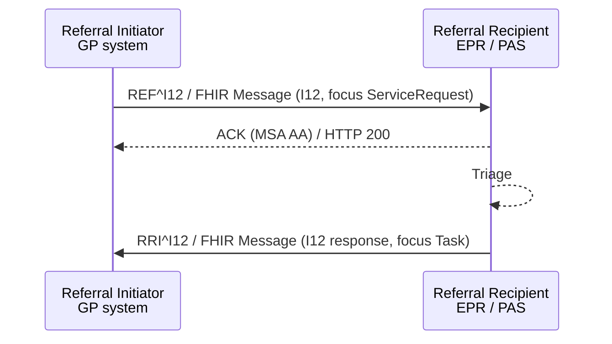

<div class="alert alert-danger" role="alert">
<b>Proof of concept.</b> This implementation guide is a demonstration only. It is
<b>not</b> an authoritative source, is not endorsed by NHS England, IHE or HL7, and
must not be used for implementation or clinical purposes.
</div>

**Patient Referral [I12]** - the HL7 v2 referral message `REF_I12` and its response
`RRI_I12`, with their FHIR Message equivalents. An alternative carrier for
[Referral Request [PCC-55]](PCC-55.html): 360X uses the order messages (`OMG^O19` /
`OSU^O51`), which match laboratory and radiology workflows; `REF_I12` is the HL7 v2
patient care referral message, used by some systems and by
[Virtually Healthcare](https://virtually-healthcare.github.io/I12.html).

### References

- HL7 v2.5.1 [REF_I12 - Patient referral](https://hl7-definition.caristix.com/v2/HL7v2.5.1/TriggerEvents/REF_I12) and [RRI_I12 - Return patient referral](https://hl7-definition.caristix.com/v2/HL7v2.5.1/TriggerEvents/RRI_I12)
- [Virtually Healthcare - Patient Referral (PCC-55)](https://virtually-healthcare.github.io/I12.html)
- [NW GMSA - Genetic Referrals: Referral Data Model](https://nw-gmsa.github.io/en/GeneticReferrals.html#referral-data-model) - REF_I12 to FHIR
- [NW GMSA HL7 v2](https://nw-gmsa.github.io/en/hl7v2.html) - MSH and PID conventions
- [FHIR Messaging](https://hl7.org/fhir/R4/messaging.html)

### Messages

| Message | HL7 v2 | FHIR Message | Focus |
|---|---|---|---|
| Patient referral | `REF^I12^REF_I12` | [Patient Referral (I12)](MessageDefinition-patient-referral.html) | [Referral Request](StructureDefinition-ReferralRequest.html) |
| Referral response (accept / decline) | `RRI^I12^RRI_I12` | [Patient Referral Response (RRI I12)](MessageDefinition-patient-referral-response.html) | [Referral Task](StructureDefinition-ReferralTask.html) |
{:.grid}



Later steps (appointment, interim note, outcome, cancellation) use the same messages as
the 360X route - see [Exchange Options](Transport.html#hl7-v2).

### Mapping

Indicative mapping of `REF_I12` to FHIR:

| HL7 v2.5.1 | Meaning | FHIR | Note |
|---|---|---|---|
| MSH-4 / MSH-6 | Sending / receiving facility | `MessageHeader.sender` / `destination.receiver` (ODS code) | |
| MSH-9 | `REF^I12^REF_I12` | `MessageHeader.eventCoding` v2-0003 `I12` | |
| RF1-1 Referral Status (0283) | P pending, A accepted, R rejected, E expired | Task `status` / `businessStatus` | Pending in the request |
| RF1-2 Referral Priority (0280) | S stat, A ASAP, R routine | `ServiceRequest.priority` | |
| RF1-3 Referral Type (0281) | e.g. Med medical, Lab, Rad | `ServiceRequest.category` | Coarse; the service is in `code` |
| RF1-5 Referral Category (0284) | O outpatient, I inpatient, E emergency, A ambulatory | `ServiceRequest.category` / `locationCode` | |
| RF1-6 Originating Referral Identifier | Referral ID (EI, namespace = ODS code) | `ServiceRequest.identifier:referralId` | The Referral ID used in every later message |
| RF1-7 / RF1-8 | Effective / expiration date | `occurrencePeriod`; Task `restriction.period` | Validity |
| RF1-10 Referral Reason (0336) | Administrative reason (e.g. O provider ordered) | - | The clinical reason is DG1 / OBX |
| RF1-11 External Referral Identifier | e.g. UBRN | `ServiceRequest.identifier:ubrn` | **To confirm** NHS use |
| PRD (role RP) | Referring provider | `ServiceRequest.requester` (PractitionerRole) | PRD-7 professional identifier |
| PRD (role RT) | Referred-to provider or service | `ServiceRequest.performer` (HealthcareService) | |
| PID | Patient | `Patient` | NHS Number and MRN in PID-3 |
| DG1 | Diagnosis / reason for referral | `ServiceRequest.reasonCode` / `reasonReference` (Condition) | SNOMED CT |
| OBR / OBX | Clinical information, referral question | `ServiceRequest.supportingInfo` (Observation, QuestionnaireResponse), `note` | Ask at order entry - see [Referral Forms](ReferralForms.html) |
| NTE | Notes, referral question | `ServiceRequest.note` | |
| PV1 | The encounter the referral was made in | `ServiceRequest.encounter` (Visit) | Optional |
{:.grid}

`RRI_I12` adds MSA (acknowledging the referral message) and carries RF1-1 `A` (accepted)
or `R` (rejected), mapped to the Referral Task (`accepted` / `rejected`).

### Example - REF_I12

Dr Allen at HT PRACTICE (P89020) refers Hodor TAMESIDE to cardiology at MFT (R0A) - the
same referral as the [Referral Request](ServiceRequest-CardiologyReferral.html) example.

```
MSH|^~\&|GPSYSTEM|P89020|EPR|R0A|20260904101500+0100||REF^I12^REF_I12|MSG000123|P|2.5.1|||AL|NE|||||
RF1|P^Pending^HL70283|A^ASAP^HL70280|MED^Medical^HL70281||O^Outpatient^HL70284|REF-2026-000123^P89020|20260904|20261204||O^Provider Ordered^HL70336|000049637246^UBRN
PRD|RP^Referring Provider^HL70286|Allen^^^^Dr||||||G1234567^GMP
PRD|RT^Referred to Provider^HL70286|^General Cardiology Outpatients||^^^R0A^^^^^^^R0A|||1234567^ERS-SERVICE
PID|1||9737383397^^^NHS^NH~B6789012^^^R0A^MR||TAMESIDE^Hodor||19600727|M|||Stockport Road^^Tameside^^OL7 0NS
DG1|1||267036007^Dyspnea^SCT||20260904|W
NTE|1||Determine the origin of Mr Tameside's shortness of breath. To be seen within a week.
NTE|2||BMI 30, non-smoker, no chest pain, family history of coronary artery disease.
```

FHIR Message equivalent: [Bundle Message - Patient Referral (I12)](Bundle-PatientReferralMessage.html).

### Example - RRI_I12

Cardiology accepts the referral:

```
MSH|^~\&|EPR|R0A|GPSYSTEM|P89020|20260905093000+0100||RRI^I12^RRI_I12|MFT-MSG-778899|P|2.5.1|||AL|NE|||||
MSA|AA|MSG000123
RF1|A^Accepted^HL70283|A^ASAP^HL70280|MED^Medical^HL70281||O^Outpatient^HL70284|REF-2026-000123^P89020|20260905|20261204
PRD|RT^Referred to Provider^HL70286|^General Cardiology Outpatients||^^^R0A^^^^^^^R0A|||1234567^ERS-SERVICE
PID|1||9737383397^^^NHS^NH~B6789012^^^R0A^MR||TAMESIDE^Hodor||19600727|M
```

FHIR Message equivalent: [Bundle Message - Patient Referral Response (RRI I12)](Bundle-PatientReferralResponseMessage.html),
whose focus is the [accepted Referral Task](Task-CardiologyReferralAccepted.html).

### I12 or OMG^O19?

| | `REF_I12` / `RRI_I12` | 360X `OMG^O19` / `OSU^O51` |
|---|---|---|
| Designed for | Patient care referrals between providers | Orders (laboratory, radiology), reused by 360X for referrals |
| Status after the first response | Not defined (only accept / reject) | Defined: accept, decline, interim, outcome, cancel |
| Fits with | Referral systems | LTW and SWF.b order management in Trust Integration Engines |
| This guide | Accepted for the request and first response | Used for the full closed loop |
{:.grid}

Either way, the Referral ID (RF1-6 or ORC-2) **SHALL** be carried in every later message.
