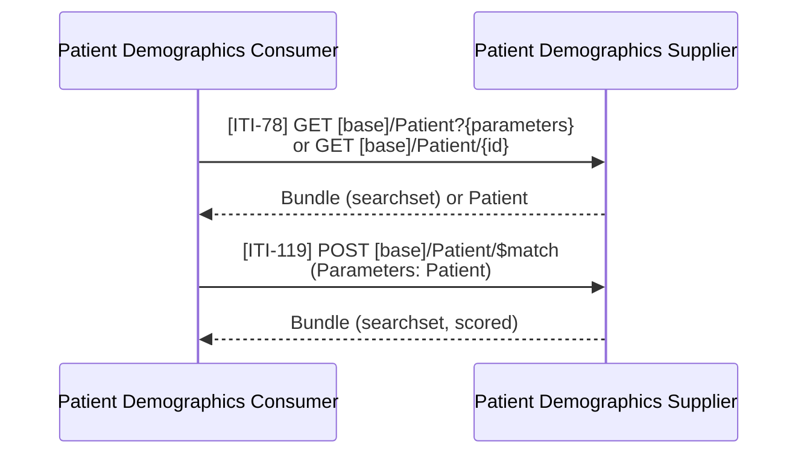

<div class="alert alert-danger" role="alert">
<b>Proof of concept.</b> This implementation guide is a demonstration only. It is
<b>not</b> an authoritative source, is not endorsed by NHS England, IHE or HL7, and
must not be used for implementation or clinical purposes.
</div>

**Mobile Patient Demographics Query [ITI-78]** and **Patient Demographics Match
[ITI-119]** (IHE PDQm) - a Patient Demographics Consumer finds a patient in a Patient
Demographics Supplier by identifier or demographics. See
[Patient Identity (PDQm)](PDQm.html) for the actors and the NHS England services (PDS).

### References

- [IHE ITI PDQm](https://profiles.ihe.net/ITI/PDQm/index.html) 3.2.0 - [ITI-78](https://profiles.ihe.net/ITI/PDQm/ITI-78.html), [ITI-119](https://profiles.ihe.net/ITI/PDQm/ITI-119.html)
- Profile: [Patient](StructureDefinition-Patient.html)
- [PDS FHIR API](https://digital.nhs.uk/developer/api-catalogue/personal-demographics-service-fhir)

### Interaction



### Mobile Patient Demographics Query [ITI-78]

| Use in the closed loop | PDQm query | PDS FHIR API |
|---|---|---|
| Verify the NHS Number on a received referral | `GET [base]/Patient?identifier=https://fhir.nhs.uk/Id/nhs-number|9737383397` | `GET /Patient/9737383397` (read; no `identifier` search) |
| Trace by demographics before referring | `GET [base]/Patient?family=TAMESIDE&given=Hodor&gender=male&birthdate=1960-07-27` | `GET /Patient?family=TAMESIDE&given=Hodor&gender=male&birthdate=eq1960-07-27` |
| Narrow by postcode | `&address-postalcode=OL7%200NS` | `&address-postcode=OL7%200NS` (excludes restricted patients) |
| Find the local record (MRN) | `GET [base]/Patient?identifier=https://fhir.mft.nhs.uk/Id/mrn|B6789012` | Not in PDS - trust MPI / PAS |
{:.grid}

The example patient is [Hodor TAMESIDE](Patient-Patient-Tameside.html), an NW GMSA test
patient.

### Patient Demographics Match [ITI-119]

The Consumer posts what it knows; the Supplier returns candidates with a score:

```json
{
  "resourceType": "Parameters",
  "parameter": [
    { "name": "resource",
      "resource": {
        "resourceType": "Patient",
        "name": [ { "family": "TAMESIDE", "given": [ "Hodor" ] } ],
        "gender": "male",
        "birthDate": "1960-07-27",
        "address": [ { "postalCode": "OL7 0NS" } ]
      } },
    { "name": "onlyCertainMatches", "valueBoolean": true }
  ]
}
```

PDS has no `$match`. Its search returns `Bundle.entry.search.score` (1.0 = exact) and
supports `_fuzzy-match` and `_exact-match`; a PDQm Match facade over PDS would map
`onlyCertainMatches` to `_exact-match` - **To confirm**.

### Expected Actions

- The Consumer **SHALL** confirm the patient (name, date of birth, NHS Number) before
  using the result to send, accept or file a referral or report.
- If PDS returns a different (superseding) NHS Number, the Referral Recipient
  **SHOULD** use it and tell the Referral Initiator (e.g. in the accept [PCC-55]).
- More than one candidate is not an error, but **SHALL NOT** be resolved automatically
  in system-to-system processing; the referral is held for manual matching.
- Restricted (sensitive) patients' location data **SHALL NOT** be copied into
  referrals, letters or directories.

### HL7 v2

Patient Demographics Query [ITI-21] (indicative):

| PDQm / PDS | HL7 v2.5.1 `QBP^Q22` |
|---|---|
| `identifier` (NHS Number) | `QPD-3` `@PID.3.1^9737383397~@PID.3.4.1^NHS` |
| `family`, `given` | `QPD-3` `@PID.5.1.1^TAMESIDE~@PID.5.2^Hodor` |
| `birthdate` | `QPD-3` `@PID.7.1^19600727` |
| `gender` | `QPD-3` `@PID.8^M` |
| `_max-results` / `_count` | `RCP-2` quantity limited request |
| Result | `RSP^K22` with `PID` segments and `QAK` |
{:.grid}
