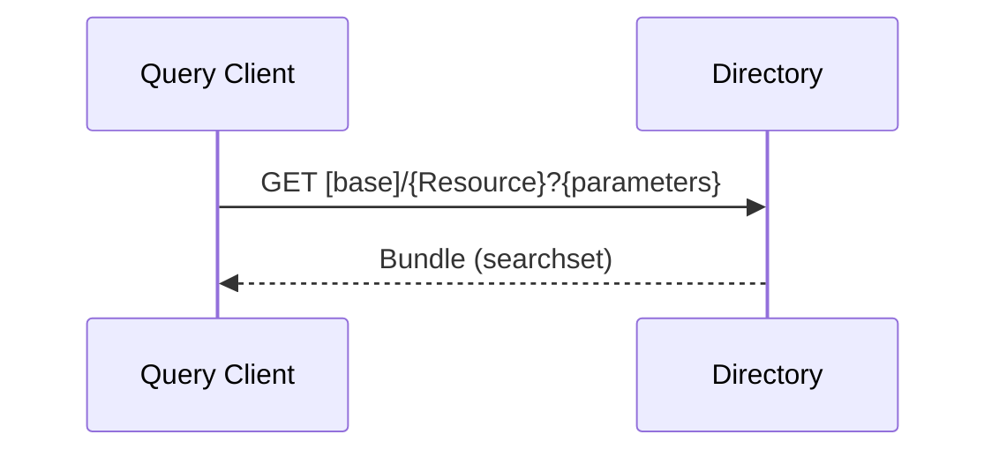

<b>Proof of concept.</b> This implementation guide is a demonstration only. It is
<b>not</b> an authoritative source, is not endorsed by NHS England, IHE or HL7, and
must not be used for implementation or clinical purposes.

**Find Matching Care Services [ITI-90]** (IHE mCSD) - a Query Client searches a Directory
for organisations, locations, services, practitioners and endpoints. Request Care
Services Updates [ITI-91] and Care Services Feed [ITI-130] keep copies of the directory
in step. See [Care Services Directory (mCSD)](mCSD.html) for the actors and the NHS
England directories.

### References

- [IHE ITI mCSD](https://profiles.ihe.net/ITI/mCSD/index.html) 4.0.0 - [ITI-90](https://profiles.ihe.net/ITI/mCSD/ITI-90.html), [ITI-91](https://profiles.ihe.net/ITI/mCSD/ITI-91.html), [ITI-130](https://profiles.ihe.net/ITI/mCSD/ITI-130.html)
- Profiles: [Organization](StructureDefinition-Organization.html), [Location](StructureDefinition-Location.html), [HealthcareService](StructureDefinition-HealthcareService.html), [Practitioner](StructureDefinition-Practitioner.html), [PractitionerRole](StructureDefinition-PractitionerRole.html)

### Interaction

| Transaction | From - To | FHIR |
|---|---|---|
| Find Matching Care Services [ITI-90] | Query Client - Directory | Search and read on `Organization`, `Location`, `HealthcareService`, `Practitioner`, `PractitionerRole`, `OrganizationAffiliation`, `Endpoint` |
| Request Care Services Updates [ITI-91] | Update Client - Directory | `_history` (changes since a time) |
| Care Services Feed [ITI-130] | Data Source - Directory | Create, update, delete or a transaction `Bundle` |
{:.grid}

### Queries in the Closed Loop

| Need | Query | NHS England service today |
|---|---|---|
| Organisation by ODS code | `GET [base]/Organization?identifier=https://fhir.nhs.uk/Id/ods-organization-code|R0A` | ODS Organisation Data Terminology API (same query) |
| Organisations a practice is related to (e.g. ICB) | `GET [base]/OrganizationAffiliation?participating-organization=...` | ODS Organisation Data Terminology API (`primary-organization`, `participating-organization`) |
| Services of a provider | `GET [base]/HealthcareService?organization.identifier=https://fhir.nhs.uk/Id/ods-organization-code|R0A` | DoS Search API (published, not yet available); eRS A035 by service ID |
| Services of a type near the patient | `GET [base]/HealthcareService?service-type={code}&location.near=...` (Location Distance Option) | DoS Search `$search-by-triage-code` (UEC); eRS A010 `$ers.searchHealthcareServicesForPatient` (**eRS only**) |
| A service and its endpoints | `GET [base]/HealthcareService?_id={id}&_include=HealthcareService:endpoint` | DoS Search API `HealthcareService?_id=` |
| Organisation and its endpoints | `GET [base]/Organization?identifier=...|P89020&_revinclude=Endpoint:organization` | DoS Search API `Organization?identifier=&_revinclude=Endpoint`; SDS FHIR API `Endpoint?organization=` (Spine); MESH endpoint lookup (**MESH only**) |
| Practitioner by professional registration | `GET [base]/Practitioner?identifier=https://fhir.hl7.org.uk/Id/gmc-number|7654321` | None national (Healthcare Worker API cannot search by GMC) |
| A user's roles | `GET [base]/PractitionerRole?practitioner.identifier=https://fhir.nhs.uk/Id/sds-user-id|...` | Healthcare Worker FHIR API `Practitioner?identifier=&_revinclude=PractitionerRole` |
| Local copy of ODS | `GET [base]/Organization/_history?_since=2026-11-01` (ITI-91) | ODS `lastChangeDate` search; ORD API sync |
{:.grid}

Search parameters follow FHIR R4 and mCSD; the NHS England APIs use their own subsets
and headers (e.g. `referral-function`, `Version` in DoS Search) - check each
specification. The GMC identifier system above is the one used in this guide's examples;
**To confirm** against the NHS England identifier systems.

### Example

Find the GP practice of [Hodor TAMESIDE](Patient-Patient-Tameside.html) (ODS `P89020`, from PDS) and how to send it
the outcome:

GET [base]/Organization?identifier=https://fhir.nhs.uk/Id/ods-organization-code|P89020&_revinclude=Endpoint:organization

The response contains the `Organization` and its `Endpoint`s; the Referral Recipient
chooses the one whose `connectionType` and `payloadType` it can send (FHIR Messaging,
HL7 v2, MESH, GP Connect Send Document) - see [Exchange Options](Transport.html).

### Expected Actions

- The Directory returns active resources matching the query; inactive or closed
  organisations and services are returned only if `active` is not filtered - Query
  Clients **SHOULD** filter on `active=true` when choosing a recipient.
- The Query Client **SHOULD** reference organisations by ODS code (`identifier`) in
  messages rather than copying the directory entry.
- An `Endpoint` that is `off` or missing is not a reason to send by another route
  without the recipient's agreement.

### HL7 v2

No equivalent query (indicative). Directory data reaches v2 systems as master files
(`MFN^M02`, `MFN^M05`) or is configured in the integration engine; see
[mCSD - HL7 v2](mCSD.html#hl7-v2).
