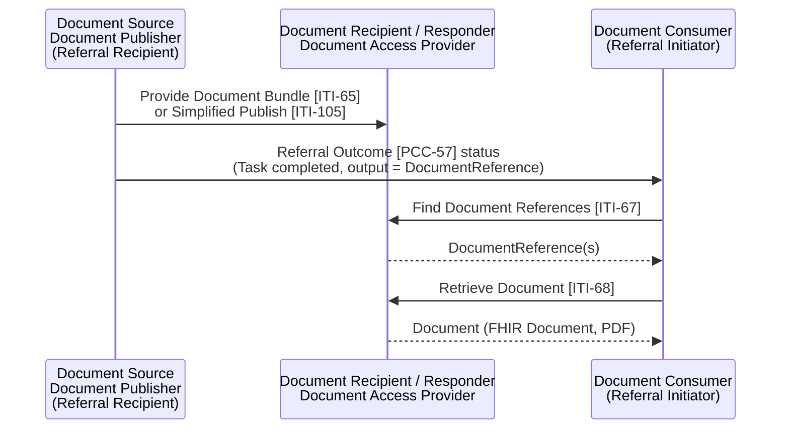

<b>Proof of concept.</b> This implementation guide is a demonstration only. It is
<b>not</b> an authoritative source, is not endorsed by NHS England, IHE or HL7, and
must not be used for implementation or clinical purposes.

**Document Sharing** (IHE MHD) - publishing clinical documents (referral letters,
consultation notes, discharge reports) so they can be found and read later, instead of
sending a copy to every party. In the EU Health Data API these are the Document
Publisher, Document Access Provider and Document Consumer.

Publishing documents for others to query is <b>highly recommended</b>. The 360X status
message then only needs to say the outcome is ready and where it is. See
<a href="HealthDataAPI.html">EU Health Data API</a>.

### References

- [IHE ITI MHD](https://profiles.ihe.net/ITI/MHD/index.html) 4.2.5
- [EU Health Data API](https://hl7.eu/fhir/health-data-api/1.0.0-ballot/en/) - Document Publisher, Document Access Provider, Document Consumer
- [NW GMSA - Document Exchange [MHD]](https://nw-gmsa.github.io/en/MHD.html)
- IHE 360X MHD Option (PCC TF-1 X.3.3)

### Interactions

| Transaction | From - To | Use in the closed loop |
|---|---|---|
| Provide Document Bundle [ITI-65] | Document Source - Document Recipient | Publish a document with full metadata (FHIR transaction with `DocumentReference`, `Binary`, `List`) |
| Simplified Publish [ITI-105] | Document Source - Document Recipient | Publish by POSTing a `DocumentReference` with the document as its attachment; the recipient completes the metadata. The usual route from a Trust Integration Engine converting HL7 v2 `MDM^T02` |
| Find Document References [ITI-67] | Document Consumer - Document Responder | Find a patient's letters and reports, e.g. the outcome of a referral or earlier correspondence when triaging |
| Retrieve Document [ITI-68] | Document Consumer - Document Responder | Get the document itself |
| Find Lists [ITI-66] | Document Consumer - Document Responder | Folders and submission sets - not needed for this guide |
{:.grid}

The Health Data API Document Publisher **creates** a `DocumentReference` (Simplified
Publish style); its Document Access Provider supports search and read of
`DocumentReference` and read of `Binary`, with an optional submission (create) option.

### Publish

POST [base]/DocumentReference 
Authorization: Bearer {accessToken} 
Content-Type: application/fhir+json

Metadata for referral documents:

| `DocumentReference` | Value | Note |
|---|---|---|
| `subject` | The patient (NHS Number) | Same patient identifier as the referral |
| `type` | [Referral Document Type](ValueSet-referral-document-type.html), e.g. LOINC 11488-4 Consult Note, 34105-7 Hospital Discharge Summary | Health Data API discharge type is 18842-5 - see [Reports](Reports.html#from-document-messaging-to-document-sharing) **Open** |
| `category` | Document class | **To confirm** NHS class codes (PRSB [Document Naming](PRSB.html)) |
| `date`, `author`, `custodian` | When, who, which organisation | |
| `context.encounter` | The encounter or stay | |
| `context.practiceSetting` | Specialty | |
| `context.related` | The referral (`ServiceRequest`, with the Referral ID as `identifier`) | Links the document to the referral it answers |
| `content.attachment` | FHIR Document (`application/fhir+json`) or PDF | `url` to the `Binary` |
| `content.format` | Format code (e.g. HDR, PDF) | |
{:.grid}

### Find and Retrieve

GET [base]/DocumentReference?patient={id}&amp;type=http://loinc.org|11488-4&amp;date=ge2026-09-01 
GET [base]/DocumentReference?patient={id}&amp;related:identifier={system}|{referralId} 
GET [base]/Binary/{id}

Finding documents by the referral (`related`) is a core FHIR R4 search parameter but is
**not** in the Health Data API Document Access Provider's list (which has `patient`,
`type`, `category`, `date`, `status`, `identifier`, `period`, `format`, `setting`,
`facility` and others) - **Open**. Until it is, the referrer finds the outcome through
the Task (`Task.output` references the `DocumentReference`) or by patient, type and date.

### With the 360X Workflow

| 360X | Document Sharing |
|---|---|
| Referral Request [PCC-55] | The referral letter or form may be published; `ServiceRequest.supportingInfo` references the `DocumentReference` |
| Interim Consultation Note [PCC-59] | Publish the note; the status message (`OSU^O51` or Task) references it |
| Referral Outcome [PCC-57] | Publish the outcome; the status message references it; the referrer retrieves it |
| HL7 v2 | `MDM^T02` to the Trust Integration Engine, which publishes by [ITI-105] |
{:.grid}

360X's MHD Option groups the Referral Initiator and Recipient with MHD Document Source
and Recipient so the transport itself is MHD. This guide uses MHD for **sharing** and
keeps the workflow in the status messages - the referrer must still be told the outcome
exists ([Exchange Options](Transport.html)).
