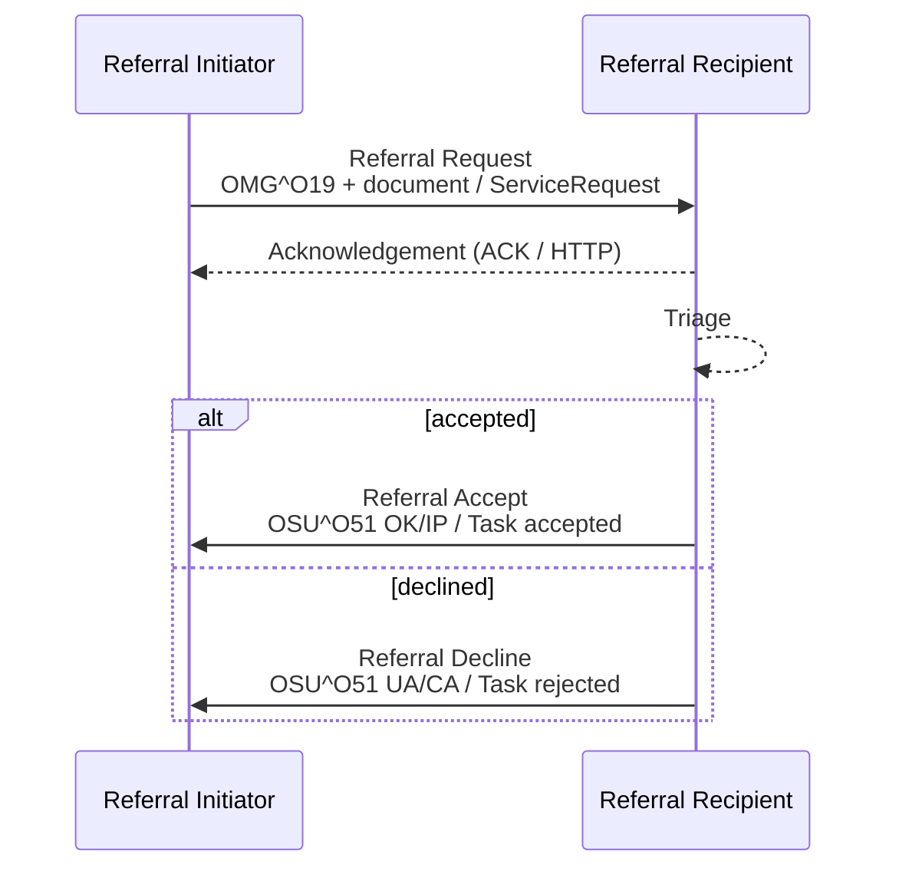

<div class="alert alert-danger" role="alert">
<b>Proof of concept.</b> This implementation guide is a demonstration only. It is
<b>not</b> an authoritative source, is not endorsed by NHS England, IHE or HL7, and
must not be used for implementation or clinical purposes.
</div>

**Referral Request [PCC-55]** - the Referral Initiator sends a referral to the Referral
Recipient, which replies with an **accept** or a **decline**.

### References

- [IHE PCC 360X](https://www.ihe.net/uploadedFiles/Documents/PCC/IHE_PCC_Suppl_360X.pdf) PCC TF-2 3.55
- [eRS FHIR API](https://digital.nhs.uk/developer/api-catalogue/e-referral-service-fhir), [BaRS FHIR API](https://digital.nhs.uk/developer/api-catalogue/booking-and-referral-fhir)
- [NW GMSA HL7 v2](https://nw-gmsa.github.io/en/hl7v2.html) - MSH, PID, PV1, ORC, OBR conventions
- [HL7 v2-to-FHIR ORC to ServiceRequest](https://build.fhir.org/ig/HL7/v2-to-fhir/ConceptMap-segment-orc-to-servicerequest.html) and [OBR to ServiceRequest](https://build.fhir.org/ig/HL7/v2-to-fhir/ConceptMap-segment-obr-to-servicerequest.html)

### Interaction



| Message | Trigger | HL7 v2 | FHIR |
|---|---|---|---|
| Referral Request | The clinician decides to refer | `OMG^O19^OMG_O19` (ORC-1 `NW`) and a clinical document | [Referral Request](StructureDefinition-ReferralRequest.html) and a FHIR Document; a [Referral Task](StructureDefinition-ReferralTask.html) with `businessStatus` `requested` |
| Referral Accept | The Referral Recipient accepts responsibility for providing the service | `OSU^O51^OSU_O51` (ORC-1 `OK`, ORC-5 `IP`) | Task `status` `accepted`, `businessStatus` `accepted` |
| Referral Decline | The Referral Recipient cannot provide the service | `OSU^O51^OSU_O51` (ORC-1 `UA`, ORC-5 `CA`, ORC-16 reason) | Task `status` `rejected`, `businessStatus` `declined`, `statusReason` |
{:.grid}

### Referral Request

#### Content

| Data item | 360X HL7 v2 | Required | FHIR ([Referral Request](StructureDefinition-ReferralRequest.html)) | Notes |
|---|---|---|---|---|
| Order control | ORC-1 `NW` | R | `status` `active`, `intent` `order` | |
| Referral ID | ORC-2 and OBR-2 | R | `identifier:referralId` ([Referral Identifier](StructureDefinition-ReferralIdentifier.html)) | `<referral ID>^^<assigning authority>`; in the NHS the assigning authority is the ODS code |
| UBRN | Not in 360X | if eRS | `identifier:ubrn` | eRS referrals only |
| Patient | PID-3, PID-5, PID-7, PID-8, PID-11 | R | `subject` ([Patient](StructureDefinition-Patient.html)) | NHS Number (traced) and local identifier |
| Ordering provider | ORC-12 and OBR-16 | R | `requester` | GMP / GMC or other professional number; 360X uses NPI |
| Service referred to | OBR-4 | R | `code` | 360X default LOINC 57133-1 Referral note; in the NHS, the specialty / service - SNOMED CT referral procedure (e.g. 183519002 Referral to cardiology service) |
| Referred-to service | MSH-5 / MSH-6 | - | `performer` | `HealthcareService` (eRS service ID, Directory of Services ID) or `Organization` |
| Reason for referral | OBR-31 (repeats) | R | `reasonCode`, `reasonReference` | SNOMED CT preferred, else text in OBR-31.2 |
| Referral question | OBX-5 (OBX-11 `O`, OBX-29 `QST`) | O | `note` | The clinical question to answer |
| Validity | TQ1-6 service duration | O | `occurrencePeriod`; Task `restriction.period` | Must not delay the accept / decline response |
| Expected by | TQ1-8 | R2 | `occurrenceDateTime` | 360X converts urgency into a date. Also send `priority` |
| Total occurrences | TQ1-14 | O | `quantityQuantity` | |
| Priority | TQ1-9 | - | `priority` | see [Priority](#priority) |
| Clinical information | CDA document in the package | R | `supportingInfo` - FHIR Document, `DocumentReference` (referral letter PDF), `QuestionnaireResponse` | |
| Date of referral | ORC-9 | - | `authoredOn` | |
{:.grid}

Example: [Referral Request - GP to Cardiology](ServiceRequest-CardiologyReferral.html).

#### Clinical Information

Where the record can be queried ([EU Health Data API](HealthDataAPI.html):
[QEDm](QEDm.html), [MHD](MHD.html)), the referral **SHOULD** carry only what the
Recipient cannot read for itself - the reason, the question, the referral form - and
reference the rest. Querying is highly recommended over copying the record into the
referral.

360X sends a CDA document (XDS-MS Referral Summary or C-CDA Referral Note) with the
order. This guide allows, in order of preference:

1. A **FHIR Document** with the relevant record (problems, medications, allergies,
   results) - HL7 Europe / IPS sections, as in [HL7 Europe HDR](https://hl7.eu/fhir/hdr/)
2. A **referral letter** as a `DocumentReference` with a PDF attachment (as eRS
   referral letters are today)
3. A **`QuestionnaireResponse`** for the service's referral form (e.g. exercise
   pre-participation screening, virtual ward eligibility), with the answers needed as
   data also sent as `Observation`s - see [Referral Forms](ReferralForms.html)

Where the Referral Initiator is a GP practice, the Referral Recipient may instead **pull**
the record when triaging, with [GP Connect](NHSEngland.html#gp-connect) Access Record
(HTML or Structured) and Access Document, or a supplier [IM1](NHSEngland.html#im1-interface-mechanism-1)
interface. The referral **SHALL** still carry the reason for referral and the referral question.

The clinical information is subject to the same access controls as the record, and
the reason for referral in the order message is clinical information too (PCC TF-2
3.55.5.2).

#### Priority

| NHS | FHIR `priority` | Expected by (TQ1-8) |
|---|---|---|
| Routine | `routine` | Service standard |
| Urgent | `urgent` | Date set by the referrer or service |
| Urgent suspected cancer (formerly two week wait) | `urgent` - **To confirm** a code for the cancer pathway | Within the Faster Diagnosis Standard timescale |
| Same day / emergency (e.g. virtual ward step-up) | `asap` or `stat` | Today |
{:.grid}

360X notes that "Urgent", "ASAP" and similar mean different things in different settings,
which is why it asks the Referral Initiator to convert urgency into a date.

#### Expected Actions

The Referral Recipient **SHALL** respond with an accept or a decline. It **SHALL** use the
patient identifier and Referral ID from the request in every later message.

### Referral Accept

| Data item | 360X HL7 v2 | FHIR ([Referral Task](StructureDefinition-ReferralTask.html)) |
|---|---|---|
| Order control | ORC-1 `OK` | `status` `accepted` (or `in-progress` once care starts) |
| Referral ID | ORC-2 | `basedOn.identifier`, `focus` |
| Order status | ORC-5 `IP` | `businessStatus` `accepted` |
| Ordering provider | ORC-12 **empty** (not echoed) | `requester` (unchanged) |
| Responsible service | MSH-3 / MSH-4 | `owner` |
{:.grid}

Example: [Referral Task - Accepted](Task-CardiologyReferralAccepted.html).

**Expected actions.** The Referral Initiator's system **SHALL** show that the Referral
Recipient has taken responsibility for the requested service.

### Referral Decline

| Data item | 360X HL7 v2 | FHIR ([Referral Task](StructureDefinition-ReferralTask.html)) |
|---|---|---|
| Order control | ORC-1 `UA` | `status` `rejected` |
| Referral ID | ORC-2 | `basedOn.identifier`, `focus` |
| Order status | ORC-5 `CA` | `businessStatus` `declined` |
| Ordering provider | ORC-12 **empty** | `requester` (unchanged) |
| Reason | ORC-16 (required; at least text in ORC-16.2) | `statusReason` ([Referral Status Reason](ValueSet-referral-status-reason-vs.html), example) |
{:.grid}

Example: [Referral Task - Declined](Task-CardiologyReferralDeclined.html). The referral
`ServiceRequest.status` becomes `revoked`.

**Expected actions.** The Referral Initiator's system **SHALL** show the decline and its
reason. A new referral needs a **new** Referral ID (`ServiceRequest.replaces` may point to
the declined one). The Referral Recipient handles the patient information it received
according to its policy for patients it will not treat.

### Examples

The Tameside cardiology referral, on the main HL7 v2 route (360X `OMG^O19` / `OSU^O51`)
and as FHIR Messages ([Referral Order (O19)](MessageDefinition-referral-order.html),
[Referral Order Status (O51)](MessageDefinition-referral-order-status.html)). The
`REF_I12` alternative is on [Patient Referral [I12]](I12.html).

#### Referral Request - OMG^O19

The Referral ID is in ORC-2 and OBR-2 (namespace = the referrer's ODS code); the reason in
OBR-31; the referral question in an OBX with OBX-11 `O` and OBX-29 `QST`; the expected date
in TQ1-8.

```
MSH|^~\&|GPSYSTEM|P89020|EPR|R0A|20260904101500+0100||OMG^O19^OMG_O19|MSG000124|P|2.5.1|||AL|NE
PID|1||9737383397^^^NHS^NH~B6789012^^^R0A^MR||TAMESIDE^Hodor||19600727|M|||Stockport Road^^Tameside^^OL7 0NS
ORC|NW|REF-2026-000123^P89020|||||||20260904101500+0100|||G1234567^Allen^^^^Dr^^^GMP
TQ1|1|||||||20260911|A^ASAP^HL70485
OBR|1|REF-2026-000123^P89020||57133-1^Referral note^LN||||||||||||G1234567^Allen^^^^Dr^^^GMP|||||||||||||||267036007^Dyspnea^SCT
OBX|1|TX|QUESTION^Referral question^L||Determine the origin of Mr Tameside's shortness of breath. To be seen within a week.||||||O||||||||||||||||||QST
NTE|1||BMI 30, non-smoker, no chest pain, family history of coronary artery disease.
```

FHIR Message: [Bundle Message - Referral Order (O19)](Bundle-ReferralOrderMessage.html)
(focus [Referral Request](ServiceRequest-CardiologyReferral.html)).

#### Referral Accept - OSU^O51

ORC-1 `OK`, ORC-5 `IP`; ORC-12 (ordering provider) is not echoed back.

```
MSH|^~\&|EPR|R0A|GPSYSTEM|P89020|20260905093000+0100||OSU^O51^OSU_O51|MFT-MSG-778900|P|2.5.1|||AL|NE
PID|1||9737383397^^^NHS^NH~B6789012^^^R0A^MR||TAMESIDE^Hodor||19600727|M|||Stockport Road^^Tameside^^OL7 0NS
ORC|OK|REF-2026-000123^P89020|||IP||||20260905093000+0100
```

FHIR Message: [Bundle Message - Referral Order Status (O51), accepted](Bundle-ReferralOrderStatusAcceptMessage.html)
(focus [Referral Task - Accepted](Task-CardiologyReferralAccepted.html)).

#### Referral Decline - OSU^O51

ORC-1 `UA`, ORC-5 `CA`, reason in ORC-16 (at least the text in ORC-16.2). The same
message is used for a later decline [PCC-56].

```
MSH|^~\&|EPR|R0A|GPSYSTEM|P89020|20260905093000+0100||OSU^O51^OSU_O51|MFT-MSG-778901|P|2.5.1|||AL|NE
PID|1||9737383397^^^NHS^NH~B6789012^^^R0A^MR||TAMESIDE^Hodor||19600727|M|||Stockport Road^^Tameside^^OL7 0NS
ORC|UA|REF-2026-000123^P89020|||CA||||20260905093000+0100|||||||SERVICE-NOT-PROVIDED^Please refer to the rapid access chest pain clinic instead.^L
```

FHIR Message: [Bundle Message - Referral Order Status (O51), declined](Bundle-ReferralOrderStatusDeclineMessage.html)
(focus [Referral Task - Declined](Task-CardiologyReferralDeclined.html), with
`statusReason` for ORC-16).

### More Information Requested (NHS)

eRS allows a provider to return a referral to the referrer for more information, and
the HL7 Physical Activity IG puts Tasks `on-hold`; a service may also need a form
completed by the patient ([Referral Forms](ReferralForms.html)). 360X has no such step. This guide uses `businessStatus`
`information-requested` with Task `status` `on-hold`, and the question in `Task.note`
or a `Communication`; the Referral Initiator updates `ServiceRequest.supportingInfo` and
the Task returns to `requested`. HL7 v2 equivalent - **Open**.

### NHS Implementations

| | eRS | BaRS | HL7 v2 (trust / region) |
|---|---|---|---|
| Referral | eRS referral with attachments (UBRN) | `ServiceRequest` in a FHIR Message | `OMG^O19` (360X) or `REF_I12` |
| Accept / decline | eRS triage outcome: accept, return to referrer, reject | Interim validation response (Application 4) - see [BaRS](BaRS.html) | `OSU^O51` or `RRI_I12` |
| Message | | | `OMG^O19` (360X) or `REF_I12` - see [Patient Referral [I12]](I12.html) |
| Mapping to this guide | UBRN in `identifier:ubrn`; eRS service as `performer` | Map to [Referral Request](StructureDefinition-ReferralRequest.html) and [Referral Task](StructureDefinition-ReferralTask.html) - see [BaRS](BaRS.html) | As above |
{:.grid}
