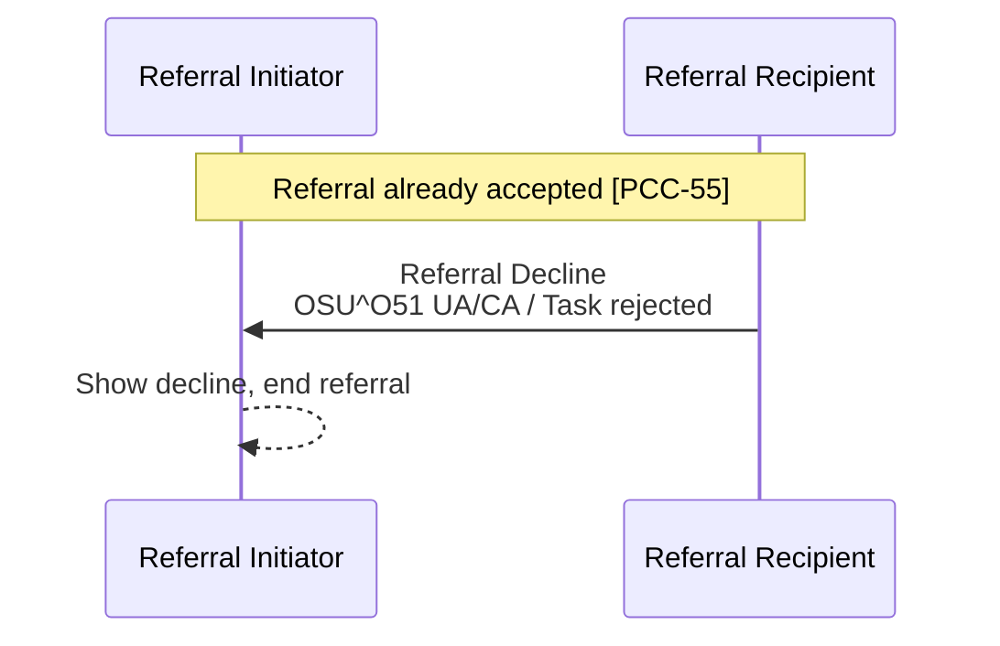

<b>Proof of concept.</b> This implementation guide is a demonstration only. It is
<b>not</b> an authoritative source, is not endorsed by NHS England, IHE or HL7, and
must not be used for implementation or clinical purposes.

**Referral Decline [PCC-56]** - the Referral Recipient declines a referral **after** it
has accepted it (for example after the patient did not attend, or when the patient
turns out to be unsuitable). It ends the referral.

### References

- [IHE PCC 360X](https://www.ihe.net/uploadedFiles/Documents/PCC/IHE_PCC_Suppl_360X.pdf) PCC TF-2 3.56

### Interaction

| Actor | Optionality |
|---|---|
| Referral Initiator | R - must handle a decline at any point of the workflow |
| Referral Recipient | O - but must send a decline as the first response if it cannot accept ([PCC-55](PCC-55.html)) |
{:.grid}

### Content

The message is the same as the Referral Decline in [PCC-55](PCC-55.html#referral-decline):

| Data item | 360X HL7 v2 | FHIR ([Referral Task](StructureDefinition-ReferralTask.html)) |
|---|---|---|
| Order control | ORC-1 `UA` | `status` `rejected` (Task was `accepted` or `in-progress`) |
| Referral ID | ORC-2 | `basedOn.identifier`, `focus` |
| Order status | ORC-5 `CA` | `businessStatus` `declined` |
| Reason | ORC-16 (at least text) | `statusReason`, e.g. `no-show`, `patient-declined`, `not-eligible` |
{:.grid}

A clinical document is not required. If the patient was seen before the decline, the
Referral Recipient **SHOULD** send what it found as an
[Interim Consultation Note [PCC-59]](PCC-59.html) or use a
[Referral Outcome [PCC-57]](PCC-57.html) instead.

### Expected Actions

- The Referral Initiator **SHALL** record that the referral has ended without being
  completed and show the reason, so the clinician can decide whether to refer again
  (with a new Referral ID).
- 360X allows a no-show to be reported as a decline reason when the Scheduling Option is
  not used. In the NHS this matches discharging a patient back to the GP after they did
  not attend (DNA letter).
