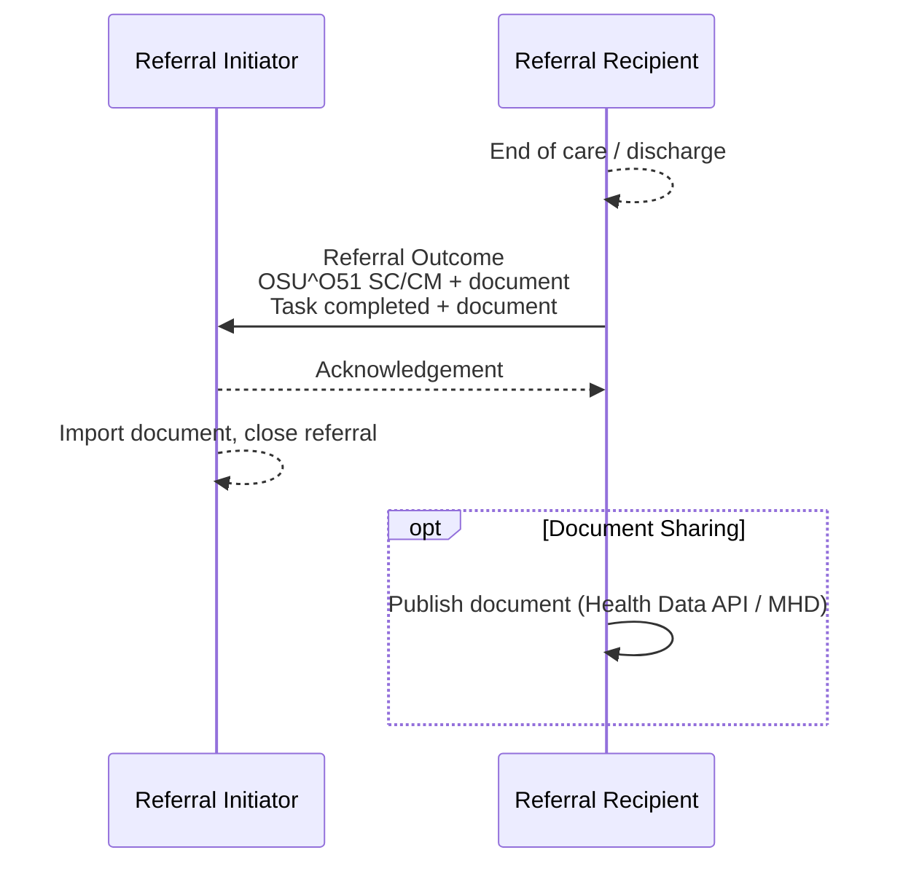

<b>Proof of concept.</b> This implementation guide is a demonstration only. It is
<b>not</b> an authoritative source, is not endorsed by NHS England, IHE or HL7, and
must not be used for implementation or clinical purposes.

**Referral Outcome [PCC-57]** - the Referral Recipient sends the result of the referral
at the end of care. It closes the loop.

### References

- [IHE PCC 360X](https://www.ihe.net/uploadedFiles/Documents/PCC/IHE_PCC_Suppl_360X.pdf) PCC TF-2 3.57
- [HL7 Europe Hospital Discharge Report](https://hl7.eu/fhir/hdr/) (1.0.0 STU 1)
- [Virtually Healthcare - Discharge Report (PCC-57)](https://virtually-healthcare.github.io/A03.html)
- [Transfer of Care](https://digital.nhs.uk/services/transfer-of-care-initiative)
- [Referral Outcome Reports](Reports.html)

### Interaction

| Actor | Optionality |
|---|---|
| Referral Initiator | R (receive) |
| Referral Recipient | R (send) |
{:.grid}

### Content

The outcome is a status update and a clinical document.

#### Status Update

| Data item | 360X HL7 v2 | FHIR ([Referral Task](StructureDefinition-ReferralTask.html)) |
|---|---|---|
| Order control | ORC-1 `SC` | `status` `completed` |
| Referral ID | ORC-2 | `basedOn.identifier`, `focus` |
| Order status | ORC-5 `CM` | `businessStatus` `completed` |
| Ordering provider | ORC-12 **empty** | `requester` (unchanged) |
| Document | In the package (360X); OBX ED / RP or `MDM^T02` (NHS) | `output` - the document |
{:.grid}

The referral `ServiceRequest.status` becomes `completed`.

#### Clinical Document

| Care delivered | Document | Profile | Transfer of Care equivalent |
|---|---|---|---|
| Outpatient / clinic | Consultation note (discharge letter) | [Consultation Note](StructureDefinition-ConsultationNote.html) (LOINC 11488-4) | Outpatient letter |
| Inpatient stay | Hospital discharge report | [Discharge Report](StructureDefinition-DischargeReport.html) (HL7 Europe HDR) | eDischarge |
| Virtual ward stay | Hospital discharge report | [Discharge Report](StructureDefinition-DischargeReport.html) | eDischarge - **To confirm** |
| Continued care | Care plan | HDR `CarePlan` / [Dynamic Care Planning](DCP.html) | - |
{:.grid}

360X used the XPHR or C-CDA documents. Whatever the type, the document **SHALL**:

- reference the referral (`Composition.extension[basedOn]` with the Referral ID);
- identify the patient with the same identifier as the referral;
- include the answer to the referral question and the plan of care, including any
  onward (secondary) referral the Referral Recipient has made;
- state medication changes, and who will action them - a prescription already sent by
  [EPS](NHSEngland.html#electronic-prescription-service-eps), or a request to the GP;
- name the Referral Initiator as a recipient (`extension[informationRecipient]` in
  HDR), and the patient's GP if different.

Examples:

- Outpatient: [Consultation Note - Referral Outcome](Composition-CardiologyOutcomeNote.html), [Referral Task - Completed](Task-CardiologyReferralCompleted.html)
- Virtual ward: [Discharge Report Document](Bundle-VirtualWardDischargeReport.html), [Referral Task - Virtual ward completed](Task-VirtualWardReferralCompleted.html)

### Expected Actions

- The Referral Initiator **SHALL** store the document, make it available to users with
  access to the patient record, and show that the referral has ended.
- It **SHALL** import the document (360X Document Import Option) and **MAY** import
  sections or discrete data (problems, medications, care plan).
- A Referral Outcome may arrive instead of a Cancel Confirmation if the Referral
  Recipient could not cancel ([PCC-58](PCC-58.html)).

### NHS Implementations

| Route | Status update | Document | Link to referral |
|---|---|---|---|
| HL7 v2 (trust / region) | `OSU^O51` | `MDM^T02` or OBX ED / RP | ORC-2 |
| Transfer of Care over MESH | None | eDischarge / outpatient letter (ITK3 FHIR STU3) | **To confirm** |
| Kettering XML over MESH | None | PDF / RTF attachment | Not supported - **To confirm** |
| GP Connect Send Document (MESH) | None | Document into the GP practice workflow | **To confirm** |
| GP Connect Update Record (community pharmacy) | None | Structured consultation summary | **To confirm** |
| IM1 (EMIS Web, SystmOne) | Supplier-specific | Written to the GP record | Supplier-specific |
| FHIR Message | `Task` | FHIR Document | `Composition` `basedOn`, `Task.basedOn` |
| Document Sharing (Health Data API) | Notification | `DocumentReference` + document | `DocumentReference.context.related` - **To confirm** |
{:.grid}
