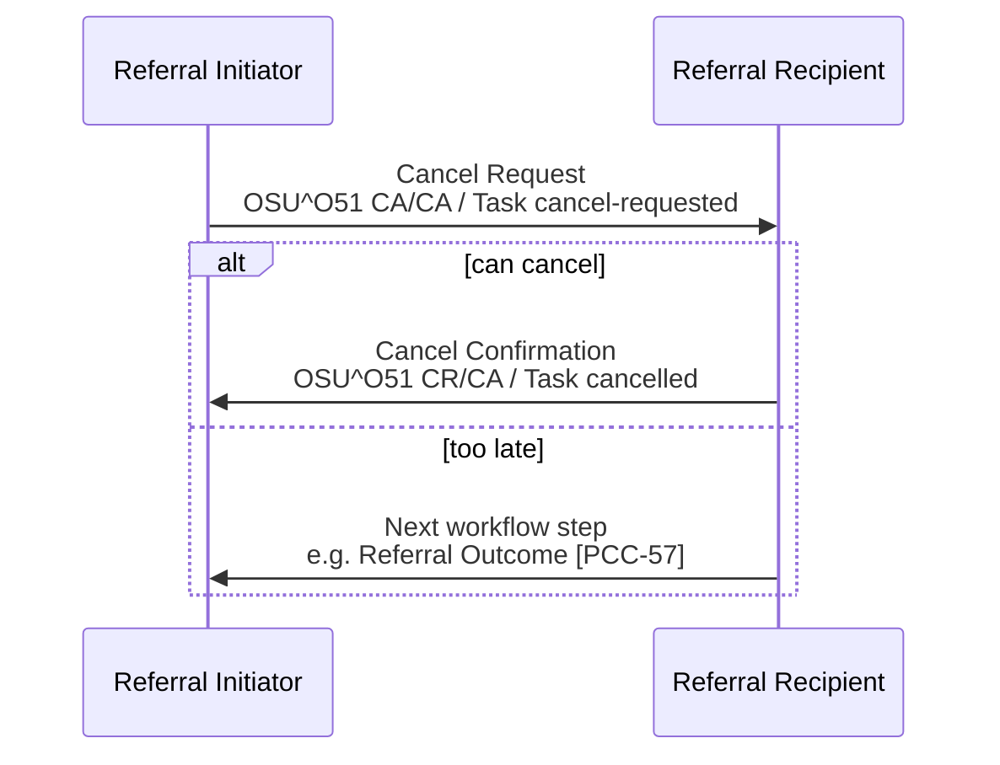

<b>Proof of concept.</b> This implementation guide is a demonstration only. It is
<b>not</b> an authoritative source, is not endorsed by NHS England, IHE or HL7, and
must not be used for implementation or clinical purposes.

**Referral Cancellation [PCC-58]** - the Referral Initiator asks for the referral to be
cancelled; the Referral Recipient confirms the cancellation, or carries on with the
next step if it cannot cancel.

### References

- [IHE PCC 360X](https://www.ihe.net/uploadedFiles/Documents/PCC/IHE_PCC_Suppl_360X.pdf) PCC TF-2 3.58

### Interaction

| Actor | Optionality |
|---|---|
| Referral Initiator | O - if it sends a Cancel Request it **SHALL** handle a Cancel Confirmation and any other reply |
| Referral Recipient | O - it is not required to confirm every request |
{:.grid}

### Cancel Request

| Data item | 360X HL7 v2 | FHIR |
|---|---|---|
| Order control | ORC-1 `CA` | [Referral Task](StructureDefinition-ReferralTask.html) `businessStatus` `cancel-requested` (Task `status` unchanged) |
| Referral ID | ORC-2 | `basedOn.identifier`, `focus` |
| Order status | ORC-5 `CA` | - |
| Ordering provider | ORC-12 - the referrer; someone else with authority may cancel | `Task.requester` unchanged; who cancelled in `Provenance` |
| Reason | ORC-16 (at least text) | `statusReason`, e.g. `no-longer-required` |
{:.grid}

With a shared FHIR server the Referral Initiator may instead set
`ServiceRequest.status` to `revoked`; the Referral Recipient still decides whether
the Task can be cancelled.

### Cancel Confirmation

| Data item | 360X HL7 v2 | FHIR |
|---|---|---|
| Order control | ORC-1 `CR` | Task `status` `cancelled` |
| Referral ID | ORC-2 | `basedOn.identifier`, `focus` |
| Order status | ORC-5 `CA` | `businessStatus` `cancelled` |
| Ordering provider | ORC-12 **empty** | - |
{:.grid}

### Expected Actions

- The Referral Recipient **SHALL** be able to receive a Cancel Request at any point. It
  decides, by its own policy, whether the referral can be cancelled.
- If it cannot (for example the patient has already been treated) it **SHALL** send the
  Referral Outcome [PCC-57] with the information up to the cancellation request.
- A Cancel Confirmation ends the referral; the Referral Initiator **SHALL** record and
  show the cancellation.
- Any booked appointment is cancelled ([PCC-60](PCC-60.html), `SIU^S15`).
