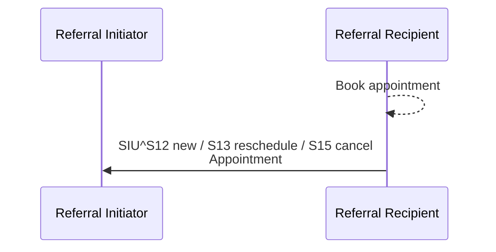
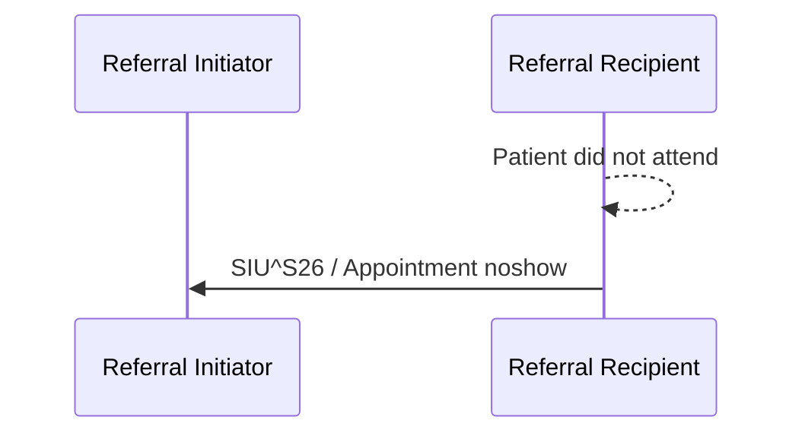

<b>Proof of concept.</b> This implementation guide is a demonstration only. It is
<b>not</b> an authoritative source, is not endorsed by NHS England, IHE or HL7, and
must not be used for implementation or clinical purposes.

The 360X **Scheduling Option**: the Referral Recipient tells the Referral Initiator about
appointments booked to carry out the referral [PCC-60] and when the patient does not
attend [PCC-61]. Both are optional.

### References

- [IHE PCC 360X](https://www.ihe.net/uploadedFiles/Documents/PCC/IHE_PCC_Suppl_360X.pdf) PCC TF-1 X.2.1.1, PCC TF-2 3.60 and 3.61
- [eRS](https://digital.nhs.uk/services/e-referral-service) and [BaRS](https://digital.nhs.uk/services/booking-and-referral-standard) - national booking

360X notes that many organisations have other, fuller ways of sharing appointments, so
the option may not be needed. In England, eRS and BaRS bookings already tell the
referrer; this option covers appointments booked locally by the provider.
When the **GP practice is the Referral Recipient** (for example NHS 111 or a virtual
ward arranging a GP follow-up), the booking is made directly with
[GP Connect Appointment Management](https://digital.nhs.uk/developer/api-catalogue/gp-connect-appointment-management-fhir),
which returns the `Appointment`.

### Appointment Notification [PCC-60]

| Message | HL7 v2 | FHIR ([Referral Appointment](StructureDefinition-ReferralAppointment.html)) | Task `businessStatus` |
|---|---|---|---|
| New appointment | `SIU^S12^SIU_S12` | `status` `booked` | `appointment-booked` |
| Reschedule | `SIU^S13^SIU_S12` | `status` `booked`, new `start` | `appointment-rescheduled` |
| Cancel appointment | `SIU^S15^SIU_S12` | `status` `cancelled` | `appointment-cancelled` |
{:.grid}

| Data item | 360X HL7 v2 | FHIR |
|---|---|---|
| Appointment ID | SCH-2 | `identifier` |
| Reason for appointment | SCH-6 LOINC 57133-1 | `serviceType`, `reasonCode` |
| Referral ID | SCH-26 | `basedOn` (identifier) |
| Date and time | TQ1-7 (at least the date) | `start`, `end` |
| Action code | RGS-2 `A` | - |
| Appointment provider | AIP-3 (should) | `participant.actor` |
{:.grid}

Example: [Referral Appointment](Appointment-CardiologyAppointment.html).

If the Referral Recipient implements the option, **every** appointment for the referral
triggers a notification, one per appointment. A Referral Initiator that implements it
**SHALL** record and show them; otherwise it may ignore them.

### No-Show Notification [PCC-61]

| Data item | 360X HL7 v2 | FHIR |
|---|---|---|
| Appointment ID | SCH-2 (matches the notification) | `identifier` |
| Referral ID | SCH-26 | `basedOn` |
| Date and time | TQ1-7 | `start` |
| Action code | RGS-2 `D` | `status` `noshow` |
| Appointment provider | AIP-3 (may) | `participant.actor` |
{:.grid}

The [Referral Task](StructureDefinition-ReferralTask.html) `businessStatus` becomes
`no-show`. The referral stays open: the Referral Recipient may rebook, or end it with a
[Referral Decline [PCC-56]](PCC-56.html) (reason `no-show`) - the NHS "discharged back to
GP after DNA". Without the Scheduling Option, the decline is the only way to report the
no-show.
