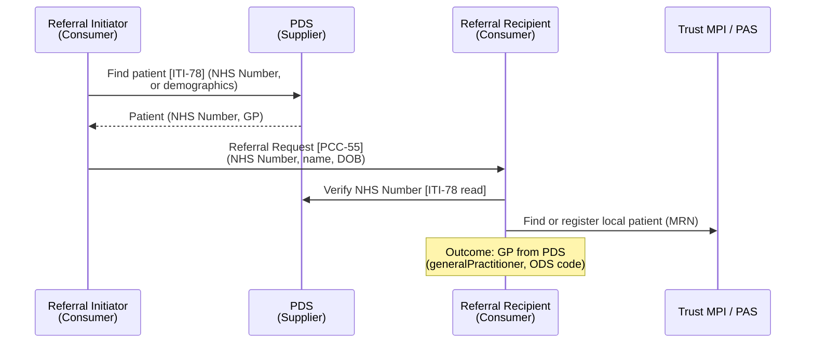

<b>Proof of concept.</b> This implementation guide is a demonstration only. It is
<b>not</b> an authoritative source, is not endorsed by NHS England, IHE or HL7, and
must not be used for implementation or clinical purposes.

IHE **Patient Demographics Query for Mobile (PDQm)** is a FHIR API for finding a patient
in a demographics supplier (an MPI or national register) by identifier or demographics.
In care coordination every party must agree **who the patient is** before a referral is
sent, accepted or filed: the Referral Initiator traces the patient before referring, the
Referral Recipient verifies the patient on receipt, and anyone querying the record
([QEDm](QEDm.html), [MHD](MHD.html)) finds the patient first.

In England the shared identifier is the **NHS Number**, and its master record is the
Personal Demographics Service (**PDS**) - see [NHS England Services](#nhs-england-services).

### References

- [IHE ITI PDQm](https://profiles.ihe.net/ITI/PDQm/index.html) 3.2.0 (2025-11-04) - [Volume 1](https://profiles.ihe.net/ITI/PDQm/volume-1.html)
- [Patient Demographics Query [ITI-78] and Match [ITI-119]](ITI-78.html) - this guide's Volume 2 page
- [EU Health Data API](HealthDataAPI.html) - every actor finds `Patient` (PDQm)
- [Personal Demographics Service (PDS) FHIR API](https://digital.nhs.uk/developer/api-catalogue/personal-demographics-service-fhir) (OpenAPI 1.3.568-alpha, checked 2026-11-02)

### Actors and Transactions

| Actor | Mobile Patient Demographics Query [ITI-78] | Patient Demographics Match [ITI-119] | In the closed loop |
|---|---|---|---|
| Patient Demographics Consumer | O (Patient Search Option) | O (Match Operation Option) | Referral Initiator (trace before referring); Referral Recipient (verify on receipt); Clinical Data and Document Consumers |
| Patient Demographics Supplier | R | O (Match Operation Option) | PDS (NHS Number); trust MPI / PAS (MRN); shared care record |
{:.grid}

A Consumer implements at least one of the two transactions; a Consumer that only
implements Match "can interoperate only with Suppliers that also implement Match"
(PDQm Volume 1).

### Search or Match

| | Search [ITI-78] | Match [ITI-119] |
|---|---|---|
| FHIR | `GET [base]/Patient?...` (search), `GET [base]/Patient/{id}` (read) | `POST [base]/Patient/$match` |
| Matching | Literal comparison of each parameter; the Consumer filters the results | The Supplier's own (MPI) algorithm, scored, with a threshold; weak matches can be withheld |
| Use | User picks from a list; lookup by a known, check-digited identifier | System-to-system matching, e.g. a message received without a trusted identifier |
{:.grid}

PDQm warns that "searching only by identifier might be unsafe" if the identifier has no
check digit. The NHS Number has one (modulus 11), which is why it is the identifier for
referral messages - but it is still verified against name and date of birth on receipt.

### Patient Identity in the Closed Loop

| Step | Who | Why |
|---|---|---|
| Before referring | Referral Initiator | Trace the NHS Number; the referral must not be sent with an unverified one |
| On receipt [PCC-55] | Referral Recipient | Verify the NHS Number and demographics; link to (or register) the local record and MRN |
| Before querying the record | Clinical Data / Document Consumer | Resolve the patient's id on the Resource or Document Access Provider |
| Sending the outcome [PCC-57] | Referral Recipient | Current registered GP (PDS `generalPractitioner`, ODS code) - then find the GP's endpoint through [mCSD](mCSD.html) |
{:.grid}

PDQm only reads demographics. Registering and updating patients and merging records are
IHE PIXm / PMIR or HL7 v2 ADT (`A28`, `A31`, `A40`) - see
[Patient Administration](PatientAdministration.html).

### HL7 v2

PDQm "is intended to support all use cases of PDQ": PDQ Patient Demographics Query
[ITI-21] `QBP^Q22` / `RSP^K22` is the HL7 v2 equivalent (indicative), and PDQv3 [ITI-47]
the HL7 v3 one. In NHS trusts a v2 PDQ is usually answered by the trust MPI / PAS or the
integration engine, which in turn traces against PDS.

### NHS England Services

<b>PDS is the national Patient Demographics Supplier for the NHS Number.</b> It is not a
general MPI: it does not hold trust MRNs, and it is searched with its own parameters
rather than the full PDQm set. Local identifiers (MRN) come from the trust MPI / PAS or a
regional MPI.

| Need | NHS England service | PDQm equivalent | Scope |
|---|---|---|---|
| Retrieve a patient by NHS Number | PDS FHIR API `GET /Patient/{nhsNumber}` | [ITI-78] read | General |
| Trace a patient by demographics | PDS FHIR API `GET /Patient?family=&given=&gender=&birthdate=&address-postcode=` | [ITI-78] search; scored results like [ITI-119] | General |
| Trace in batch (registers, migrations) | Demographics Batch Service (MESH) - "deprecated ... retired at the end of 2026", replaced by PDS MESH | - (no batch transaction) | General |
| Legacy integration | [PDS HL7 V3 API](https://digital.nhs.uk/developer/api-catalogue/personal-demographics-service-hl7-v3) (synchronous and asynchronous) | PDQv3 [ITI-47] | Spine (HSCN) |
| Be told of changes (death, change of GP or address) | PDS change notifications via [MNS](https://digital.nhs.uk/developer/api-catalogue/multicast-notification-service) - **To confirm** event types | PIXm / PMIR feed, `ADT^A31` | General |
| Patient identified for an eRS referral | eRS expects the patient to be identified "via Personal Demographic Service (PDS)" before service search (A010) | [ITI-78] before [ITI-90] | **eRS** |
| Patient identified for a BaRS message | NHS Number in the BaRS `Patient`; whether a PDS trace is required is **To confirm** | [ITI-78] | **BaRS** |
{:.grid}

#### PDS FHIR API - Tips

From the [PDS FHIR API](https://digital.nhs.uk/developer/api-catalogue/personal-demographics-service-fhir) OpenAPI file:

- **Access mode matters.** Application-restricted access returns "only a single unique
  match" (`_max-results` must be 1); healthcare worker (CIS2) access returns "up to 50".
  A Trust Integration Engine verifying an incoming referral uses the first; a clinician
  picking a patient uses the second.
- **Scores.** "Every matched patient in the result list includes a score"; 1.0 is an
  exact match, results sorted best first. `_exact-match` returns only 1.0; `_fuzzy-match`
  checks "homophones, transposed names and historic information". This is closer to
  PDQm Match [ITI-119] than to a literal FHIR search, but uses search syntax - PDS does
  not offer `$match`.
- **No `identifier` search.** Use read (`GET /Patient/{nhsNumber}`), not
  `?identifier=https://fhir.nhs.uk/Id/nhs-number|...`. A PDQm Consumer needs a small
  adapter for PDS.
- **Search returns less than read.** Search omits place of birth, pharmacy, communication
  and contact preferences; read the record after selecting the patient.
- **Restricted patients.** Address, telecom, contact and `generalPractitioner` are
  removed; searching with a postcode or GP excludes them. Do not copy a restricted
  patient's address into a referral.
- **Superseded and invalidated records.** Invalidated records are not returned; "if an
  invalidated patient record has been superseded, the superseding record is returned".
  Check the NHS Number returned against the one sent, and update the referral if it
  changed.
- **Audit.** PDS records "an access request in our audit trail for all patients
  matched in a PDS search" - search with enough detail to get one match.
- **GP for the outcome.** `Patient.generalPractitioner` gives the registered practice
  (ODS code) - the default recipient of the Referral Outcome copy.

### Gaps

- PDS supports a subset of the PDQm ITI-78 parameters and no ITI-119 `$match`; a facade
  is needed for an off-the-shelf PDQm Consumer - **To confirm** whether NHS England plans
  PDQm conformance.
- Trust MRNs are not in PDS. The Referral Recipient needs its own MPI (PDQm / PIXm
  Supplier, or HL7 v2 PDQ) to find the local record.
- No national PDQ (HL7 v2) interface; v2 systems depend on the trust MPI or integration
  engine.
