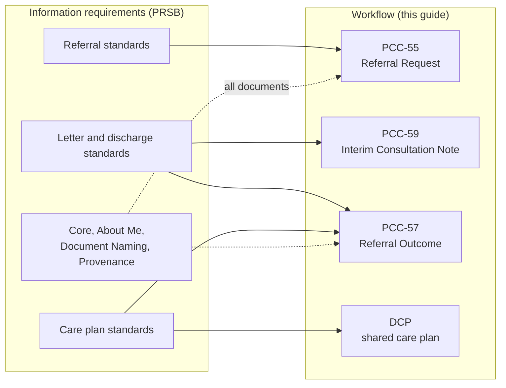

<b>Proof of concept.</b> This implementation guide is a demonstration only. It is
<b>not</b> an authoritative source, is not endorsed by NHS England, IHE or HL7, and
must not be used for implementation or clinical purposes.

The [Professional Record Standards Body (PRSB)](https://theprsb.org/standards/) publishes
the clinical content standards for records shared in the UK: what information a
referral, letter, discharge summary or care plan should contain, and how it is
headed. They are **information requirements**, not exchange formats. In the
[NW GMSA](https://nw-gmsa.github.io/en/HowToEngineerInteroperability.html) terms they
feed the data model; this guide supplies the workflow (the PCC interactions) they are
carried in.

This page lists each PRSB standard (as published on 2026-11-01), the 360X interaction it
may apply to and where in the [clinical process](ClinicalProcess.html) it may apply.
The mappings are **indicative** - PRSB does not define them. As with other national
standards, PRSB content is assessed against the general standards (HL7 Europe HDR, IPS,
FHIR / CDA Documents) rather than assumed to be complete.

### References

- [PRSB standards](https://theprsb.org/standards/) - names, descriptions and latest versions below are from this list, checked 2026-11-01
- [Clinical Process](ClinicalProcess.html) - Start, Assessment, Diagnosis, Plan, Implement, Evaluate, End
- [Transfer of Care](https://digital.nhs.uk/services/transfer-of-care-initiative) - the FHIR documents built from the PRSB transfer of care standards
- [HL7 Europe Hospital Discharge Report](https://hl7.eu/fhir/hdr/)

### How PRSB Standards Fit

| Kind of PRSB standard | Carried as | Profile in this guide |
|---|---|---|
| Referral | `ServiceRequest` and its clinical information (`supportingInfo`: FHIR Document, letter, `QuestionnaireResponse`) | [Referral Request](StructureDefinition-ReferralRequest.html) |
| Letter (outpatient) | FHIR Document | HDR section structure (HDR itself is inpatient only - **Open**) |
| Discharge | FHIR Document | [HL7 Europe HDR](https://hl7.eu/fhir/hdr/) |
| Care plan | `CarePlan`, shared through DCP or sent in the outcome | [Care Plan](StructureDefinition-PatientCarePlan.html), HDR `CarePlan` |
| Shared record view | Health Data API (document or resource sharing) | - |
| Cross-cutting | Document metadata, sections, `Provenance` | All documents |
{:.grid}

### Referral Standards

| PRSB standard | Version | PRSB description | PCC interaction | Clinical process |
|---|---|---|---|---|
| [Clinical Referral Information Standard](https://theprsb.org/standards/clinical-referral-information-standard/) | v1.0 | "Improving the exchange of referral information from GPs to hospital consultants and other health care professionals providing outpatient services." | [PCC-55](PCC-55.html) - the referral content (reason, question, clinical information); the eRS referral letter | Implement (GP); Assessment (recipient's triage) |
| [111 Referral Standard](https://theprsb.org/standards/111referralstandard) | v1.0 | "Supporting clear and concise information flows between the 111 referrer and the receiving services and professionals." | [PCC-55](PCC-55.html) (BaRS on some routes today - see the [assessment](NHSEngland.html#booking-and-referral-standard-bars)); [PCC-60](PCC-60.html) when 111 books | Implement (111); Start for the receiving service - including a [virtual ward](VirtualWards.html) step-up |
| [Hospital Referral for Assessment for Community Care](https://theprsb.org/standards/hospitalrefferalforassessmenforcommunitycare) | v1.1 | "...the information required in respect of a person being referred for ongoing community assessment for social care and support after a hospital stay." | [PCC-55](PCC-55.html) from the ward to social care; [PCC-57](PCC-57.html) back | End (hospital discharge planning); Implement |
| [Urgent Transfer of Care from Care Home to Hospital](https://theprsb.org/standards/carehometohospital) | v1.3 | "...the information required for the care and support of a person when they are admitted to hospital from a care home in an emergency." | [PCC-55](PCC-55.html) - a transfer rather than a referral (no accept / decline) | Implement (care home); Start (hospital) |
| [Ambulance Handover to Emergency Care](https://theprsb.org/standards/ambulancehandover/) | v1.0 | "...the information that is shared when care is transferred from ambulances to emergency departments." | [PCC-55](PCC-55.html) as a handover (no accept / decline) | Start and Assessment (ED) |
| [Social Prescribing Standard](https://theprsb.org/standards/social-prescribing-standard) | v1.1 | "Sharing and recording of information for all models of social prescribing including those used in local authorities and voluntary organisations..." | [PCC-55](PCC-55.html) to a link worker or service; [PCC-57](PCC-57.html) outcome | Implement; Evaluate |
{:.grid}

### Letter and Discharge Standards

| PRSB standard | Version | PRSB description | PCC interaction | Clinical process |
|---|---|---|---|---|
| [Outpatient Letter Standard](https://theprsb.org/standards/outpatientletterstandard) | v2.2 | "...digital outpatient letters allow clinical information to be recorded, exchanged and accessed consistently across care settings. Best practice for most outpatient letters is writing directly to patients." | [PCC-59](PCC-59.html) (clinic letter during care); [PCC-57](PCC-57.html) (discharge from outpatients) - outpatient letter (HDR section codes) | End of each encounter; Evaluate (referrer) |
| [Transfer of Care - Acute Inpatient Discharge Standard](https://theprsb.org/standards/edischargesummary) | v2.1 | "Enabling hospitals to safely transfer standardised clinical information which can be extracted directly into GP IT systems, when a patient is discharged." | [PCC-57](PCC-57.html) - [HL7 Europe HDR](https://hl7.eu/fhir/hdr/); also a [virtual ward](VirtualWards.html) discharge | End; Evaluate (GP) |
| [Emergency Care Discharge Standard](https://theprsb.org/standards/emergencycaredischarge) | v2.2 | "Sharing discharge information between Emergency Care and GP practices is essential for ensuring patient safety and good ongoing treatment." | [PCC-57](PCC-57.html) for a referral to ED (e.g. from 111 or the GP) - HDR fit is **Open** (inpatient only) | End; Evaluate |
| [Mental Health Inpatient Discharge](https://theprsb.org/standards/mentalhealth/) | v2.1 | "Standardising information shared so professionals can provide continuity of care when an adult is discharged from mental health services." | [PCC-57](PCC-57.html) - Discharge Report | End; Evaluate |
| [Community Pharmacy Standard](https://theprsb.org/standards/communitypharmacy/) | v3.01.3 | "Supporting information sharing between community pharmacists and GP practices." | [PCC-57](PCC-57.html) - pharmacy consultation back to the GP (GP Connect Update Record); [PCC-55](PCC-55.html) for referrals to the pharmacy | Implement (pharmacy); Evaluate (GP) |
{:.grid}

### Care Plan and Condition Standards

| PRSB standard | Version | PRSB description | PCC interaction | Clinical process |
|---|---|---|---|---|
| [Personalised Care and Support Plan](https://theprsb.org/standards/personalisedcareandsupportplan) | v2.0 | "Allowing the sharing of care plans between patients, carers and all the health and care professionals involved in a person's care..." | [DCP](DCP.html) (PCC-37 to PCC-41); [PCC-57](PCC-57.html) outcome as a care plan (continued care) | Plan; Evaluate |
| [Palliative and End of Life Care Information Standard](https://theprsb.org/standards/palliativeandendoflifecare) | v1.11 | "...the standardised recording of information related to palliative care and end of life forming the core content of information to be held in electronic palliative care co-ordination systems (EPaCCS)." | [DCP](DCP.html) - EPaCCS as the Care Plan Service; [PCC-55](PCC-55.html) supporting information | Plan; read in every Assessment |
| [Nursing Care Needs Standard](https://theprsb.org/standards/nursingcareneeds/) | v1.0 | "...a new nursing standard for use across different health and social care settings." | [PCC-55](PCC-55.html) supporting information (e.g. referral to community nursing or a virtual ward); [DCP](DCP.html) | Assessment; Plan |
| [Wound Care Standard](https://theprsb.org/standards/wound-care-standard/) | v1.0 | "...the information record content for the management of wound care..." - assessment and treatment, treatment plan, supported self-care | [DCP](DCP.html); [PCC-59](PCC-59.html) / [PCC-57](PCC-57.html) from community nursing | Assessment; Plan; Implement |
| [Diabetes Standard](https://theprsb.org/standards/diabetesstandards) | v1.0 | "...sharing diabetes information between people and professionals across all care settings, including self management data from digital apps and medical devices..." | [DCP](DCP.html); device data as in [virtual ward monitoring](VirtualWards.html#care-plan-and-monitoring); [PCC-55](PCC-55.html) supporting information | Assessment; Plan; Evaluate |
| [Epilepsy Information Standard](https://theprsb.org/standards/epilepsyinformationstandard/) | v1-build.0.12 | "...a nationally agreed approach to recording and sharing epilepsy related information..." | [DCP](DCP.html); [PCC-55](PCC-55.html) / [PCC-57](PCC-57.html) content for neurology referrals | Assessment; Diagnosis; Plan |
| [Maternity Information Standard](https://theprsb.org/standards/maternityrecord) | v2.1.2 | - | [DCP](DCP.html) (the DCP pregnancy use case); referrals within maternity care [PCC-55](PCC-55.html) | Plan; across encounters |
| [Shared Decision Making Standard](https://theprsb.org/standards/shareddecisionmakingstandard) | v1.0 | "A collaborative process where clinicians and individuals consider treatment options together..." | [PCC-59](PCC-59.html) / [PCC-57](PCC-57.html) plan of care section; [DCP](DCP.html) | Plan |
| [Obstetric Anaesthetic Standard](https://theprsb.org/standards/obstetricanaestheticstandard/) | v1.0.0 | "...the minimum dataset needed to improve care and quality outcomes for obstetric anaesthetic services..." | Not a referral standard - in-service recording | Implement |
{:.grid}

### Screening and Prevention Standards

| PRSB standard | Version | PRSB description | PCC interaction | Clinical process |
|---|---|---|---|---|
| [Healthy Child Record Standard](https://theprsb.org/standards/healthychildrecordstandard) | Amd 56/2024 | "...what information on screening tests, immunisations and developmental milestones should be accessible..." | [PCC-55](PCC-55.html) / [PCC-57](PCC-57.html) for screening follow-up (the 360X newborn hearing [use case](360X.html#public-health-to-specialist)); [DCP](DCP.html) | Assessment; Plan |
| [NHS Health Check Standard](https://theprsb.org/standards/nhshealthcheckstandard/) | v1.3.0 | "...a public health programme aimed at preventing non-communicable diseases (NCDs) among adults aged 40-74 in England." | Results may trigger [PCC-55](PCC-55.html); outcome to the GP [PCC-57](PCC-57.html) if done outside the practice | Assessment; Diagnosis |
{:.grid}

### Shared Record and Cross-cutting Standards

| PRSB standard | Version | PRSB description | PCC interaction | Clinical process |
|---|---|---|---|---|
| [Core Information Standard](https://theprsb.org/standards/core-information-standard/) | v2.01 | "...a set of information that can potentially be shared between systems in different sites and settings..." | All documents - the headings behind the sections of the referral, outpatient letters (HDR section codes) and [HL7 Europe HDR](https://hl7.eu/fhir/hdr/) | All - Subjective (view the record) in each encounter |
| [About Me Standard](https://theprsb.org/standards/aboutme) | v2.01 | "The most important details that a person wants to share with professionals in health and social care." | [PCC-55](PCC-55.html) supporting information; shared record | All - especially Assessment |
| [Care Homes View of Shared Care Records](https://theprsb.org/standards/carehomesview/) | v1.1 | "Information that care home staff can see in a shared care record." | Not a PCC interaction - Health Data API resource / document sharing ([Reports](Reports.html#from-document-messaging-to-document-sharing)) | Assessment (Subjective) |
| [Information Provided by Local Authorities in Shared Care Records](https://theprsb.org/standards/localauthorityinformation) | v1.1 | "The important details that the local authority holds about people that would be useful for health and care professionals..." | Not a PCC interaction - shared record; read when triaging [PCC-55](PCC-55.html) | Assessment (Subjective) |
| [Document Naming Standard](https://theprsb.org/standards/documentnaming) | v4.9 | "Making sure that records are properly named and indexed, so they can be retrieved in order to provide ongoing care." | Every document in [PCC-55](PCC-55.html), [PCC-57](PCC-57.html), [PCC-59](PCC-59.html): `DocumentReference.type` / `Composition.type` ([Referral Document Type](ValueSet-referral-document-type.html)) | Evaluate (finding documents later) |
| [Provenance Data Standard](https://theprsb.org/standards/provenance) | v1.2 | "...who made the record entry or carried out the activity, where and when..." | All interactions - `author`, `requester`, `owner`, `Provenance` | All |
{:.grid}

### Summary by Interaction

| PCC interaction | PRSB standards that may apply |
|---|---|
| [Referral Request [PCC-55]](PCC-55.html) | Clinical Referral Information, 111 Referral, Hospital Referral for Assessment for Community Care, Urgent Transfer of Care from Care Home to Hospital, Ambulance Handover, Social Prescribing; supporting information from About Me, Nursing Care Needs, Palliative and End of Life Care and condition standards |
| Accept / Decline [PCC-55], [PCC-56], Cancellation [PCC-58] | None - workflow status only (Provenance) |
| [Interim Consultation Note [PCC-59]](PCC-59.html) | Outpatient Letter; Wound Care, Shared Decision Making and condition standards for content |
| [Referral Outcome [PCC-57]](PCC-57.html) | Outpatient Letter, Acute Inpatient Discharge, Emergency Care Discharge, Mental Health Inpatient Discharge, Community Pharmacy; Personalised Care and Support Plan (continued care) |
| [Appointment [PCC-60] / No-Show [PCC-61]](PCC-60.html) | None (111 Referral where 111 books) |
| [Dynamic Care Planning](DCP.html) | Personalised Care and Support Plan, Palliative and End of Life Care, Maternity, Diabetes, Epilepsy, Wound Care, Nursing Care Needs, Healthy Child Record |
| All | Core Information, Document Naming, Provenance, About Me |
{:.grid}

### Summary by Clinical Process

| Clinical process | PRSB standards that may apply |
|---|---|
| Start | Ambulance Handover, Urgent Transfer of Care from Care Home to Hospital, 111 Referral (receiving service) |
| Assessment | Core Information, About Me, Care Homes View, Local Authority Information, Nursing Care Needs, NHS Health Check, Healthy Child Record, condition standards |
| Diagnosis | Epilepsy, NHS Health Check |
| Plan | Personalised Care and Support Plan, Palliative and End of Life Care, Shared Decision Making, Maternity, Diabetes, Wound Care |
| Implement | Clinical Referral Information, 111 Referral, Social Prescribing, Hospital Referral for Assessment for Community Care, Community Pharmacy |
| Evaluate | Outpatient Letter, discharge standards, Community Pharmacy, Document Naming |
| End | Acute Inpatient Discharge, Emergency Care Discharge, Mental Health Inpatient Discharge, Outpatient Letter, Hospital Referral for Assessment for Community Care |
{:.grid}

**To confirm:** PRSB headings to HL7 Europe HDR sections, and the Clinical Referral
Information Standard to the [Referral](StructureDefinition-Referral.html) logical model.
An indicative heading mapping for discharge is on
[Referral Outcome Reports](Reports.html#hl7-europe-hospital-discharge-report).
