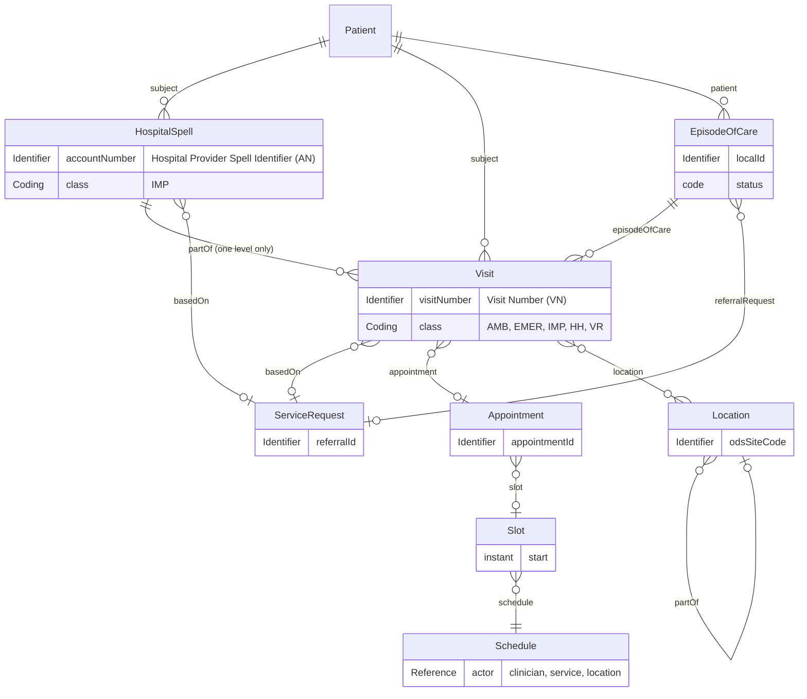
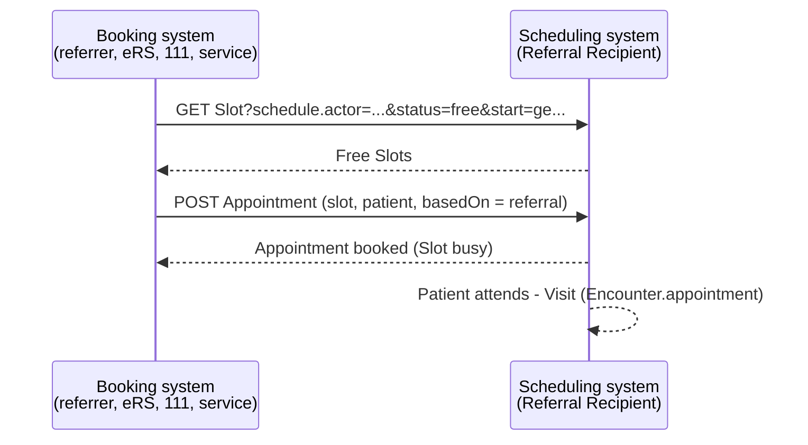

<b>Proof of concept.</b> This implementation guide is a demonstration only. It is
<b>not</b> an authoritative source, is not endorsed by NHS England, IHE or HL7, and
must not be used for implementation or clinical purposes.

The general purpose patient administration model behind every referral: who the
patient and the professionals are, which organisations and locations are involved, the
encounters and episodes in which care happens, and the schedules and appointments that
book it. It follows the FHIR R4
[Administration module](https://hl7.org/fhir/R4/administration-module.html), with UK
definitions from the [NW GMSA IG](https://nw-gmsa.github.io/en/artifacts.html) and the
[Interweave (Yorkshire and Humber Care Record) IG](https://fhir.interweavedigital.com/R4/artifacts.html).

### References

- FHIR R4 Administration module - [clinical registration](https://hl7.org/fhir/R4/administration-module.html#clinical-reg) and [scheduling](https://hl7.org/fhir/R4/administration-module.html#sched)
- [NW GMSA FHIR IG - Resource Profiles](https://nw-gmsa.github.io/en/artifacts.html) - source of the copied profiles, [HL7 v2 PV1](https://nw-gmsa.github.io/en/hl7v2.html)
- [Interweave IG](https://fhir.interweavedigital.com/R4/artifacts.html) (0.1.0) - [Encounter](https://fhir.interweavedigital.com/R4/StructureDefinition-Interweave-Encounter.html), [Encounter Grouping](https://fhir.interweavedigital.com/R4/StructureDefinition-Interweave-EncounterGrouping.html), [EpisodeOfCare](https://fhir.interweavedigital.com/R4/StructureDefinition-Interweave-EpisodeOfCare.html), Location, Schedule, Slot
- NHS Data Dictionary [HOSPITAL PROVIDER SPELL IDENTIFIER](https://www.datadictionary.nhs.uk/data_elements/hospital_provider_spell_identifier.html)
- [HL7 v2-to-FHIR PV1 to Encounter](https://build.fhir.org/ig/HL7/v2-to-fhir/ConceptMap-segment-pv1-to-encounter.html)

### Model

| FHIR category | Resources | Profiles in this guide | Source |
|---|---|---|---|
| Individuals | Patient, RelatedPerson, Practitioner, PractitionerRole | [Patient](StructureDefinition-Patient.html), [RelatedPerson](StructureDefinition-RelatedPerson.html), [Practitioner](StructureDefinition-Practitioner.html), [PractitionerRole](StructureDefinition-PractitionerRole.html) | NW GMSA (on HL7 Europe Base) |
| Entities | Organization, Location, HealthcareService | [Organization](StructureDefinition-Organization.html), [Location](StructureDefinition-Location.html); HealthcareService unprofiled | NW GMSA; Interweave |
| Clinical registration | Encounter, EpisodeOfCare, (Account) | [Encounter](StructureDefinition-Encounter.html) (base), [Hospital Spell](StructureDefinition-HospitalSpell.html), [Visit](StructureDefinition-Visit.html), [Episode Of Care](StructureDefinition-EpisodeOfCare.html); Account not used | NW GMSA; Interweave |
| Scheduling | Schedule, Slot, Appointment, AppointmentResponse | [Schedule](StructureDefinition-Schedule.html), [Slot](StructureDefinition-Slot.html), [Referral Appointment](StructureDefinition-ReferralAppointment.html) | Interweave; this guide |
{:.grid}

### Identifiers

These identifiers are frequently confused. They identify **different things**, and the
HL7 v2 identifier type (CX.5) and FHIR `Identifier.type` **SHALL** always say which one
is meant.

| Term (ubiquitous) | What it identifies | HL7 v2 | FHIR | Profile |
|---|---|---|---|---|
| **Account Number**, Spell Number, Hospital Provider Spell Identifier | A whole **hospital provider spell** - admission to discharge, under one trust | CX type `AN`. HL7 v2 defines PID-18 Patient Account Number; NHS ADT feeds commonly carry the spell in **PV1-19** with CX.5 `AN` (as the NW GMSA PV1 does) - **To confirm** per trust | `Encounter.identifier` (type `AN`) on the [Hospital Spell](StructureDefinition-HospitalSpell.html) | [Hospital Provider Spell Identifier](StructureDefinition-HospitalProviderSpellIdentifier.html) |
| **Visit Number**, Attendance Number, Encounter Number | One **attendance or contact** - an A&E attendance, an outpatient attendance, a community contact, or a stay within a spell | PV1-19 Visit Number, CX type `VN` | `Encounter.identifier` (type `VN`) on the [Visit](StructureDefinition-Visit.html) | [Visit Number](StructureDefinition-VisitNumber.html) |
| Alternate visit identifier | Another identifier for the same visit | PV1-50 | `Encounter.identifier` | - |
| Consultant episode | A period under one consultant **within** a spell (NHS Data Dictionary) | Not PV1 - the NW GMSA convention is that "the PV1 segment should represent the episode/stay/visit number, not a consultant episode" | Not modelled - **Open** | - |
| **EpisodeOfCare** (FHIR) | A period of **responsibility** for the patient by one organisation, usually referral to discharge, containing many encounters (community, mental health, programmes) | No direct v2 equivalent | `EpisodeOfCare.identifier` | [Episode Of Care](StructureDefinition-EpisodeOfCare.html) |
| FHIR **Account** | A **financial** account for charges | (PID-18 maps to `Account` in HL7 v2-to-FHIR) | `Account` | **Not used** - an NHS Account Number is a spell identifier, not a billing account; Interweave also discourages `Encounter.account` |
| Referral ID, UBRN | The referral | ORC-2, OBR-2 | `ServiceRequest.identifier` | [Referral Identifier](StructureDefinition-ReferralIdentifier.html), [UBRN](StructureDefinition-UniqueBookingReferenceNumber.html) |
| Appointment ID | A booking | SCH-2 | `Appointment.identifier` | [Referral Appointment](StructureDefinition-ReferralAppointment.html) |
| NHS Number, MRN | The patient | PID-3 (types `NH`, `MR`) | `Patient.identifier` | [NHS Identifier](StructureDefinition-NHSIdentifier.html), [Medical Record Number](StructureDefinition-MedicalRecordNumber.html) |
{:.grid}

Rules of thumb:

- An **outpatient attendance** has a Visit Number and **no** spell.
- An **admission** has a spell (Account Number); the stays within it may have their own
  Visit Numbers, `partOf` the spell.
- An **A&E attendance** followed by an admission is two encounters - the A&E Visit and the
  inpatient spell - linked if required by a grouping (Interweave Encounter Grouping) - see
  below.
- A **virtual ward stay** is a [Hospital Spell](StructureDefinition-HospitalSpell.html)
  (identifier type `AN`) whose location is the patient's home - no separate profile.
  Recording it as a spell is **To confirm** against NHS England virtual ward data
  collection rules.
- A **community service, programme or team** caseload is an EpisodeOfCare; each contact
  is a Visit within it.
- Every identifier carries its assigning organisation (ODS code in `assigner`), because
  none of these numbers is unique outside the trust that issued it.

Example: [Hospital Provider Spell Identifier](StructureDefinition-HospitalProviderSpellIdentifier.html)
`1001166717^^^R0A^AN` on the [day case spell](Encounter-CardiacCatheterisationSpell.html)
and Visit Number `IP2026092101^^^R0A^VN` on the [stay within it](Encounter-CardiacCatheterisationVisit.html);
Visit Number `OP2026090701^^^R0A^VN` on the [outpatient attendance](Encounter-CardiologyOutpatientAttendance.html), which has no spell.

### Clinical Registration

Following the [Interweave Encounter](https://fhir.interweavedigital.com/R4/StructureDefinition-Interweave-Encounter.html)
rules:

| Rule | Detail |
|---|---|
| One encounter per period of continuous care in one setting | A change of care setting (emergency, inpatient, outpatient) starts a new encounter |
| Ward and bed moves are location history | Not new encounters; `Encounter.location` with period and status, down to ward level |
| One level of hierarchy | A Visit is `partOf` a Hospital Spell (or an Interweave grouping); no deeper nesting |
| No `planned` encounters | A future encounter is an `Appointment` |
| Class | `IMP` inpatient, `AMB` outpatient / ambulatory, `EMER` emergency, `HH` home health, `VR` virtual |
| Referral | `Encounter.basedOn` and `EpisodeOfCare.referralRequest` reference the [Referral Request](StructureDefinition-ReferralRequest.html) |
{:.grid}

NW GMSA's Hospital Spell is described as related to the Interweave Encounter Grouping
(the shell that holds the overall period and admission / discharge details). This guide
uses the NW GMSA model (Hospital Spell and Visit) - **To confirm** that an A&E attendance
followed by an admission is grouped the same way in both.

HL7 v2 mapping (indicative, from the NW GMSA PV1 and HL7 v2-to-FHIR):

| HL7 v2 | FHIR | Note |
|---|---|---|
| ADT `A01` admit, `A04` register, `A03` discharge, `A02` transfer | Encounter create / update; `status`; `location` history | IHE PAM |
| PV1-2 Patient Class | `class` | |
| PV1-3 Assigned Patient Location | `location.location` ([Location](StructureDefinition-Location.html)) | |
| PV1-7 / PV1-8 / PV1-9 / PV1-17 Attending / Referring / Consulting / Admitting Doctor | `participant` (`ATND`, `REF`, `CON`, `ADM`) | |
| PV1-10 Hospital Service | `serviceType` | |
| PV1-14 Admit Source, PV1-36 Discharge Disposition | `hospitalization.admitSource`, `dischargeDisposition` | |
| PV1-19 Visit Number | `identifier` - type `VN` (Visit) or `AN` (spell), by CX.5 | See [Identifiers](#identifiers) |
| PV1-44 / PV1-45 Admit / Discharge Date/Time | `period.start` / `period.end` | |
{:.grid}

### Scheduling

The FHIR [scheduling](https://hl7.org/fhir/R4/administration-module.html#sched) resources
separate **availability** from **booking**:

| Resource | Meaning | In the closed loop |
|---|---|---|
| [Schedule](StructureDefinition-Schedule.html) | A clinician's, service's or location's availability (a clinic) | The Referral Recipient's clinics |
| [Slot](StructureDefinition-Slot.html) | A bookable period on a Schedule (`free`, `busy`) | What the referrer, eRS or 111 books |
| [Referral Appointment](StructureDefinition-ReferralAppointment.html) | The booking, `basedOn` the referral, in a `slot` | Appointment Notification [PCC-60], No-Show [PCC-61] |
| AppointmentResponse | A participant accepting or declining | Optional |
| [Visit](StructureDefinition-Visit.html) | The attendance that happens (`Encounter.appointment`) | Clinic outcome, interim note [PCC-59] |
{:.grid}

| Implementation | Pattern |
|---|---|
| HL7 v2 | `SRM` / `SRR` booking requests; `SIU` notifications (`S12` new, `S13` reschedule, `S15` cancel, `S26` no-show) - SCH (appointment), AIS / AIP / AIL (service, person, location) |
| eRS | Booking into the provider's slots for the referral (UBRN) |
| GP Connect Appointment Management | FHIR search for free slots and booking an appointment at a GP practice |
| BaRS | "Get slots" and booking - assessed on [NHS England Referral and Report Services](NHSEngland.html#booking-and-referral-standard-bars) |
{:.grid}

Example: [Schedule](Schedule-CardiologyClinicSchedule.html), [Slot](Slot-CardiologyClinicSlot.html),
[Appointment](Appointment-CardiologyAppointment.html), [outpatient attendance](Encounter-CardiologyOutpatientAttendance.html).

### How the Referral Uses Them

| Referral step | Patient administration |
|---|---|
| Referral Request [PCC-55] | `Patient` (NHS Number), `PractitionerRole` / `Organization` (referrer), `HealthcareService` (recipient); `ServiceRequest.encounter` the Visit in which the referral was made |
| Accept [PCC-55] | Community and programme services open an [Episode Of Care](StructureDefinition-EpisodeOfCare.html) (`referralRequest`); see the [exercise programme episode](EpisodeOfCare-ExerciseProgrammeEpisode.html) |
| Appointment [PCC-60] | Schedule, Slot, Appointment |
| Attendance | [Visit](StructureDefinition-Visit.html) (Visit Number), `basedOn` the referral |
| Admission | [Hospital Spell](StructureDefinition-HospitalSpell.html) (Account Number); [virtual ward](VirtualWards.html) stay |
| Interim note [PCC-59] | Outpatient letter `Composition.encounter` = the Visit |
| Outcome [PCC-57] | Outpatient letter `encounter` = the Visit; [HL7 Europe HDR](https://hl7.eu/fhir/hdr/) `encounter` = the Hospital Spell |
{:.grid}
