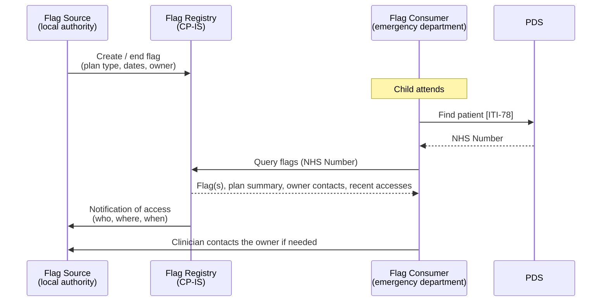

<b>Proof of concept.</b> This implementation guide is a demonstration only. It is
<b>not</b> an authoritative source, is not endorsed by NHS England, IHE or HL7, and
must not be used for implementation or clinical purposes.

A **patient flag** (alert) warns anyone caring for the patient of something they must
know before acting - a safeguarding plan, a needed adjustment, a risk. In care
coordination a flag often **points to a plan owned by someone else** and tells the
reader who to contact; it is not the plan itself.

<b>No IHE profile.</b> IHE has no profile for patient flags or flag registers. This page
combines general building blocks - FHIR <code>Flag</code> (HL7 IPS / EPS alerts), IHE
PDQm, mCSD, DCP and BALP - and assesses the NHS England Patient Flags Service against
them. <b>Draft</b>: the pattern below is a proposal, not a published standard.

### References

- [FHIR Flag](https://hl7.org/fhir/R4/flag.html) (R4)
- [HL7 IPS Flag - Alert](https://hl7.org/fhir/uv/ips/en/StructureDefinition-Flag-alert-uv-ips-definitions.html), [HL7 Europe Patient Summary - Flag](https://build.fhir.org/ig/hl7-eu/eps/StructureDefinition-flag-eu-eps-definitions.html) - the Alerts section (LOINC 104605-1, see [Templates](Templates.html))
- [Dynamic Care Planning (DCP)](DCP.html), [Care Services Directory (mCSD)](mCSD.html), [Patient Identity (PDQm)](PDQm.html)
- NHS England [Patient Flags Service](https://digital.nhs.uk/services/patient-flags-service) and [Child Protection - Information Sharing (CP-IS)](https://digital.nhs.uk/services/patient-flags-service/child-protection---information-sharing-cp-is) (checked 2026-11-02)
- [CP-IS SMSP API standards](https://digital.nhs.uk/developer/api-catalogue/child-protection---information-sharing-smsp-standards), [FGM-IS SMSP API standards](https://digital.nhs.uk/developer/api-catalogue/female-genital-mutilation---information-sharing-smsp-standards)
- PRSB [Information Provided by Local Authorities in Shared Care Records](https://theprsb.org/standards/localauthorityinformation) - see [PRSB Standards](PRSB.html)

### Kinds of Flag

| Kind | What the flag carries | Where the detail is | FHIR | Example |
|---|---|---|---|---|
| Plan pointer | That a plan exists, its type and dates, and who owns it | The owner's system - not shared | `Flag` + summary `CarePlan` (no content) | CP-IS child protection plan |
| Status | A legal or administrative status | The owner's system | `Flag` (code), optionally `Observation` | CP-IS looked-after child |
| Risk | A risk to be aware of | The owner's system, or none | `Flag` | FGM-IS (family history of FGM) |
| Need with content | The need and the adjustments to make | In the flag | `Flag` with detail, or `Flag` + `CarePlan` / `Observation` | Reasonable Adjustment Flag |
{:.grid}

### Flags and Care Plans

A plan-pointer flag is the "find" half of [Dynamic Care Planning](DCP.html): it says a
care plan exists and who holds it, without giving its content.

| Flag | DCP / FHIR |
|---|---|
| Plan type | `CarePlan.category` |
| Start and end | `CarePlan.period` (and `Flag.period`) |
| Owner and contacts | `CarePlan.author` / `careTeam`; contacts from the owner's [mCSD](mCSD.html) `Organization` / `HealthcareService` |
| Plan held by the owner | DCP Care Plan Service; summary found with Search for Care Plan [PCC-41] |
| Plan content | Retrieve Care Plan [PCC-38] - not offered to flag readers |
| Reason (e.g. a safeguarding concern) | `CarePlan.addresses` - **deliberately empty** when the reason is not shared |
{:.grid}

In FHIR R4, `Flag` cannot reference the plan without an extension; HL7 Europe notes its
extension "will be replaced by `Flag.supportingInfo`" in R6 - which extension to use in
R4 is **To confirm**. Until then the `Flag` and the `CarePlan` share `subject` and
`period`, and the `CarePlan` can be found by search.

### Actors (proposed)

| Actor | Role | DCP / IHE equivalent | NHS England (CP-IS) |
|---|---|---|---|
| Flag Source | Owns the plan or status; creates, updates and ends the flag | Care Plan Contributor / Care Plan Service | Local authority social care system |
| Flag Registry | Holds flags for a population; answers queries; records access | Care Plan Service (summary only) | CP-IS on Spine |
| Flag Consumer | Checks for flags when the patient presents; contacts the owner | Care Plan Contributor (read only), QEDm Clinical Data Consumer | Unscheduled care system (ED, urgent treatment centre, out of hours, ambulance) |
{:.grid}

### Process Flow

| Step | General standard | Notes |
|---|---|---|
| Find the patient | IHE PDQm [ITI-78] (PDS) | NHS Number is the key |
| Query flags | QEDm-style search: `GET [base]/Flag?patient={id}&status=active`, `GET [base]/CarePlan?patient={id}&category={code}` | QEDm does not list `Flag` - an extension of QEDm, **To confirm** |
| Owner's contacts | IHE mCSD [ITI-90] | Office hours and out-of-hours numbers as `telecom` / `availableTime` |
| Record access | IHE BALP (`AuditEvent`), ATNA | Who viewed which flag |
| Notify the owner | **No IHE transaction.** FHIR Subscription on access, or a message (e.g. an encounter / attendance notification to the care team) | DCP subscriptions [PCC-39/40] notify of **plan** changes, not of the patient's attendance |
| Create / update / end flag | DCP Update Care Plan [PCC-37] (plan summary); `Flag` create / update | |
{:.grid}

### NHS England Patient Flags Service

The [Patient Flags Service](https://digital.nhs.uk/services/patient-flags-service)
"records and shares safeguarding and accessibility information", meant to be "visible
wherever a patient receives care". It has three flags:

| Flag | What it is | Kind | Technology | Scope |
|---|---|---|---|---|
| [CP-IS](https://digital.nhs.uk/services/patient-flags-service/child-protection---information-sharing-cp-is) | Child protection plan, looked-after child, unborn child on a pre-birth plan; owner local authority | Plan pointer; status | HL7 V3 via Spine Mini Service Providers (SMSP), "a simplified read-only model and synchronous interactions", HSCN | Unscheduled care ("scheduled care and local authorities cannot currently use SMSP client access") |
| [FGM-IS](https://digital.nhs.uk/developer/api-catalogue/female-genital-mutilation---information-sharing-smsp-standards) | Girls under 18 with a family history of FGM | Risk | SMSP - **To confirm** details | NHS staff |
| Reasonable Adjustment Flag | A person's impairments and the adjustments they need | Need with content | **To confirm** | All care settings |
{:.grid}

#### CP-IS

From the [CP-IS SMSP standards](https://digital.nhs.uk/developer/api-catalogue/child-protection---information-sharing-smsp-standards):

- CP-IS holds per child: NHS Number, "plan details: type, start date and end date", the
  responsible local authority with office hours and emergency duty contact numbers, and
  the 25 most recent accesses from unscheduled care settings.
- A query "automatically triggers a notification to the relevant local authority" - the
  Flag Registry records access and notifies the Flag Source.
- CP-IS "does not store full social care or healthcare records" (NHS England CP-IS page) -
  the plan stays with the local authority.

| CP-IS | This page |
|---|---|
| Child protection plan | `Flag` + `CarePlan` (category child protection plan, `period`, `author` local authority, no `addresses`) |
| Looked-after child | `Flag` (status); the child's care plan is held by the local authority |
| Unborn child on a pre-birth plan | `Flag` and `CarePlan` with `subject` = the **mother**, moved to the baby's NHS Number after birth |
| Local authority contacts | mCSD `Organization` / `HealthcareService` `telecom` |
| Access history | `AuditEvent` (BALP) |
| Notification to the local authority | Subscription or message - no IHE equivalent |
{:.grid}

Points to note:

- **The reason is not shared.** Local authority guidance says the reason for the plan
  (e.g. the category of abuse) is not passed to the NHS
  ([Tameside](https://www.tameside.gov.uk/childprotection/cpis),
  [North Yorkshire](https://trixcms.trixonline.co.uk/api/assets/northyorkshirecs/878680c1-49c0-45bf-a45f-b551c702d2bc/cp-is-info.pdf));
  NHS England's pages do not say - **To confirm**. A CP-IS flag is **not** a
  `Condition`.
- **Pre-birth plans** show on the mother's record until 28 days after the expected
  delivery date, then the local authority closes the unborn plan and opens one on the
  baby's record (local authority guidance - **To confirm** against NHS England).
- **Unscheduled care only.** Scheduled care (e.g. a Referral Recipient in this guide)
  cannot use SMSP CP-IS access today, although a referral is also a point where the
  owner may need to know. Whether referrals should check flags is **Open**.

### In the Closed Loop

| Step | Use of flags |
|---|---|
| Referral Request [PCC-55] | The Referral Initiator **SHOULD NOT** copy a safeguarding flag's detail into the referral; the Recipient checks the registry itself (data sharing, not messaging - see [EU Health Data API](HealthDataAPI.html)) |
| Triage | Reasonable adjustments affect how the appointment is offered [PCC-60] |
| Referral Outcome [PCC-57] / discharge report | Alerts section (HDR / EPS `Flag`) for flags raised during care; nationally held flags are referenced, not copied |
{:.grid}

### HL7 v2

No HL7 v2 equivalent for querying flags (indicative). Flags are sometimes sent as
local `Z` segments or `OBX` in ADT; this is a **gap**.

### Gaps

- No IHE profile for flag registries; `Flag` is not in QEDm.
- No standard for notifying the flag owner on access (CP-IS does this in HL7 V3).
- FHIR R4 `Flag` cannot reference the `CarePlan` it points to without an extension.
- National flags are HL7 V3 / SMSP, not FHIR, and limited to unscheduled care -
  **To confirm** NHS England plans for a FHIR Patient Flags API.
