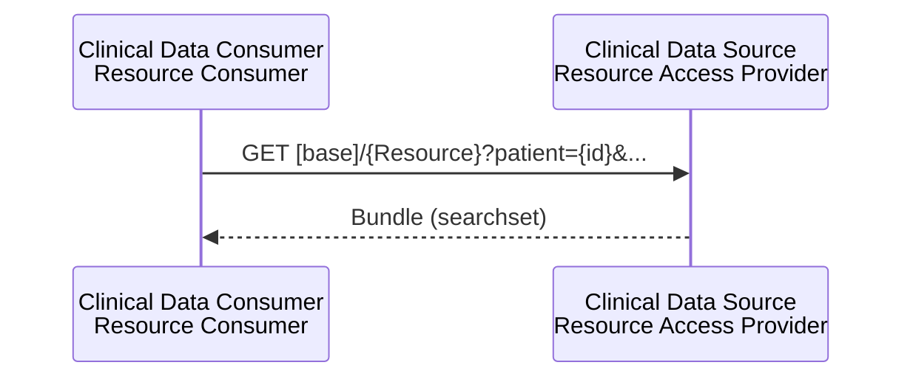

<b>Proof of concept.</b> This implementation guide is a demonstration only. It is
<b>not</b> an authoritative source, is not endorsed by NHS England, IHE or HL7, and
must not be used for implementation or clinical purposes.

**Mobile Query Existing Data [PCC-44]** (IHE QEDm) - a Clinical Data Consumer queries a
Clinical Data Source for structured data: problems, allergies, medications,
observations, results, immunisations, procedures and encounters. In the EU Health Data
API these are the Resource Consumer and Resource Access Provider.

Querying the record is <b>highly recommended</b> over sending it in the referral.
The referral carries the reason, the question and the Referral ID; the Recipient reads
the current record when it needs it. See <a href="HealthDataAPI.html">EU Health Data API</a>.

### References

- [IHE PCC QEDm](https://profiles.ihe.net/PCC/QEDm/index.html) 3.0.0 Trial Implementation (2024-12-12)
- [EU Health Data API](https://hl7.eu/fhir/health-data-api/1.0.0-ballot/en/) - Resource Access Provider / Resource Consumer (imports the HL7 IPA server)
- [HL7 International Patient Access (IPA)](https://hl7.org/fhir/uv/ipa/)
- [NW GMSA - Resource Access [IPA/QEDm]](https://nw-gmsa.github.io/en/QEDm.html)

### Interaction

| Actor | Health Data API | In the closed loop |
|---|---|---|
| Clinical Data Consumer | Resource Consumer | Referral Recipient triaging; virtual ward team; Referral Initiator reviewing an outcome |
| Clinical Data Source | Resource Access Provider | Shared care record, Single Patient Record (planned), GP record (GP Connect Access Record: Structured), trust EPR |
{:.grid}

### Find the Patient

The patient is found first by NHS Number (IHE PDQm / Health Data API `Patient` search):

GET [base]/Patient?identifier=https://fhir.nhs.uk/Id/nhs-number|9876543210

### Queries

Search parameters are those of the Health Data API Resource Access Provider.

| Use in the closed loop | Query |
|---|---|
| Active problems before triage | `GET [base]/Condition?patient={id}&clinical-status=active` |
| Allergies | `GET [base]/AllergyIntolerance?patient={id}&clinical-status=active` |
| Current medication | `GET [base]/MedicationStatement?patient={id}&status=active`, `GET [base]/MedicationRequest?patient={id}&status=active` |
| Recent results | `GET [base]/DiagnosticReport?patient={id}&date=ge2026-01-01`, `GET [base]/Observation?patient={id}&category=laboratory` |
| Vital signs and remote monitoring | `GET [base]/Observation?patient={id}&category=vital-signs&date=ge2026-10-06` |
| Physical activity (exercise referral) | `GET [base]/Observation?patient={id}&code=http://loinc.org|89574-8` |
| Recent hospital and virtual ward stays | `GET [base]/Encounter?patient={id}&date=ge2026-01-01` |
| Immunisations | `GET [base]/Immunization?patient={id}` |
{:.grid}

QEDm also covers procedures, which the Health Data API Resource Access Provider does
not list - **To confirm**.

### Expected Actions

- The Clinical Data Source returns the matching resources it holds and is allowed to
  share; an empty result does not mean the patient has none.
- The Clinical Data Consumer **SHOULD** show the source and date of each item. With the
  QEDm **Provenance Option** a resource can be traced to the document it came from (IHE
  mXDE), for example the medications in a [Discharge Report](StructureDefinition-DischargeReport.html).
- Data read through QEDm supports decisions; it is not filed into the consumer's record
  unless a clinician chooses to (reconciliation).

### Relationship to the Workflow

| 360X step | QEDm use |
|---|---|
| Referral Request [PCC-55] | Recipient reads problems, medications, allergies and results instead of receiving them; the referral's `supportingInfo` can **reference** the resources that matter |
| Triage, information requested | Recipient checks the record before asking the referrer |
| [Virtual ward](VirtualWards.html) monitoring | Care team reads observations from the monitoring platform or shared record |
| Referral Outcome [PCC-57] | Referrer reads the structured data behind the outcome (e.g. new diagnoses, medication changes) |
{:.grid}
