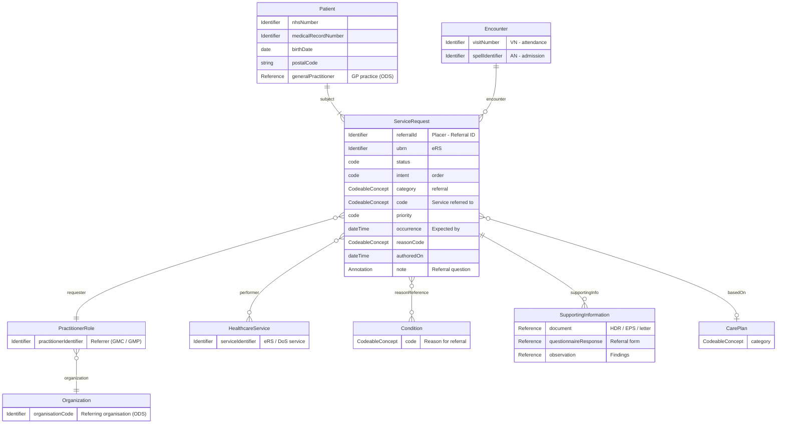
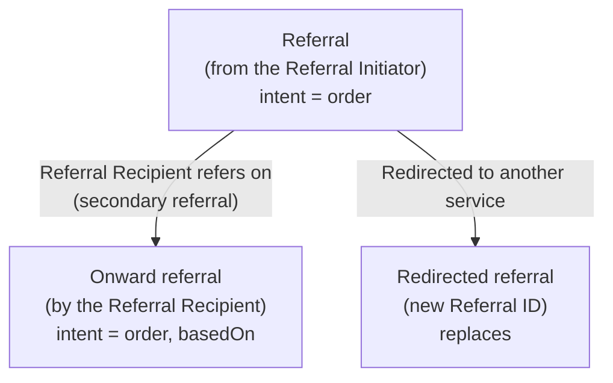

<b>Proof of concept.</b> This implementation guide is a demonstration only. It is
<b>not</b> an authoritative source, is not endorsed by NHS England, IHE or HL7, and
must not be used for implementation or clinical purposes.

The **referral** itself - the request sent by the Referral Initiator in
[Referral Request [PCC-55]](PCC-55.html) - as a domain model with `ServiceRequest` as the
main entity. It covers only what the referrer sends: the patient, where the referral was
made, who refers, who is asked, what for and why, and the supporting information. The
workflow that follows is **not** part of this model:

| Not in this model | Where it is |
|---|---|
| Accept, decline, cancel, status | [Referral Task](StructureDefinition-ReferralTask.html), [Referral Status](DataModel.html#referral-status) |
| Appointments and no-shows | [Referral Appointment](StructureDefinition-ReferralAppointment.html), [PCC-60](PCC-60.html) |
| Interim note and outcome | [Discharge Report](StructureDefinition-DischargeReport.html) model, [Referral Outcome Reports](Reports.html) |
{:.grid}

The same shape is used for **diagnostic orders**: the NW GMSA
[Genomic Test Order](https://nw-gmsa.github.io/en/Questionnaire-GenomicTestOrder.html)
is a `ServiceRequest` with the patient, hospital spell, requester and reason, plus a
specimen. A referral is that order without the specimen and with richer supporting
information. The [Clinical Referral](StructureDefinition-Referral.html) logical model
covers the whole closed loop; this page is its request part.

### References

- [FHIR ServiceRequest](https://hl7.org/fhir/R4/servicerequest.html) and [FHIR Workflow](https://hl7.org/fhir/R4/workflow.html)
- [IHE PCC 360X](https://www.ihe.net/uploadedFiles/Documents/PCC/IHE_PCC_Suppl_360X.pdf) - Referral Request [PCC-55], `OMG^O19`
- [NW GMSA - Genomic Test Order](https://nw-gmsa.github.io/en/Questionnaire-GenomicTestOrder.html) and [NW GMSA HL7 v2](https://nw-gmsa.github.io/en/hl7v2.html) conventions
- PRSB [Clinical Referral Information Standard](https://theprsb.org/standards/clinical-referral-information-standard/) v1.0 - clinical headings

### Domain Archetype

The entities a referral carries, with `ServiceRequest` at the centre:

### Referral Request

[FHIR Messaging](https://hl7.org/fhir/R4/messaging.html), following the
[Referral Order (O19)](MessageDefinition-referral-order.html) message definition, is the
FHIR format for sending this model; HL7 v2 `OMG^O19^OMG_O19` (360X) is the baseline
- see the [PCC-55 example](PCC-55.html#examples). The message is an aggregate: a
collection of FHIR resources sent together, in the same way that HL7 v2 groups segments.

#### Patient Demographics

<b>HL7 FHIR Profile:</b> <a href="StructureDefinition-Patient.html">Patient</a>

<b>HL7 v2 Segment:</b> <a href="https://nw-gmsa.github.io/en/hl7v2.html#pid">PID</a>

| Name | Value Set / Data Type | Cardinality | HL7 v2 OMG_O19 | HL7 FHIR ServiceRequest | HL7 FHIR Resource |
|---|---|---|---|---|---|
| NHS Number | [NHS Number](StructureDefinition-NHSIdentifier.html) | 0..1 | PID-3 | `ServiceRequest.subject.identifier` | [Patient](StructureDefinition-Patient.html) `identifier` |
| Medical Record Number | [Medical Record Number](StructureDefinition-MedicalRecordNumber.html) | 0..* | PID-3 | `ServiceRequest.subject.identifier` if no NHS Number | [Patient](StructureDefinition-Patient.html) `identifier` |
| Name | | 1..1 | PID-5 | | [Patient](StructureDefinition-Patient.html) `name` |
| Date of Birth | | 1..1 | PID-7 | | [Patient](StructureDefinition-Patient.html) `birthDate` |
| Postcode | | 0..1 | PID-11 | | [Patient](StructureDefinition-Patient.html) `address.postalCode` |
| Registered GP practice | [Organisation Code](StructureDefinition-OrganisationCode.html) | 0..1 | PD1-3 | | [Patient](StructureDefinition-Patient.html) `generalPractitioner` (Organization, ODS) |
{:.grid}

#### Encounter

<b>HL7 FHIR Profile:</b> <a href="StructureDefinition-Visit.html">Visit</a> or <a href="StructureDefinition-HospitalSpell.html">Hospital Spell</a>

<b>HL7 v2 Segment:</b> <a href="https://nw-gmsa.github.io/en/hl7v2.html#pv1">PV1</a>

The encounter in which the referral was made (a GP consultation, a clinic attendance or
an admission). Optional; required when a hospital refers onwards during an admission.
See [Patient Administration](PatientAdministration.html#identifiers).

| Name | Value Set / Data Type | Cardinality | HL7 v2 OMG_O19 | HL7 FHIR ServiceRequest | HL7 FHIR Resource |
|---|---|---|---|---|---|
| Visit Number | [Visit Number](StructureDefinition-VisitNumber.html) (type `VN`) | 0..1 | PV1-19 | `ServiceRequest.encounter.identifier` | [Visit](StructureDefinition-Visit.html) `identifier` |
| Account / Spell Number | [Hospital Provider Spell Identifier](StructureDefinition-HospitalProviderSpellIdentifier.html) (type `AN`) | 0..1 | PV1-19 (or PID-18) | `ServiceRequest.encounter.identifier` | [Hospital Spell](StructureDefinition-HospitalSpell.html) `identifier` |
{:.grid}

#### Referral

<b>HL7 FHIR Profile:</b> <a href="StructureDefinition-ReferralRequest.html">Referral Request</a> (ServiceRequest)

<b>HL7 v2 Segments:</b> <a href="https://nw-gmsa.github.io/en/hl7v2.html#orc">ORC</a>, OBR, TQ1

| Name | Value Set / Data Type | Cardinality | HL7 v2 OMG_O19 | HL7 FHIR ServiceRequest |
|---|---|---|---|---|
| Referral ID (Placer) | [Referral Identifier](StructureDefinition-ReferralIdentifier.html) | 1..1 | ORC-2, OBR-2 | `identifier:referralId` |
| UBRN | [UBRN](StructureDefinition-UniqueBookingReferenceNumber.html) | 0..1 | Not in 360X - **To confirm** | `identifier:ubrn` |
| Filler referral number | | 0..1 | ORC-3, OBR-3 | `identifier` (type `FILL`) - the Referral Recipient's reference |
| Status | | 1..1 | ORC-1 `NW` | `status` `active` |
| Intent | | 1..1 | - | `intent` `order` |
| Category | [Referral Category](ValueSet-referral-category.html) | 1..* | - | `category` |
| Service referred to | [Referral Service Type](ValueSet-referral-service-type.html) | 1..1 | OBR-4 | `code` |
| Priority | | 0..1 | TQ1-9 | `priority` |
| Expected by | | 0..1 | TQ1-8 | `occurrenceDateTime` |
| Date of referral | | 1..1 | ORC-9 | `authoredOn` |
| Referral question | | 0..1 | OBX-5 (OBX-11 `O`, OBX-29 `QST`) | `note` |
| Notes | | 0..* | NTE | `note` |
{:.grid}

#### Referrer

<b>HL7 FHIR Profile:</b> <a href="StructureDefinition-PractitionerRole.html">PractitionerRole</a>, <a href="StructureDefinition-Organization.html">Organization</a>

<b>HL7 v2 Segment:</b> <a href="https://nw-gmsa.github.io/en/hl7v2.html#orc">ORC</a>

| Name | Value Set / Data Type | Cardinality | HL7 v2 OMG_O19 | HL7 FHIR ServiceRequest | HL7 FHIR Resource |
|---|---|---|---|---|---|
| Referring clinician | [Practitioner Identifier](StructureDefinition-PractitionerIdentifier.html) (GMC, GMP) | 1..1 | ORC-12, OBR-16 | `requester` (PractitionerRole) | [PractitionerRole](StructureDefinition-PractitionerRole.html) `practitioner.identifier` |
| Referring organisation | [Organisation Code](StructureDefinition-OrganisationCode.html) | 1..1 | ORC-21 | `requester` (PractitionerRole) | [PractitionerRole](StructureDefinition-PractitionerRole.html) `organization.identifier` |
{:.grid}

ORC-12 and ORC-21 are mandatory in this guide - see [PCC-55](PCC-55.html#examples).

#### Referred To

<b>HL7 FHIR Profile:</b> <a href="StructureDefinition-HealthcareService.html">HealthcareService</a> or <a href="StructureDefinition-Organization.html">Organization</a>

<b>HL7 v2:</b> MSH-5 / MSH-6 (the destination of the message)

| Name | Value Set / Data Type | Cardinality | HL7 v2 OMG_O19 | HL7 FHIR ServiceRequest | HL7 FHIR Resource |
|---|---|---|---|---|---|
| Service | eRS service ID, Directory of Services ID or local service | 0..1 | MSH-5 | `performer` | [HealthcareService](StructureDefinition-HealthcareService.html) `identifier` |
| Organisation | [Organisation Code](StructureDefinition-OrganisationCode.html) | 0..1 | MSH-6 | `performer` | [Organization](StructureDefinition-Organization.html) `identifier` |
| Named clinician | [Practitioner Identifier](StructureDefinition-PractitionerIdentifier.html) | 0..1 | - | `performer` (PractitionerRole) | [PractitionerRole](StructureDefinition-PractitionerRole.html) |
{:.grid}

#### Reason for Referral

| Name | Value Set / Data Type | Cardinality | HL7 v2 OMG_O19 | HL7 FHIR ServiceRequest | HL7 FHIR Resource |
|---|---|---|---|---|---|
| Reason for referral | SNOMED CT (clinical finding, disorder) or text | 1..* | OBR-31 (or DG1-3) | `reasonCode` | - |
| Condition | SNOMED CT | 0..* | DG1 | `reasonReference` | `Condition` (where the problem is recorded) |
{:.grid}

#### Supporting Information

Clinical content is referenced, not copied into the referral - see
[Composition, Archetypes and Templates](Templates.html) and the
[BaRS review](BaRS.html#referral-clinical-document-or-patient-summary).

| Name | Value Set / Data Type | Cardinality | HL7 v2 OMG_O19 | HL7 FHIR ServiceRequest | HL7 FHIR Resource |
|---|---|---|---|---|---|
| Clinical document (referral letter, discharge report) | [Discharge Report](StructureDefinition-DischargeReport.html) model | 0..* | OBX (type `ED` / `RP`) or `MDM^T02` | `supportingInfo` | `Bundle` ([HL7 Europe HDR](https://hl7.eu/fhir/hdr/)) or `DocumentReference` |
| Patient summary | [Patient Summary](StructureDefinition-PatientSummary.html) model | 0..1 | OBX (type `ED` / `RP`) | `supportingInfo` | `Bundle` ([HL7 Europe EPS](https://hl7.eu/fhir/eps/1.0.0-ballot/)) or `DocumentReference` |
| Referral form | [Referral Forms](ReferralForms.html) | 0..* | OBX (ask at order entry) | `supportingInfo` | `QuestionnaireResponse` |
| Findings (e.g. vital signs) | [Observation](StructureDefinition-Observation.html) | 0..* | OBX | `supportingInfo` | `Observation` |
| Care plan this referral carries out | [Care Plan](StructureDefinition-PatientCarePlan.html) | 0..1 | - | `basedOn` | `CarePlan` |
{:.grid}

### Original, Onward and Redirected Referrals

A referral can give rise to others. Each is the same archetype, created by a different
actor:

| Relationship | FHIR | Note |
|---|---|---|
| Onward (secondary) referral | New `ServiceRequest` with `basedOn` the original | Reported to the original referrer in the plan of care of the outcome [PCC-57] |
| Redirected referral | New `ServiceRequest` (new Referral ID) with `replaces` the original | The original ends with Task `businessStatus` `redirected` |
| Referral to more than one service | One `ServiceRequest` each, sharing `requisition` | Equivalent to an order group |
{:.grid}

Example: [Referral Request - GP to cardiology](ServiceRequest-CardiologyReferral.html),
sent as [Referral Order (O19)](Bundle-ReferralOrderMessage.html).
