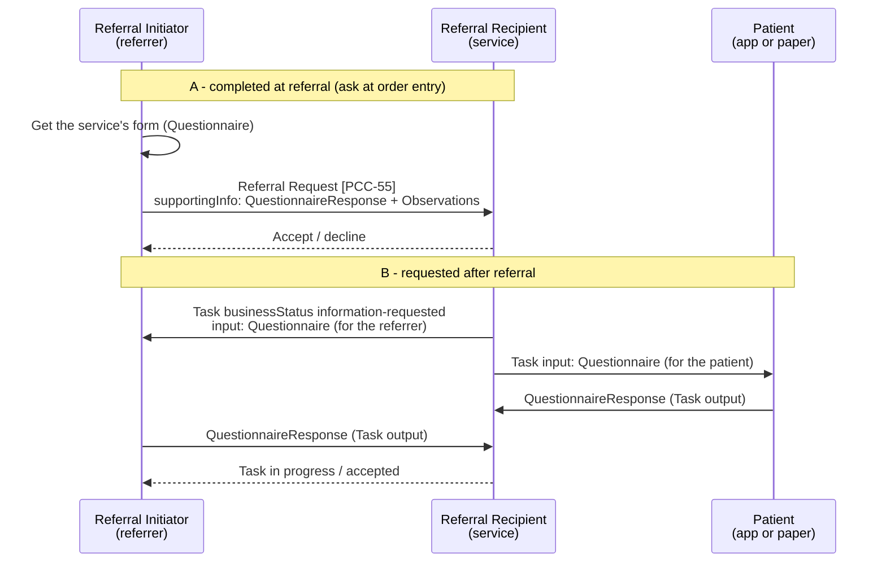

<b>Proof of concept.</b> This implementation guide is a demonstration only. It is
<b>not</b> an authoritative source, is not endorsed by NHS England, IHE or HL7, and
must not be used for implementation or clinical purposes.

Many services need a **form** completed as part of a referral: a pre-participation
screening such as the PAR-Q+ for exercise referral, eligibility criteria for a virtual
ward or weight management service, a cancer referral proforma, or the "ask at order
entry" questions on a genomic test order. The form is part of the referral's
**supporting information**. It is the same pattern wherever it appears, so this page
defines it once.

### References

- [HL7 Physical Activity IG - Referral Workflow](https://build.fhir.org/ig/HL7/physical-activity/workflow.html) (1.0.1 STU 1; continuous build checked 2026-11-01) - a recent FHIR referral workflow using ServiceRequest, Task, Observations and Subscription
- [HL7 Structured Data Capture (SDC)](https://build.fhir.org/ig/HL7/sdc/) - Questionnaire, form filling, [workflow](https://hl7.org/fhir/uv/sdc/workflow.html) and [data extraction](https://hl7.org/fhir/uv/sdc/extraction.html)
- [NW GMSA - Genomic Test Order](https://nw-gmsa.github.io/en/Questionnaire-GenomicTestOrder.html) - ask at order entry questionnaires for genomic test orders
- IHE LTW / 360X - ask at order entry and referral questions as OBX segments in the order (see [Referral Request [PCC-55]](PCC-55.html))
- [PAR-Q+ and ePARmed-X+](https://eparmedx.com/) - a validated physical activity readiness questionnaire; [terms and conditions](https://eparmedx.com/about/terms-and-conditions/) (checked 2026-11-01)

### Where Forms Appear

| Referral | Form | Completed by | When |
|---|---|---|---|
| Exercise on referral, physical activity, cardiac or pulmonary rehabilitation | Pre-participation screening (e.g. PAR-Q+), referrer's clinical details and medical clearance | Patient; referrer | Before the referral (referrer) and before the first session (patient) |
| [Virtual ward](VirtualWards.html) | Eligibility / acceptance criteria, baseline observations (e.g. NEWS2) | Referrer | At referral |
| Urgent suspected cancer | Tumour-site referral proforma | Referrer | At referral (often attached to the eRS referral today) |
| Genomic test | Ask at order entry questions | Referrer | At ordering ([NW GMSA](https://nw-gmsa.github.io/en/Questionnaire-GenomicTestOrder.html)) |
| Social prescribing, weight management, diabetes prevention | Eligibility, patient goals and preferences | Referrer; patient | At referral, or at the first contact |
| Any service | More information requested during triage | Referrer | After referral |
{:.grid}

### Two Patterns

| | A - Completed at referral | B - Requested after referral |
|---|---|---|
| Who asks | The service publishes the form; the referrer's system shows it when referring | The service, during triage or before the first contact |
| Who completes | Referrer | Patient, carer or referrer |
| 360X step | [Referral Request [PCC-55]](PCC-55.html) | Between Accept [PCC-55] and the first appointment [PCC-60]; or before accepting |
| FHIR | `ServiceRequest.supportingInfo` → `QuestionnaireResponse`, `Observation`; or `DocumentReference` (attached form) | [Referral Task](StructureDefinition-ReferralTask.html) `input` (`Questionnaire`) → `output` (`QuestionnaireResponse`); `businessStatus` `information-requested`, `status` `on-hold` until it is returned |
| HL7 v2 | OBX segments in `OMG^O19` (ask at order entry, as in LTW and the 360X referral question); OBX type ED for an attached PDF form | No 360X equivalent - **Open**; a returned form can be an `ORU^R01` or `MDM^T02` with the Referral ID |
| Example | [Referrer's form](QuestionnaireResponse-ExerciseReferralFormResponse.html) on the [exercise referral](ServiceRequest-ExerciseReferral.html) | [Form requested](Task-ExerciseReferralFormRequested.html), [patient's form](QuestionnaireResponse-ExercisePreParticipationResponse.html), [Task in progress](Task-ExerciseReferralInProgress.html) |
{:.grid}

### Form, Data or Attachment

A completed form can be sent three ways. In order of preference:

| Level | FHIR | HL7 v2 | Use |
|---|---|---|---|
| Data | `Observation` (and `Condition`), with `derivedFrom` the QuestionnaireResponse | OBX with coded OBX-3 (LOINC / SNOMED CT) | Answers the receiving system needs as data: vital signs, scores, activity level. Extracted from the form ([SDC extraction](https://hl7.org/fhir/uv/sdc/extraction.html)) |
| Form | `QuestionnaireResponse`, with `questionnaire` the service's canonical `Questionnaire` | OBX per question (ask at order entry) | The record of what was asked and answered, including free text and declarations |
| Attachment | `DocumentReference` with the form as PDF | OBX type ED (base64) or RP | Paper or PDF forms - the Document Messaging level, as eRS attachments are today |
{:.grid}

Send the **form and the data together**: the QuestionnaireResponse records what was
asked; the Observations make the answers usable (for example the blood pressure in
the [exercise referral](Observation-ExerciseReferralBloodPressure.html), or the
[Exercise Vital Sign](Observation-ExerciseVitalSignBaseline.html) baseline). Coding the
questions (`Questionnaire.item.code`) is what makes extraction possible.

### Publishing the Form

The Referral Recipient owns its form. It **SHOULD** publish it as a `Questionnaire`
with a canonical URL and version, so referrers' systems can render it and the response
can say which version was answered (`QuestionnaireResponse.questionnaire`). How a
service advertises its form - on its `HealthcareService` entry, in a service directory,
or with an `ActivityDefinition` / `PlanDefinition` for the service - is **Open**.

Example forms:
[referrer's form](Questionnaire-ExerciseReferralForm.html) and
[physical activity readiness](Questionnaire-ExercisePreParticipationForm.html), completed by the
patient ([response](QuestionnaireResponse-ExercisePreParticipationResponse.html)).

### Clinical Data Forms

General purpose forms for clinical data that referrals often need, with coded items so
the answers can be extracted as Observations:

| Form | Content | Source | Used with |
|---|---|---|---|
| [Vital Signs](Questionnaire-VitalSigns.html) | Oxygen saturation, weight, height, head circumference, temperature, blood pressure, heart and respiratory rate, BMI, pain score, level of consciousness, oxygen | Copied from [Virtually Healthcare](https://virtually-healthcare.github.io/Questionnaire-VitalSigns.html) (structure and codes unchanged) | Baseline observations for [virtual ward](VirtualWards.html) and exercise referrals; monitoring |
| [Social Context](Questionnaire-SocialContext.html) | Household composition, accommodation, occupation, education, lifestyle, smoking, alcohol, drug / substance use, social circumstances (including carers), access, dependants, household environment | [Virtually Healthcare](https://virtually-healthcare.github.io/Questionnaire-SocialContext.html), completed from the PRSB [Core Information Standard](https://theprsb.org/standards/core-information-standard/) v2.01 Social context section | Social prescribing, community, virtual ward and exercise referrals |
{:.grid}

The Social Context form follows the PRSB elements and their code sets: household
composition (SNOMED CT refset 1027891000000106), occupation (refset 999001571000000109),
smoking status (refset 999000891000000102, date ceased smoking 160625004), and the PRSB
alcohol and drug / substance use findings. Accommodation status (NHS Data Dictionary
ACCOMMODATION STATUS CODE) is free text until a FHIR code system is available -
**To confirm**. The PRSB "person completing the record", date and location for each
element map to `QuestionnaireResponse.author`, `authored` and the extracted Observations.

### Example: Physical Activity Readiness (PAR-Q+ Structure)

The patient's form follows the structure of the
[PAR-Q+ for individuals](https://eparmedx.com/) (2025), a widely used, validated
pre-participation screening:

| PAR-Q+ part | FHIR Questionnaire |
|---|---|
| Seven general health questions (yes / no), two with a list of conditions | `group` "general" with `boolean` items; the condition and medication lists are `string` items shown with `enableWhen` when the answer is yes |
| Follow-up questions about medical conditions, completed only if any general answer is yes | `group` "follow-up" with `enableBehavior` `any` and an `enableWhen` per general question |
| Ten condition sections, each with a yes / no and sub-questions answered only if yes | Nested `group` per condition, sub-questions with `enableWhen`; **one** section (cardiovascular) is included |
| Participant declaration (clearance valid for up to 12 months) | `group` "declaration": agreement, name, date |
| Outcome: cleared, or seek advice from a doctor or qualified exercise professional | Not encoded - an SDC calculated expression or the service's assessment |
{:.grid}

In the [example response](QuestionnaireResponse-ExercisePreParticipationResponse.html) the
patient (with coronary artery disease, on medication and not regularly active) answers yes
to two general questions and to the cardiovascular follow-up, so he should get advice from a
qualified exercise professional before becoming more active - which the exercise on
referral programme provides.

<b>Copyright.</b> The PAR-Q+ is copyright of the PAR-Q+ Collaboration. Its
<a href="https://eparmedx.com/about/terms-and-conditions/">terms</a> require prior written
authorisation to reproduce it outside permitted uses or to incorporate it into electronic
surveys, applications or other digital platforms. The example therefore follows the form's
<b>structure</b> only: item text is short descriptive labels, not the official wording, and
only one of the ten follow-up sections is included. A service using the PAR-Q+ in a FHIR
Questionnaire needs the Collaboration's permission and must use the official text.

### HL7 Physical Activity IG

The [Physical Activity IG](https://build.fhir.org/ig/HL7/physical-activity/workflow.html)
is a recent example of a referral workflow designed on the general FHIR standards. It
fits this guide's [FHIR RESTful Task](Transport.html#fhir-restful-task) option:

| Physical Activity IG | This guide |
|---|---|
| Care Manager - creates and owns the `ServiceRequest` | Referral Initiator |
| Full Service Provider (own FHIR endpoint) / Light Service Provider (records held on the Care Manager) | Referral Recipient - with or without its own FHIR server |
| Patient Engagement App | Patient completing forms and recording activity |
| `ServiceRequest` - "the official referral"; only its author updates it | [Referral Request](StructureDefinition-ReferralRequest.html) |
| `Task` - "to give the ability to accept or refuse, convey progress and link to results", even for directed referrals; several Tasks may solicit providers for one referral | [Referral Task](StructureDefinition-ReferralTask.html) - 360X is a directed referral (one recipient) |
| Task status `requested`, `accepted`, `rejected` (with reason), `on-hold`, `cancelled`, `failed`, `completed` | Task `status` with the 360X `businessStatus` - see [Referral Status](DataModel.html#referral-status) |
| Observations (exercise vital signs) pushed or queried | Progress observations in `Task.output` |
| PA Intervention Report - a `DiagnosticReport` (PDF) in `Task.output` | Referral Outcome [PCC-57] - [Consultation Note](StructureDefinition-ConsultationNote.html) or [Discharge Report](StructureDefinition-DischargeReport.html) |
| Subscription for new Tasks; email / SMS prompt for light participants | Event notification (FHIR Subscription, NHS MNS) |
| Cancel by setting the Task to `cancelled`; changes to the referral as Task notes | Referral Cancellation [PCC-58] |
{:.grid}

Differences to note: the Physical Activity IG is US realm; it solicits providers with
undirected Tasks, where 360X directs the referral to one recipient; and its outcome is
a DiagnosticReport rather than a clinical document. Its Questionnaire use is for
patient feedback; the form pattern above is this guide's addition.

### Clinical Process

| Clinical process | Form |
|---|---|
| Assessment | The referrer records the observations the form asks for |
| Implement | The form is sent with the referral (pattern A) |
| Start (service) | The service asks for the patient's form before the first contact (pattern B) |
| Evaluate | Progress observations (e.g. weekly activity) and the outcome report come back |
{:.grid}
