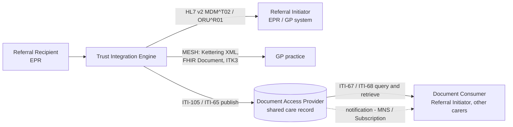

<b>Proof of concept.</b> This implementation guide is a demonstration only. It is
<b>not</b> an authoritative source, is not endorsed by NHS England, IHE or HL7, and
must not be used for implementation or clinical purposes.

The report back - consultation note, clinic letter or discharge summary - is what
closes the loop. This page describes the report content and the ways of delivering it,
from the MESH and HL7 v2 messaging most trusts use today to document sharing through
the EU Health Data API.

### References

- [HL7 Europe Hospital Discharge Report (HDR)](https://hl7.eu/fhir/hdr/) - 1.0.0 STU 1 (2026-10-16)
- [EU Health Data API](https://hl7.eu/fhir/health-data-api/1.0.0-ballot/en/) - 1.0.0-ballot (2026-03-13)
- [IHE ITI Mobile access to Health Documents (MHD)](https://profiles.ihe.net/ITI/MHD/index.html)
- [Transfer of Care](https://digital.nhs.uk/services/transfer-of-care-initiative), [PRSB standards](https://theprsb.org/standards/)
- [NW GMSA - Health Data API](https://nw-gmsa.github.io/en/HIE.html), [Document Exchange (MHD)](https://nw-gmsa.github.io/en/MHD.html), [Message Exchange](https://nw-gmsa.github.io/en/MQ.html)

### Report Types

| Situation | 360X transaction | Report | Profile |
|---|---|---|---|
| Outpatient clinic, results so far | Interim Consultation Note [PCC-59] | Clinic letter | [Consultation Note](StructureDefinition-ConsultationNote.html) |
| Outpatient care finished, patient discharged to the referrer | Referral Outcome [PCC-57] | Clinic (discharge) letter | [Consultation Note](StructureDefinition-ConsultationNote.html) |
| Inpatient or virtual ward stay ended | Referral Outcome [PCC-57] | Discharge summary | [Discharge Report](StructureDefinition-DischargeReport.html) (HL7 Europe HDR) |
| Continued care (no end of care) | Referral Outcome [PCC-57] | Care plan | `CarePlan` - see [Dynamic Care Planning](DCP.html) |
| Test or examination | LAB-3, RAD-128 | Diagnostic report | See [Cancer Pathology Report](https://kevinmayfield.github.io/CancerPathologyReport/) and [Enterprise Imaging](https://kevinmayfield.github.io/Imaging/) |
{:.grid}

Each report **SHALL** reference the referral it answers, by the Referral ID (and the
UBRN if eRS was used):

| Format | Where the referral reference goes |
|---|---|
| FHIR Document | `Composition.extension[basedOn]` ([event-basedOn](https://hl7.org/fhir/extensions/StructureDefinition-event-basedOn.html), as in HDR) |
| FHIR DocumentReference | `DocumentReference.context.related` (the `ServiceRequest`) - **To confirm** against the Health Data API |
| HL7 v2 `MDM^T02` | TXA-12 unique document number for the letter; referral in ORC-2 / OBR-2 if present, or TXA-22 - **To confirm** |
| HL7 v2 `ORU^R01` / `OSU^O51` (360X) | ORC-2 Referral ID |
| Kettering XML | Not supported - **To confirm** |
| GP Connect Send Document / Update Record | **To confirm** |
| IM1 | Supplier-specific - write the Referral ID / UBRN with the document if the API allows |
{:.grid}

### HL7 Europe Hospital Discharge Report

HDR is a FHIR Document (`Bundle` of type `document`) whose first entry is a
`Composition` with sections for the hospital stay. It is built on HL7 Europe Base and
the International Patient Summary, and is one of the European Electronic Health Record
exchange Format (EEHRxF) priority categories. It is the most likely successor to the
Transfer of Care eDischarge document.

| HDR section (LOINC) | Transfer of Care / PRSB heading (indicative) |
|---|---|
| Alerts (104605-1) | Safety alerts |
| Admission evaluation (67851-6) | Presenting complaints or issues, clinical summary |
| Hospital course (8648-8) | Clinical summary |
| Diagnostic summary (11535-2) | Diagnoses |
| Significant procedures (10185-7) | Procedures |
| Significant results (30954-2) | Investigations and results |
| Pharmacotherapy (87232-5) | Medications and medical devices |
| Discharge medications (75311-1) | Medications and medical devices - discharge |
| Allergies (48765-2) | Allergies and adverse reactions |
| Problems (11450-4) | Problem list |
| Functional status (47420-5) | Social context, functional status |
| Plan of care (18776-5) | Plan and requested actions |
| Discharge details (8650-4) | Discharge details |
| Attachments (77599-9) | - |
{:.grid}

The heading mapping is indicative only - **To confirm** against the PRSB eDischarge
standard. This guide's [Discharge Report](StructureDefinition-DischargeReport.html)
derives from HDR and adds one rule: `basedOn` **SHALL** reference the referral.

**HDR is for inpatient stays.** HDR's `Encounter` only allows inpatient classes
(`IMP`, `ACUTE`, `NONAC`, `OBSENC`, `SS`) and its `Composition.type` is fixed to
LOINC 34105-7 (Hospital Discharge Summary). It does not fit an outpatient clinic
letter, so this guide uses a separate [Consultation Note](StructureDefinition-ConsultationNote.html)
(LOINC 11488-4) with HDR-style sections. A virtual ward stay is treated as an
inpatient stay so it can use HDR - see [Virtual Wards](VirtualWards.html).

Example: [Virtual ward discharge report](Bundle-VirtualWardDischargeReport.html).

### Delivering the Report

| Pattern | Standard | When |
|---|---|---|
| Document Messaging (push) | HL7 v2 `MDM^T02` (document with ED / RP OBX), `ORU^R01`; FHIR Message with the document; Kettering XML, ITK3 or GP Connect Send Document over MESH | Default - the report must reach the referrer. Matches 360X, which pushes the outcome to the Referral Initiator |
| Document Sharing (publish and query) | EU Health Data API / IHE MHD (ITI-105 Simplified Publish, ITI-65 Provide Document Bundle, ITI-67 Find Document References, ITI-68 Retrieve Document) | So other carers can find the report later; shared care records |
| Event Notification | NHS MNS, FHIR Subscription | Tell the referrer a report has been published, instead of pushing it |
{:.grid}

360X pushes the outcome to the Referral Initiator. Document sharing does not replace
that: a published document only closes the loop if the referrer is notified or
queries for it.

### From Document Messaging to Document Sharing

See also [EU Health Data API](HealthDataAPI.html) and [Document Sharing [MHD]](MHD.html).

The [EU Health Data API](https://hl7.eu/fhir/health-data-api/1.0.0-ballot/en/) defines
the actors for sharing documents and resources, based on IHE MHD, PDQm and HL7 IPA:

| Health Data API actor | Role in the closed loop | Typical NHS system |
|---|---|---|
| Document Publisher | Referral Recipient publishes the consultation note or discharge report | Trust Integration Engine (from HL7 v2 `MDM^T02`) |
| Document Access Provider | Stores and serves documents (`DocumentReference`, `Binary`) | Shared care record, EDMS, NRL (pointer only) |
| Document Consumer | Referral Initiator, or anyone else caring for the patient, finds and reads reports | GP system, EPR, clinical portal |
| Resource Access Provider | Serves the structured content (Conditions, CarePlans, results) | Shared care record, data platform |
| Resource Consumer | Reads structured data, e.g. the care plan | EPR, care coordination system |
{:.grid}

The Health Data API `DocumentReference` derives from the IHE MHD Minimal
DocumentReference. A Kettering XML envelope or an HL7 v2 `MDM^T02` maps onto it
directly (patient, type, date, author, attachment), so a trust already sending letters
by MESH can publish the same letters with little extra mapping.

**Open:** the Health Data API discharge report document type value set uses LOINC
18842-5 (Discharge summary), while HDR fixes `Composition.type` to 34105-7 (Hospital
Discharge Summary). Which code should `DocumentReference.type` carry?

### HL7 v2 Report Messages

Most trust EPRs already produce HL7 v2 for letters:

| Message | Use | Notes |
|---|---|---|
| `MDM^T02` Original document notification and content | Clinic letter, discharge summary | TXA document metadata; content in OBX (type ED, base64 PDF, or RP pointer). See [NW GMSA HL7 v2](https://nw-gmsa.github.io/en/hl7v2.html) |
| `ORU^R01` | Reports, sometimes letters | As used for pathology and imaging; NW GMSA uses ORU for hospital reports |
| `OSU^O51` | 360X status update sent with the outcome | ORC-1 SC, ORC-5 CM (outcome) or A (interim) |
{:.grid}

A Trust Integration Engine (or regional orchestration engine) can turn either into a
FHIR Document Message, a Kettering XML MESH message, or an ITI-105 publish. The
referral identifier must be carried through each step.
