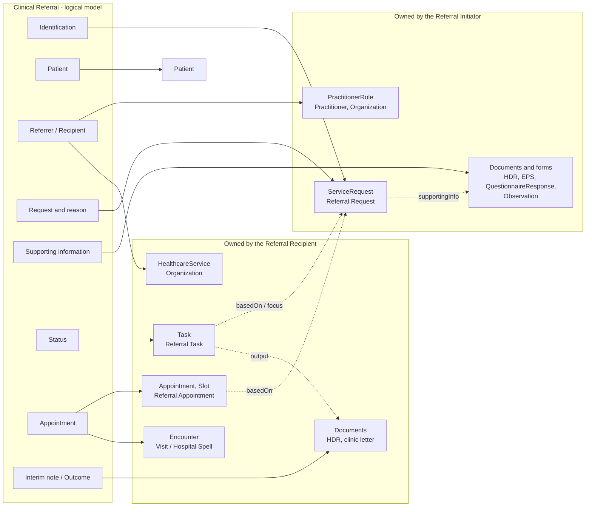

<b>Proof of concept.</b> This implementation guide is a demonstration only. It is
<b>not</b> an authoritative source, is not endorsed by NHS England, IHE or HL7, and
must not be used for implementation or clinical purposes.

### From Logical Model to Implementation Model

This logical model says **what** information a closed loop referral carries. An
implementation splits it into FHIR resources, each **owned** by one side of the
exchange, and sends them by one of the [Exchange Options](Transport.html). The
**Mappings** tab gives the element-level mapping; this section shows the breakdown.

**Next:** the [Clinical Referral Domain Model](ReferralDomainModel.html) goes into more
detail on how the bulk of this model - the request: `ServiceRequest` and what it
references - is implemented, field by field, in FHIR and HL7 v2.

### Breakdown

| Logical model | Implementation resource (profile) | Elements | Owned and updated by |
|---|---|---|---|
| `referralId`, `ubrn` | `ServiceRequest` ([Referral Request](StructureDefinition-ReferralRequest.html)) | `identifier:referralId` ([Referral Identifier](StructureDefinition-ReferralIdentifier.html), type `PLAC`, assigner ODS code), `identifier:ubrn` | Referral Initiator. Every other resource refers to the referral by this identifier (`basedOn.identifier`) |
| `patient` | `Patient` ([Patient](StructureDefinition-Patient.html)) | `ServiceRequest.subject`; `Task.for` | Referral Initiator sends it with the request; afterwards the patient is known to both sides and referenced by NHS Number (`for.identifier`) |
| `referrer` | `PractitionerRole` ([PractitionerRole](StructureDefinition-PractitionerRole.html)), with `Practitioner` and `Organization` | `ServiceRequest.requester`, `Task.requester` - professional code and ODS code | Referral Initiator |
| `recipient` | `HealthcareService` (eRS service ID, Directory of Services ID) or `Organization` | `ServiceRequest.performer` (who is asked), `Task.owner` (who has taken it on) | Referral Initiator chooses; Referral Recipient confirms as `Task.owner` |
| `serviceRequested`, `priority`, `expectedBy`, `reasonForReferral`, `referralQuestion`, `dateOfReferral` | `ServiceRequest` | `code`, `priority`, `occurrenceDateTime`, `reasonCode` / `reasonReference`, `note`, `authoredOn` | Referral Initiator |
| `validityPeriod` | `Task` ([Referral Task](StructureDefinition-ReferralTask.html)) | `restriction.period` | Referral Initiator sets; Referral Recipient works within it |
| `clinicalDocument`, `patientSummary`, `forms`, `observations` | `Bundle` (FHIR Document - [HL7 Europe HDR](https://hl7.eu/fhir/hdr/), [EPS](https://hl7.eu/fhir/eps/1.0.0-ballot/)) or `DocumentReference`; `QuestionnaireResponse`; `Observation` ([Observation](StructureDefinition-Observation.html)) | `ServiceRequest.supportingInfo` | Referral Initiator - see the [Discharge Report](StructureDefinition-DischargeReport.html) and [Patient Summary](StructureDefinition-PatientSummary.html) models and [Referral Forms](ReferralForms.html) |
| `carePlan` | `CarePlan` ([Care Plan](StructureDefinition-PatientCarePlan.html)) | `ServiceRequest.basedOn` | Whoever owns the plan - see [Care Plan and Execution](StructureDefinition-CarePlanModel.html) |
| `status`, `statusReason` | `Task` ([Referral Task](StructureDefinition-ReferralTask.html)) | `status`, `businessStatus` ([Referral Workflow Status](CodeSystem-referral-workflow-status.html)), `statusReason` | Referral Recipient (the Referral Initiator only requests a cancellation) - see [Referral Status](DataModel.html#referral-status) |
| `appointment` | `Appointment` ([Referral Appointment](StructureDefinition-ReferralAppointment.html)), `Slot`; `Encounter` ([Visit](StructureDefinition-Visit.html) or [Hospital Spell](StructureDefinition-HospitalSpell.html)) | `Appointment.basedOn`, `start`, `status`; `Encounter.basedOn`; `Task.output` | Referral Recipient (or the Referral Initiator when booking through eRS) - see [Appointment Booking](360X.html#appointment-booking) |
| `interimNote`, `outcome` | `Bundle` (FHIR Document - [HL7 Europe HDR](https://hl7.eu/fhir/hdr/), or a clinic letter) or `DocumentReference` | `Task.output` (linked to the referral through the Task, not inside the document) | Referral Recipient - see [Referral Outcome Reports](Reports.html) |
{:.grid}

### How the Pieces Travel

The same resources are exchanged differently depending on the [exchange option](Transport.html):

| Step | FHIR REST | FHIR Messaging | HL7 v2 (360X) | Document sharing |
|---|---|---|---|---|
| Referral Request [PCC-55] | Create `ServiceRequest` and `Task` (status `requested`) on the recipient's or a shared server | [Referral Order (O19)](MessageDefinition-referral-order.html): `MessageHeader`, `ServiceRequest`, `Patient`, `PractitionerRole`, supporting resources | `OMG^O19`: PID, ORC (ORC-2 Referral ID, ORC-12, ORC-21), TQ1, OBR, OBX, NTE | Supporting documents published; `ServiceRequest.supportingInfo` references them |
| Accept, decline, cancel, status | Update `Task` | [Referral Order Status (O51)](MessageDefinition-referral-order-status.html): `MessageHeader`, `Task` only - patient, referrer and recipient by identifier | `OSU^O51`: PID, ORC (ORC-1 / ORC-5) | - |
| Appointment [PCC-60], [PCC-61] | Create / update `Appointment` | O51 with the `Appointment` in `Task.output` | `SIU^S12` / `S13` / `S15` / `S26` | - |
| Interim note [PCC-59], outcome [PCC-57] | Create document; update `Task.output` | O51 with the document `Bundle` | `OSU^O51` and `MDM^T02` (TXA-14 Referral ID) | [MHD](MHD.html) Provide Document Bundle; `DocumentReference.context.related` the referral |
{:.grid}

Rules that hold whatever the exchange option:

- The **Referral ID** is in every message and every resource that refers to the referral.
- The **Referral Initiator** owns the request (`ServiceRequest`); the **Referral Recipient**
  owns the work (`Task`, `Appointment`, `Encounter`) and the documents it writes.
- **Clinical content travels as documents** (HDR, EPS, forms), referenced from the
  referral, so they can also be shared through an API instead of being sent
  ([EU Health Data API](HealthDataAPI.html)).

Example: the GP to cardiology referral -
[Referral Request](ServiceRequest-CardiologyReferral.html),
[Referral Task - Accepted](Task-CardiologyReferralAccepted.html),
[Appointment](Appointment-CardiologyAppointment.html),
[Referral Task - Completed](Task-CardiologyReferralCompleted.html), and as messages
[Referral Order (O19)](Bundle-ReferralOrderMessage.html) and
[Referral Order Status (O51), accepted](Bundle-ReferralOrderStatusAcceptMessage.html).
