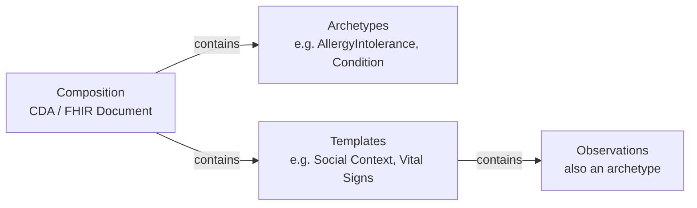
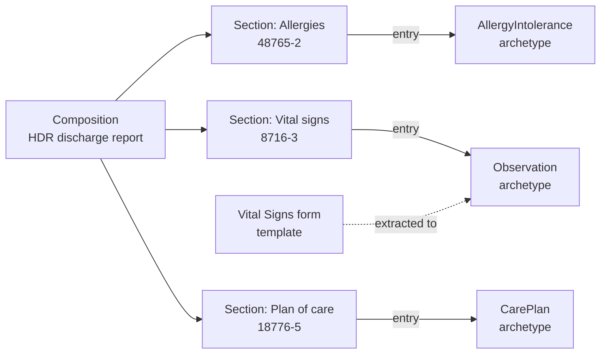
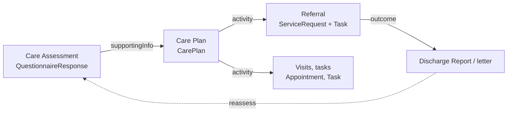

<b>Proof of concept.</b> This implementation guide is a demonstration only. It is
<b>not</b> an authoritative source, is not endorsed by NHS England, IHE or HL7, and
must not be used for implementation or clinical purposes.

<b>Note for developers.</b> Composition, archetypes and templates are key structures
in clinical informatics.
<ul>
<li><b>Templates</b> are often collections of <code>Observation</code>s - the questions
and answers in data entry forms.</li>
<li><b>Archetypes</b> are quite similar to how data is often persisted in databases or
shared between EHR systems.</li>
<li><b>Compositions</b> are CDA or FHIR Documents. They are often used in regional and
national data sharing, especially around IHE XDS systems. In hospital and regional
systems they are often in PDF or structured text form (a FHIR
<code>DocumentReference</code> + <code>Binary</code>).</li>
</ul>
This kind of structure can also be called a (Domain-Driven Design) <b>aggregate</b>.

A Composition contains archetypes and templates; templates contain Observations (which
are also archetypes).

Clinical information is built in these layers:

| Layer | What it is | Example | Sources used here |
|---|---|---|---|
| **Composition** | A document: a set of templates and archetypes for one purpose, attested and shared as a whole | Discharge summary, outpatient letter, patient summary | HL7 Europe HDR / EPS; CDA; `DocumentReference` + `Binary` (PDF) |
| **Archetype** | The definition of one clinical concept, independent of where it is used | An allergy, a blood pressure, a referral, a care plan | NHS England [FDP Canonical Data Model](https://cdm.solutionexchange.federateddataplatform.nhs.uk/) (CDM) objects; FHIR resources |
| **Template** | A reusable set of archetypes for a purpose - a section of a document or record | PRSB "Allergies and adverse reactions", "Social context" | PRSB standards; HL7 Europe HDR / EPS sections |
| **Form** | A template captured as questions answered at one time | Social Context, Vital Signs, Care Assessment | `Questionnaire` / `QuestionnaireResponse` |
{:.grid}

PRSB standards are built from the same **sections** used again and again - patient
demographics, allergies, social context, plan and requested actions. Each section is a
reusable **template**. Some map directly to FHIR resources; others are captured as
**forms**. This page lists the repeating templates found in ten PRSB standards, the
matching NHS FDP Canonical Data Model objects (the archetypes) and the forms in this
guide.

### Compositions: HDR and Patient Summary

<b>Important.</b> The Hospital Discharge Report and the Patient Summary are expected to
be key structures in the NHS England <b>Single Patient Record</b> (SPR). This is the
authors' expectation, not a published NHS England position - <b>To confirm</b>.

The two documents (compositions) used in this guide show the layers. Each `Composition`
has coded **sections**; each section's `entry` holds the **archetypes** (FHIR
resources) and its `text` holds the narrative. Some sections are filled from a
**template** captured as a form. The PRSB section is the matching heading in the PRSB
standard for that document.

#### HL7 Europe Hospital Discharge Report

[HL7 Europe HDR](https://hl7.eu/fhir/hdr/) 1.0.0 `composition-eu-hdr` (document type
LOINC 34105-7); all sections are optional. Outpatient letters use the same section codes
on a plain `Composition` (see the [Discharge Report](StructureDefinition-DischargeReport.html)
model). PRSB: eDis = [Transfer of Care - Acute Inpatient Discharge](https://theprsb.org/standards/edischargesummary)
v2.1, OPL = [Outpatient Letter](https://theprsb.org/standards/outpatientletterstandard) v2.2.

| HDR section (LOINC) | Archetypes - section entries (FHIR) | FDP CDM object (archetype) | PRSB section | Template / form in this guide |
|---|---|---|---|---|
| Alerts (104605-1) | `Flag`, `DocumentReference` | [Patient Alert](https://cdm.solutionexchange.federateddataplatform.nhs.uk/1.0.0/object/PatientAlert) | Safety alerts (eDis, OPL) | - |
| Admission evaluation (67851-6) | Any resource (narrative) | [Admission](https://cdm.solutionexchange.federateddataplatform.nhs.uk/1.0.0/object/Admission) | Admission details - reason for admission (eDis); History (OPL) | - |
| Patient history (11329-0) | Any resource (narrative) | - | - **To confirm** | - |
| Vital signs (8716-3) | `Observation` (vital signs), `DocumentReference` | [Observation](https://cdm.solutionexchange.federateddataplatform.nhs.uk/1.0.0/object/Observation) | Examination findings (OPL) | [Vital Signs](Questionnaire-VitalSigns.html) |
| Physical findings (29545-1) | `Observation`, `DocumentReference` | [Finding](https://cdm.solutionexchange.federateddataplatform.nhs.uk/1.0.0/object/Finding) | Examination findings (OPL) **To confirm** | - |
| Functional status (47420-5) | `Condition`, `ClinicalImpression`, `Observation`, `QuestionnaireResponse`, `DocumentReference` | [Scored Assessment](https://cdm.solutionexchange.federateddataplatform.nhs.uk/1.0.0/object/ScoredAssessment), [Disability](https://cdm.solutionexchange.federateddataplatform.nhs.uk/1.0.0/object/Disability) | Assessments (eDis); Assessment scales (OPL) | [Care Assessment](Questionnaire-CareAssessment.html) **To confirm** |
| Discharge summary (18842-5) | Any resource (narrative) | [Clinical Note](https://cdm.solutionexchange.federateddataplatform.nhs.uk/1.0.0/object/ClinicalNote) | Clinical summary (eDis) | - |
| Course of the stay (8648-8) | Any resource (narrative) | [Ward Stay](https://cdm.solutionexchange.federateddataplatform.nhs.uk/1.0.0/object/WardStay) | Clinical summary (eDis, OPL) | - |
| Diagnoses (11535-2) | `Condition` | [Patient Diagnosis](https://cdm.solutionexchange.federateddataplatform.nhs.uk/1.0.0/object/PatientDiagnosis), [Comorbidity](https://cdm.solutionexchange.federateddataplatform.nhs.uk/1.0.0/object/Comorbidity) | Diagnoses (eDis, OPL); Problems and issues (OPL) | - |
| Significant procedures (10185-7) | `Procedure` | [Procedure](https://cdm.solutionexchange.federateddataplatform.nhs.uk/1.0.0/object/Procedure) | Procedures (eDis, OPL) | - |
| Medical devices (46264-8) | `DeviceUseStatement`, `Procedure`, `DocumentReference` | - | Medications and medical devices (eDis, OPL) | - |
| Implanted devices (57080-4) | `DeviceUseStatement`, `Procedure` | - | Medications and medical devices (eDis, OPL) | - |
| History of procedures (47519-4) | `Procedure`, `DocumentReference` | [Procedure](https://cdm.solutionexchange.federateddataplatform.nhs.uk/1.0.0/object/Procedure) | Procedures (OPL) **To confirm** | - |
| Medicines during the stay (87232-5) | `MedicationStatement`, `MedicationRequest`, `MedicationDispense`, `MedicationAdministration` | - (none in v1.0.0) | Medications and medical devices - discontinued (eDis) | - |
| Significant results (30954-2) | `Observation`, `DiagnosticReport`, `DocumentReference` | [Test Result](https://cdm.solutionexchange.federateddataplatform.nhs.uk/1.0.0/object/TestResult), [Radiology Exam](https://cdm.solutionexchange.federateddataplatform.nhs.uk/1.0.0/object/RadiologyExam), [Histology](https://cdm.solutionexchange.federateddataplatform.nhs.uk/1.0.0/object/Histology) | Investigation results (eDis, OPL) | - |
| Clinical synthesis (67781-5) | Any resource (narrative) | [Clinical Note](https://cdm.solutionexchange.federateddataplatform.nhs.uk/1.0.0/object/ClinicalNote) | Clinical summary (eDis, OPL) | - |
| Plan of care (18776-5) | `CarePlan`, `DocumentReference` | [Community Care Plan](https://cdm.solutionexchange.federateddataplatform.nhs.uk/1.0.0/object/CommunityCarePlan) | Plan and requested actions; Information and advice given (eDis, OPL) | [Care Plan](StructureDefinition-PatientCarePlan.html) |
| Medicines on discharge (75311-1) | `MedicationRequest`, `MedicationDispense`, `MedicationStatement` | - (none in v1.0.0) | Medications and medical devices (eDis, OPL) | - |
| Allergies (48765-2) | `AllergyIntolerance`, `DocumentReference` | [Patient Allergy](https://cdm.solutionexchange.federateddataplatform.nhs.uk/1.0.0/object/PatientAllergy) | Allergies and adverse reactions (eDis, OPL) | - |
| Problems (11450-4) | `Condition`, `DocumentReference` | [Patient Diagnosis](https://cdm.solutionexchange.federateddataplatform.nhs.uk/1.0.0/object/PatientDiagnosis) | Problems and issues (OPL) **To confirm** | - |
| Immunisations (11369-6) | `Immunization`, `DocumentReference` | - | - | - |
| Discharge details (8650-4) | Any resource (narrative) | [Admission](https://cdm.solutionexchange.federateddataplatform.nhs.uk/1.0.0/object/Admission) | Discharge details (eDis) | - |
| Attachments (77599-9) | `DocumentReference`, `Binary` | [Clinic Letter](https://cdm.solutionexchange.federateddataplatform.nhs.uk/1.0.0/object/ClinicLetter) | - | - |
{:.grid}

Document header, not sections: Person completing record → `Composition.author`;
Distribution list → `informationRecipient` extension; Patient demographics and GP
practice → `Composition.subject` (`Patient`); Admission / attendance details →
`Composition.encounter`. No HDR section: Social context, Individual requirements,
Legal information, Participation in research, Person and carer concerns (narrative or
the Patient Summary - **To confirm**).

#### HL7 Europe Patient Summary

[HL7 Europe EPS](https://hl7.eu/fhir/eps/1.0.0-ballot/) follows the
[IPS](https://hl7.org/fhir/uv/ips/) sections; checked here against IPS 2.0.1
`Composition-uv-ips` (document type LOINC 60591-5) - EPS differences **To confirm**.
Problems, allergies and medications are required (1..1). PRSB: CIS =
[Core Information Standard](https://theprsb.org/standards/core-information-standard/)
v2.01. See the [Patient Summary](StructureDefinition-PatientSummary.html) model.

| EPS / IPS section (LOINC) | Archetypes - section entries (FHIR) | FDP CDM object (archetype) | PRSB CIS section | Template / form in this guide |
|---|---|---|---|---|
| Problems (11450-4) **required** | `Condition`, `DocumentReference` | [Patient Diagnosis](https://cdm.solutionexchange.federateddataplatform.nhs.uk/1.0.0/object/PatientDiagnosis), [Comorbidity](https://cdm.solutionexchange.federateddataplatform.nhs.uk/1.0.0/object/Comorbidity) | Problem list | - |
| Allergies and intolerances (48765-2) **required** | `AllergyIntolerance`, `DocumentReference` | [Patient Allergy](https://cdm.solutionexchange.federateddataplatform.nhs.uk/1.0.0/object/PatientAllergy) | Allergies and adverse reactions | - |
| Medication summary (10160-0) **required** | `MedicationStatement`, `MedicationRequest`, `MedicationAdministration`, `MedicationDispense`, `DocumentReference` | - (none in v1.0.0) | Medications and medical devices | - |
| Immunisations (11369-6) | `Immunization`, `DocumentReference` | - | Vaccinations | - |
| Results (30954-2) | `Observation`, `DiagnosticReport`, `DocumentReference` | [Test Result](https://cdm.solutionexchange.federateddataplatform.nhs.uk/1.0.0/object/TestResult), [Radiology Exam](https://cdm.solutionexchange.federateddataplatform.nhs.uk/1.0.0/object/RadiologyExam), [Histology](https://cdm.solutionexchange.federateddataplatform.nhs.uk/1.0.0/object/Histology) | Investigation results | - |
| History of procedures (47519-4) | `Procedure`, `DocumentReference` | [Procedure](https://cdm.solutionexchange.federateddataplatform.nhs.uk/1.0.0/object/Procedure) | Procedures and therapies | - |
| Medical devices (46264-8) | `DeviceUseStatement`, `DocumentReference` | - | Medications and medical devices; Equipment and adaptations | - |
| Past problems (11348-0) | `Condition`, `DocumentReference` | [Patient Diagnosis](https://cdm.solutionexchange.federateddataplatform.nhs.uk/1.0.0/object/PatientDiagnosis) | Problem list (past problems) | - |
| Vital signs (8716-3) | `Observation`, `DocumentReference` | [Observation](https://cdm.solutionexchange.federateddataplatform.nhs.uk/1.0.0/object/Observation) | Examination findings | [Vital Signs](Questionnaire-VitalSigns.html) |
| Functional status (47420-5) | `Condition`, `ClinicalImpression`, `DocumentReference` | [Scored Assessment](https://cdm.solutionexchange.federateddataplatform.nhs.uk/1.0.0/object/ScoredAssessment), [Disability](https://cdm.solutionexchange.federateddataplatform.nhs.uk/1.0.0/object/Disability) | Assessments | [Care Assessment](Questionnaire-CareAssessment.html) **To confirm** |
| Social history (29762-2) | `Observation`, `DocumentReference` | [Social And Personal Circumstance](https://cdm.solutionexchange.federateddataplatform.nhs.uk/1.0.0/object/SocialAndPersonalCircumstance) | Social context | [Social Context](Questionnaire-SocialContext.html) |
| Pregnancy (10162-6) | `Observation`, `DocumentReference` | [Pregnancy](https://cdm.solutionexchange.federateddataplatform.nhs.uk/1.0.0/object/Pregnancy) | Pregnancy status | - |
| Plan of care (18776-5) | `CarePlan`, `ImmunizationRecommendation`, `DocumentReference` | [Community Care Plan](https://cdm.solutionexchange.federateddataplatform.nhs.uk/1.0.0/object/CommunityCarePlan) | Plan and requested actions; Care and support plan | [Care Plan](StructureDefinition-PatientCarePlan.html) |
| Advance directives (42348-3) | `Consent`, `DocumentReference` | [Mental Health Act Legal Status](https://cdm.solutionexchange.federateddataplatform.nhs.uk/1.0.0/object/MentalHealthActLegalStatus) **To confirm** | Legal information; End of life care | Candidate |
| Alerts (104605-1) | `Flag`, `DocumentReference` | [Patient Alert](https://cdm.solutionexchange.federateddataplatform.nhs.uk/1.0.0/object/PatientAlert), [Safeguarding Vulnerability Factor](https://cdm.solutionexchange.federateddataplatform.nhs.uk/1.0.0/object/SafeguardingVulnerabilityFactor) | Alerts; Safeguarding | - |
| Patient story (81338-6) | Any resource (narrative) | - | About me | Candidate (PRSB [About Me](https://theprsb.org/standards/aboutme)) |
{:.grid}

Document header, not sections: Person demographics and GP practice →
`Composition.subject` (`Patient`). No EPS / IPS section: Individual requirements,
Legal information (other than advance decisions), Professional and personal contacts,
Participation in research, Family history, Risks, Services and care - **To confirm**.

Section codes and entry types are from the `hl7.fhir.eu.hdr` 1.0.0 and
`hl7.fhir.uv.ips` 2.0.1 packages; PRSB and CDM mappings are indicative - **To confirm**.

### References

| Abbreviation | PRSB standard | Version | Source checked |
|---|---|---|---|
| CIS | [Core Information Standard](https://theprsb.org/standards/core-information-standard/) | v2.01 | JSON |
| CRIS | [Clinical Referral Information Standard](https://theprsb.org/standards/clinical-referral-information-standard/) | v1.0 | Web page, Excel v1.2 |
| eDis | [Transfer of Care - Acute Inpatient Discharge](https://theprsb.org/standards/edischargesummary) | v2.1 | Web page |
| OPL | [Outpatient Letter](https://theprsb.org/standards/outpatientletterstandard) | v2.2 | Excel |
| ECD | [Emergency Care Discharge](https://theprsb.org/standards/emergencycaredischarge) | v2.2 | Web page |
| MHD | [Mental Health Inpatient Discharge](https://theprsb.org/standards/mentalhealth/) | v2.1 | Web page |
| 111 | [111 Referral Standard](https://theprsb.org/standards/111referralstandard) | v1.0 | Web page |
| CP | [Community Pharmacy Standard](https://theprsb.org/standards/communitypharmacy/) | v3.01.3 | Excel |
| HRAC | [Hospital Referral for Assessment for Community Care and Support](https://theprsb.org/standards/hospitalrefferalforassessmenforcommunitycare) | v1.1 | Excel |
| PCSP | [Personalised Care and Support Plan](https://theprsb.org/standards/personalisedcareandsupportplan) | v2.0 | Web page |
{:.grid}

Archetypes: [NHS FDP Canonical Data Model](https://cdm.solutionexchange.federateddataplatform.nhs.uk/)
v1.0.0 ([Full Specification](https://cdm.solutionexchange.federateddataplatform.nhs.uk/1.0.0/specification),
142 objects; [NHS England - Canonical Data Model](https://digital.nhs.uk/data-and-information/nhs-data-architecture/canonical-data-model-cdm)).

Checked 2026-11-02. Section names vary slightly between standards (for example
"Patient demographics" and "Person demographics"); they are grouped below. The CIS
defines almost all of them, so it is not counted.

### Repeating Templates

Sections that appear in three or more of the nine other standards:

| Template (PRSB section) | Count | Standards | FHIR | Form in this guide | FDP CDM object (archetype) |
|---|---|---|---|---|---|
| Person / patient demographics | 9 | all | `Patient` | - | [Patient](https://cdm.solutionexchange.federateddataplatform.nhs.uk/1.0.0/object/Patient), [Patient Name History](https://cdm.solutionexchange.federateddataplatform.nhs.uk/1.0.0/object/PatientNameHistory), [Patient Address History](https://cdm.solutionexchange.federateddataplatform.nhs.uk/1.0.0/object/PatientAddressHistory), [Patient Identifier History](https://cdm.solutionexchange.federateddataplatform.nhs.uk/1.0.0/object/PatientIdentifierHistory) |
| GP practice | 9 | all | `Patient.generalPractitioner` - an `Organization` (the GP practice; master record in ODS), referenced by ODS code | - | [GP Practice Registration](https://cdm.solutionexchange.federateddataplatform.nhs.uk/1.0.0/object/GpPracticeRegistration) |
| Referral / referrer details | 8 | CRIS, eDis, OPL, ECD, MHD, 111, CP, HRAC | [Clinical Referral](StructureDefinition-Referral.html) - `ServiceRequest` | - | [Referral](https://cdm.solutionexchange.federateddataplatform.nhs.uk/1.0.0/object/Referral), [UEC Referral](https://cdm.solutionexchange.federateddataplatform.nhs.uk/1.0.0/object/UecReferral), [eRS Service](https://cdm.solutionexchange.federateddataplatform.nhs.uk/1.0.0/object/ErsService) |
| Allergies and adverse reactions | 8 | CRIS, eDis, OPL, ECD, MHD, 111, CP, HRAC | `AllergyIntolerance` | - | [Patient Allergy](https://cdm.solutionexchange.federateddataplatform.nhs.uk/1.0.0/object/PatientAllergy) |
| Medications and medical devices | 8 | CRIS, eDis, OPL, ECD, MHD, 111, CP, HRAC | `MedicationStatement`, `MedicationRequest`, `DeviceUseStatement` | - | - (none in v1.0.0) |
| Plan and requested actions | 7 | eDis, OPL, ECD, MHD, 111, CP, HRAC | Document plan of care section; `CarePlan`; `ServiceRequest` | - | [Community Care Plan](https://cdm.solutionexchange.federateddataplatform.nhs.uk/1.0.0/object/CommunityCarePlan) |
| Social context | 7 | CRIS, eDis, OPL, MHD, 111, CP, HRAC | `Observation` (social history) | [Social Context](Questionnaire-SocialContext.html) | [Social And Personal Circumstance](https://cdm.solutionexchange.federateddataplatform.nhs.uk/1.0.0/object/SocialAndPersonalCircumstance) |
| Clinical summary / narrative | 7 | eDis, OPL, ECD, MHD, 111, CP, HRAC | Document narrative section | - | [Clinical Note](https://cdm.solutionexchange.federateddataplatform.nhs.uk/1.0.0/object/ClinicalNote), [Clinic Letter](https://cdm.solutionexchange.federateddataplatform.nhs.uk/1.0.0/object/ClinicLetter) |
| Diagnoses / problems | 7 | eDis, OPL, ECD, MHD, 111, CP, HRAC | `Condition` | - | [Patient Diagnosis](https://cdm.solutionexchange.federateddataplatform.nhs.uk/1.0.0/object/PatientDiagnosis), [Comorbidity](https://cdm.solutionexchange.federateddataplatform.nhs.uk/1.0.0/object/Comorbidity) |
| Individual requirements | 6 | CRIS, eDis, OPL, MHD, 111, HRAC | `Flag`, `Observation` - **To confirm** | [Care Assessment](Questionnaire-CareAssessment.html) (group) | [Disability](https://cdm.solutionexchange.federateddataplatform.nhs.uk/1.0.0/object/Disability), [Special Educational Need](https://cdm.solutionexchange.federateddataplatform.nhs.uk/1.0.0/object/SpecialEducationalNeed) |
| Legal information | 6 | CRIS, eDis, OPL, MHD, CP, HRAC | `Consent`, `DocumentReference` (advance decisions) | Candidate | [Mental Health Act Legal Status](https://cdm.solutionexchange.federateddataplatform.nhs.uk/1.0.0/object/MentalHealthActLegalStatus) |
| Information and advice given | 6 | CRIS, eDis, OPL, ECD, MHD, CP | Document section; `Communication` | - | - |
| Person and carer concerns, expectations and wishes | 6 | CRIS, eDis, OPL, MHD, 111, HRAC | `Observation`, `Goal` | [Care Assessment](Questionnaire-CareAssessment.html) (item) | - |
| Person completing record | 5 | CRIS, eDis, OPL, ECD, MHD (and inside every HRAC and CP entry) | `Composition.author`, `QuestionnaireResponse.author`, `Provenance` | Not an item - see [below](#repeating-sub-templates) | [Care Professional](https://cdm.solutionexchange.federateddataplatform.nhs.uk/1.0.0/object/CareProfessional) |
| Distribution list | 5 | CRIS, eDis, OPL, ECD, MHD | HDR `informationRecipient` extension | - | - |
| Procedures | 5 | eDis, OPL, ECD, MHD, CP | `Procedure` | - | [Procedure](https://cdm.solutionexchange.federateddataplatform.nhs.uk/1.0.0/object/Procedure) |
| Investigation results | 5 | CRIS, eDis, OPL, MHD, CP | `Observation`, `DiagnosticReport` | - | [Test Result](https://cdm.solutionexchange.federateddataplatform.nhs.uk/1.0.0/object/TestResult), [Radiology Exam](https://cdm.solutionexchange.federateddataplatform.nhs.uk/1.0.0/object/RadiologyExam), [Histology](https://cdm.solutionexchange.federateddataplatform.nhs.uk/1.0.0/object/Histology) |
| Assessments / assessment scales | 5 | CRIS, eDis, OPL, MHD, CP | `QuestionnaireResponse`, scored `Observation` | Per instrument, e.g. the [exercise referral forms](ReferralForms.html) | [Scored Assessment](https://cdm.solutionexchange.federateddataplatform.nhs.uk/1.0.0/object/ScoredAssessment) |
| Discharge details | 5 | eDis, ECD, MHD, CP, HRAC | `Encounter` ([Hospital Spell](StructureDefinition-HospitalSpell.html)) | - | [Admission](https://cdm.solutionexchange.federateddataplatform.nhs.uk/1.0.0/object/Admission), [Ward Stay](https://cdm.solutionexchange.federateddataplatform.nhs.uk/1.0.0/object/WardStay) |
| Admission details | 4 | eDis, MHD, CP, HRAC | `Encounter` ([Hospital Spell](StructureDefinition-HospitalSpell.html)) | - | [Admission](https://cdm.solutionexchange.federateddataplatform.nhs.uk/1.0.0/object/Admission), [Encounter](https://cdm.solutionexchange.federateddataplatform.nhs.uk/1.0.0/object/Encounter) |
| Safety alerts | 4 | CRIS, eDis, OPL, MHD | `Flag` | - | [Patient Alert](https://cdm.solutionexchange.federateddataplatform.nhs.uk/1.0.0/object/PatientAlert) |
| Safeguarding | 4 | ECD, 111, CP, HRAC | `Flag`, `Condition` | - | [Safeguarding Vulnerability Factor](https://cdm.solutionexchange.federateddataplatform.nhs.uk/1.0.0/object/SafeguardingVulnerabilityFactor), [Child Protection Plan](https://cdm.solutionexchange.federateddataplatform.nhs.uk/1.0.0/object/ChildProtectionPlan) |
| Family history | 4 | CRIS, OPL, MHD, CP | `FamilyMemberHistory` | - | - |
| Participation in research | 4 | CRIS, eDis, OPL, MHD | `ResearchSubject` | - | - |
| Examination findings | 3 | CRIS, OPL, CP | `Observation` (vital signs) | [Vital Signs](Questionnaire-VitalSigns.html) | [Observation](https://cdm.solutionexchange.federateddataplatform.nhs.uk/1.0.0/object/Observation), [Finding](https://cdm.solutionexchange.federateddataplatform.nhs.uk/1.0.0/object/Finding) |
| Risks | 3 | ECD, 111, HRAC | `RiskAssessment`, `Flag` | [Care Assessment](Questionnaire-CareAssessment.html) (group) | - |
| Presenting complaints or issues | 3 | ECD, 111, CP | `Condition` (category presenting complaint) | - | - |
{:.grid}

Less common: About me (HRAC, PCSP), contingency and additional support plans (HRAC,
PCSP), professional and personal contacts (HRAC, PCSP), attendance details (OPL, ECD).
Only in HRAC: care needs summary, assessed level of care, primary support reason - the
**care assessment**. Only in PCSP: the care and support plan itself.

CDM objects are matched by name to the PRSB sections - **To confirm** against each
object's properties. Version 1.0.0 has no medication object.

**Templates or forms?** A template whose content is a clinical fact with its own FHIR
resource (an allergy, a medicine, a diagnosis) is exchanged as that resource, inside a
document (HDR, EPS) or by API. A form is used where the content is a set of questions
answered at one time - social context, vital signs, an assessment. The answers can then
be extracted into resources (SDC extraction) where that is useful.

### Canonical Data Model and This Guide's Models

The FDP CDM objects that correspond to this guide's [logical models](DataModel.html#information-models):

| Logical model | FDP CDM objects |
|---|---|
| [Clinical Referral](StructureDefinition-Referral.html) | [Referral](https://cdm.solutionexchange.federateddataplatform.nhs.uk/1.0.0/object/Referral), [UEC Referral](https://cdm.solutionexchange.federateddataplatform.nhs.uk/1.0.0/object/UecReferral), [Transfer Of Care Request](https://cdm.solutionexchange.federateddataplatform.nhs.uk/1.0.0/object/TransferOfCareRequest), [Booking Request](https://cdm.solutionexchange.federateddataplatform.nhs.uk/1.0.0/object/BookingRequest), [eRS Service](https://cdm.solutionexchange.federateddataplatform.nhs.uk/1.0.0/object/ErsService), [Appointment](https://cdm.solutionexchange.federateddataplatform.nhs.uk/1.0.0/object/Appointment), [Clinic Slot](https://cdm.solutionexchange.federateddataplatform.nhs.uk/1.0.0/object/ClinicSlot) |
| [Discharge Report](StructureDefinition-DischargeReport.html) | [Clinic Letter](https://cdm.solutionexchange.federateddataplatform.nhs.uk/1.0.0/object/ClinicLetter), [Clinical Note](https://cdm.solutionexchange.federateddataplatform.nhs.uk/1.0.0/object/ClinicalNote), [Admission](https://cdm.solutionexchange.federateddataplatform.nhs.uk/1.0.0/object/Admission), [Outpatient Activity](https://cdm.solutionexchange.federateddataplatform.nhs.uk/1.0.0/object/OutpatientActivity), [UEC Attendance](https://cdm.solutionexchange.federateddataplatform.nhs.uk/1.0.0/object/UecAttendance) |
| [Patient Summary](StructureDefinition-PatientSummary.html) | [Patient](https://cdm.solutionexchange.federateddataplatform.nhs.uk/1.0.0/object/Patient), [Patient Allergy](https://cdm.solutionexchange.federateddataplatform.nhs.uk/1.0.0/object/PatientAllergy), [Patient Diagnosis](https://cdm.solutionexchange.federateddataplatform.nhs.uk/1.0.0/object/PatientDiagnosis), [Procedure](https://cdm.solutionexchange.federateddataplatform.nhs.uk/1.0.0/object/Procedure), [Test Result](https://cdm.solutionexchange.federateddataplatform.nhs.uk/1.0.0/object/TestResult), [Observation](https://cdm.solutionexchange.federateddataplatform.nhs.uk/1.0.0/object/Observation), [Patient Alert](https://cdm.solutionexchange.federateddataplatform.nhs.uk/1.0.0/object/PatientAlert), [Pregnancy](https://cdm.solutionexchange.federateddataplatform.nhs.uk/1.0.0/object/Pregnancy), [Social And Personal Circumstance](https://cdm.solutionexchange.federateddataplatform.nhs.uk/1.0.0/object/SocialAndPersonalCircumstance) |
| [Care Plan and Execution](StructureDefinition-CarePlanModel.html) | [Community Care Plan](https://cdm.solutionexchange.federateddataplatform.nhs.uk/1.0.0/object/CommunityCarePlan), [Child Protection Plan](https://cdm.solutionexchange.federateddataplatform.nhs.uk/1.0.0/object/ChildProtectionPlan), [Team](https://cdm.solutionexchange.federateddataplatform.nhs.uk/1.0.0/object/CdmTeam), [Assigned Care Professional](https://cdm.solutionexchange.federateddataplatform.nhs.uk/1.0.0/object/AssignedCareProfessional) |
| [Patient Administration](PatientAdministration.html) | [Encounter](https://cdm.solutionexchange.federateddataplatform.nhs.uk/1.0.0/object/Encounter), [Admission](https://cdm.solutionexchange.federateddataplatform.nhs.uk/1.0.0/object/Admission), [Ward Stay](https://cdm.solutionexchange.federateddataplatform.nhs.uk/1.0.0/object/WardStay), [Virtual Ward](https://cdm.solutionexchange.federateddataplatform.nhs.uk/1.0.0/object/VirtualWard), [Virtual Ward Stay](https://cdm.solutionexchange.federateddataplatform.nhs.uk/1.0.0/object/VirtualWardStay), [Location](https://cdm.solutionexchange.federateddataplatform.nhs.uk/1.0.0/object/Location), [Site](https://cdm.solutionexchange.federateddataplatform.nhs.uk/1.0.0/object/Site), [Care Service](https://cdm.solutionexchange.federateddataplatform.nhs.uk/1.0.0/object/CareService) |
{:.grid}

Mapping by object name only - **To confirm** against the CDM properties and links.

### Repeating Sub-templates

Inside the sections, the same groups of items repeat in every record entry, especially
in HRAC and CP:

| Sub-template | Items | FHIR |
|---|---|---|
| Person completing record | Name, role, grade, specialty, organisation, professional identifier, date completed, contact details | `author` (`PractitionerRole` - practitioner and organisation identifiers), `Provenance` |
| Performing professional | Name, role, grade, specialty, professional identifier, organisation, contact details | `performer` / `asserter` (`PractitionerRole`) |
| Location | Coded value (ODS), free text | `Location` / `Encounter.location` |
| Record entry dates | Date, start date, end date | `effective[x]`, `period`, `recordedDate` |
{:.grid}

These are record metadata, not questions: in a form they are
`QuestionnaireResponse.author`, `authored` and `source`, not items.

### Forms in This Guide

| Questionnaire | Based on | PRSB section | Used for |
|---|---|---|---|
| [Social Context](Questionnaire-SocialContext.html) | CIS | Social context | Referral supporting information; patient summary social history |
| [Vital Signs](Questionnaire-VitalSigns.html) | NHS England Clinical Observations codes | Examination findings | Referral supporting information; virtual ward monitoring |
| [Care Assessment](Questionnaire-CareAssessment.html) | HRAC v1.1 | About me, individual requirements, care needs summary, assessed level of care, primary support reason, risks, concerns | Input to a [Care Plan](StructureDefinition-PatientCarePlan.html) |
| [Exercise referral forms](ReferralForms.html) | HL7 Physical Activity IG; PAR-Q+ (structure only) | Assessment scales | Referral and pre-attendance forms |
{:.grid}

Candidates for further forms: Individual requirements (as its own form), About Me
(PRSB [About Me](https://theprsb.org/standards/aboutme)), Legal information, and
Person and carer concerns - **Open**.

### Care Assessment and Care Plan

In the NHS a **care assessment** form is very often called a "care plan". They are
different things:

| | Care assessment | Care plan |
|---|---|---|
| What it is | What the person needs, the risks, what matters to them - assessed at a point in time | What will be done about it: activities, who does them, when, towards which goals |
| FHIR | `QuestionnaireResponse` ([Care Assessment](Questionnaire-CareAssessment.html)) | `CarePlan` ([Care Plan](StructureDefinition-PatientCarePlan.html)) - the [Care Plan and Execution](StructureDefinition-CarePlanModel.html) model |
| PRSB | HRAC (care needs summary, assessed level of care, risks) | PCSP (care and support plan, contingency plans) |
| Changes | A new assessment each time | Updated as activities progress; shared through [DCP](DCP.html) |
{:.grid}

In the FDP CDM the same split exists: [Community Care Plan](https://cdm.solutionexchange.federateddataplatform.nhs.uk/1.0.0/object/CommunityCarePlan)
is "a record of planned treatment or healthcare for a patient in the community setting"
(after the NHS Data Dictionary Care Plan), while assessments are
[Scored Assessment](https://cdm.solutionexchange.federateddataplatform.nhs.uk/1.0.0/object/ScoredAssessment) records.

Social care uses "care plan" in the FHIR sense; the confusion is mostly in the NHS,
where a "care plan" received from another organisation (for example the BaRS `CarePlan`
- see the [BaRS review](BaRS.html#3-careplan-is-the-assessment-not-a-plan)) is often an
assessment.

Example: the [completed care assessment](QuestionnaireResponse-CareAssessmentResponse.html)
before discharge from the virtual ward, and the
[community care and support plan](CarePlan-CommunitySupportPlan.html) formed from it
(`CarePlan.supportingInfo` references the assessment; its activities include a referral
to pulmonary rehabilitation).
