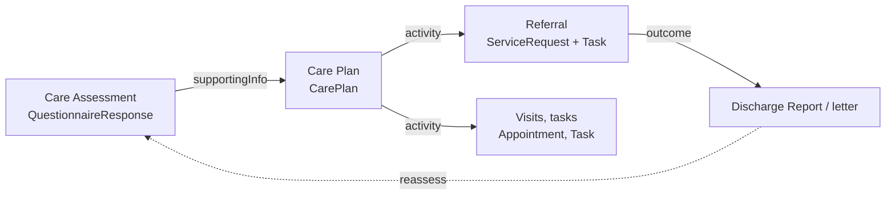

<b>Proof of concept.</b> This implementation guide is a demonstration only. It is
<b>not</b> an authoritative source, is not endorsed by NHS England, IHE or HL7, and
must not be used for implementation or clinical purposes.

PRSB standards are built from the same **sections** used again and again - patient
demographics, allergies, social context, plan and requested actions. Each section is a
reusable **template**. Some map directly to FHIR resources; others are captured as
**forms** (`Questionnaire` / `QuestionnaireResponse`). This page lists the repeating
templates found in ten PRSB standards, and the forms in this guide.

### References

| Abbreviation | PRSB standard | Version | Source checked |
|---|---|---|---|
| CIS | [Core Information Standard](https://theprsb.org/standards/core-information-standard/) | v2.01 | JSON |
| CRIS | [Clinical Referral Information Standard](https://theprsb.org/standards/clinical-referral-information-standard/) | v1.0 | Web page, Excel v1.2 |
| eDis | [Transfer of Care - Acute Inpatient Discharge](https://theprsb.org/standards/edischargesummary) | v2.1 | Web page |
| OPL | [Outpatient Letter](https://theprsb.org/standards/outpatientletterstandard) | v2.2 | Excel |
| ECD | [Emergency Care Discharge](https://theprsb.org/standards/emergencycaredischarge) | v2.2 | Web page |
| MHD | [Mental Health Inpatient Discharge](https://theprsb.org/standards/mentalhealth/) | v2.1 | Web page |
| 111 | [111 Referral Standard](https://theprsb.org/standards/111referralstandard) | v1.0 | Web page |
| CP | [Community Pharmacy Standard](https://theprsb.org/standards/communitypharmacy/) | v3.01.3 | Excel |
| HRAC | [Hospital Referral for Assessment for Community Care and Support](https://theprsb.org/standards/hospitalrefferalforassessmenforcommunitycare) | v1.1 | Excel |
| PCSP | [Personalised Care and Support Plan](https://theprsb.org/standards/personalisedcareandsupportplan) | v2.0 | Web page |
{:.grid}

Checked 2026-11-02. Section names vary slightly between standards (for example
"Patient demographics" and "Person demographics"); they are grouped below. The CIS
defines almost all of them, so it is not counted.

### Repeating Templates

Sections that appear in three or more of the nine other standards:

| Template (PRSB section) | Count | Standards | FHIR | Form in this guide |
|---|---|---|---|---|
| Person / patient demographics | 9 | all | `Patient` | - |
| GP practice | 9 | all | `Patient.generalPractitioner` (ODS code) | - |
| Referral / referrer details | 8 | CRIS, eDis, OPL, ECD, MHD, 111, CP, HRAC | [Clinical Referral](StructureDefinition-Referral.html) - `ServiceRequest` | - |
| Allergies and adverse reactions | 8 | CRIS, eDis, OPL, ECD, MHD, 111, CP, HRAC | `AllergyIntolerance` | - |
| Medications and medical devices | 8 | CRIS, eDis, OPL, ECD, MHD, 111, CP, HRAC | `MedicationStatement`, `MedicationRequest`, `DeviceUseStatement` | - |
| Plan and requested actions | 7 | eDis, OPL, ECD, MHD, 111, CP, HRAC | Document plan of care section; `CarePlan`; `ServiceRequest` | - |
| Social context | 7 | CRIS, eDis, OPL, MHD, 111, CP, HRAC | `Observation` (social history) | [Social Context](Questionnaire-SocialContext.html) |
| Clinical summary / narrative | 7 | eDis, OPL, ECD, MHD, 111, CP, HRAC | Document narrative section | - |
| Diagnoses / problems | 7 | eDis, OPL, ECD, MHD, 111, CP, HRAC | `Condition` | - |
| Individual requirements | 6 | CRIS, eDis, OPL, MHD, 111, HRAC | `Flag`, `Observation` - **To confirm** | [Care Assessment](Questionnaire-CareAssessment.html) (group) |
| Legal information | 6 | CRIS, eDis, OPL, MHD, CP, HRAC | `Consent`, `DocumentReference` (advance decisions) | Candidate |
| Information and advice given | 6 | CRIS, eDis, OPL, ECD, MHD, CP | Document section; `Communication` | - |
| Person and carer concerns, expectations and wishes | 6 | CRIS, eDis, OPL, MHD, 111, HRAC | `Observation`, `Goal` | [Care Assessment](Questionnaire-CareAssessment.html) (item) |
| Person completing record | 5 | CRIS, eDis, OPL, ECD, MHD (and inside every HRAC and CP entry) | `Composition.author`, `QuestionnaireResponse.author`, `Provenance` | Not an item - see [below](#repeating-sub-templates) |
| Distribution list | 5 | CRIS, eDis, OPL, ECD, MHD | HDR `informationRecipient` extension | - |
| Procedures | 5 | eDis, OPL, ECD, MHD, CP | `Procedure` | - |
| Investigation results | 5 | CRIS, eDis, OPL, MHD, CP | `Observation`, `DiagnosticReport` | - |
| Assessments / assessment scales | 5 | CRIS, eDis, OPL, MHD, CP | `QuestionnaireResponse`, scored `Observation` | Per instrument, e.g. the [exercise referral forms](ReferralForms.html) |
| Discharge details | 5 | eDis, ECD, MHD, CP, HRAC | `Encounter` ([Hospital Spell](StructureDefinition-HospitalSpell.html)) | - |
| Admission details | 4 | eDis, MHD, CP, HRAC | `Encounter` ([Hospital Spell](StructureDefinition-HospitalSpell.html)) | - |
| Safety alerts | 4 | CRIS, eDis, OPL, MHD | `Flag` | - |
| Safeguarding | 4 | ECD, 111, CP, HRAC | `Flag`, `Condition` | - |
| Family history | 4 | CRIS, OPL, MHD, CP | `FamilyMemberHistory` | - |
| Participation in research | 4 | CRIS, eDis, OPL, MHD | `ResearchSubject` | - |
| Examination findings | 3 | CRIS, OPL, CP | `Observation` (vital signs) | [Vital Signs](Questionnaire-VitalSigns.html) |
| Risks | 3 | ECD, 111, HRAC | `RiskAssessment`, `Flag` | [Care Assessment](Questionnaire-CareAssessment.html) (group) |
| Presenting complaints or issues | 3 | ECD, 111, CP | `Condition` (category presenting complaint) | - |
{:.grid}

Less common: About me (HRAC, PCSP), contingency and additional support plans (HRAC,
PCSP), professional and personal contacts (HRAC, PCSP), attendance details (OPL, ECD).
Only in HRAC: care needs summary, assessed level of care, primary support reason - the
**care assessment**. Only in PCSP: the care and support plan itself.

**Templates or forms?** A template whose content is a clinical fact with its own FHIR
resource (an allergy, a medicine, a diagnosis) is exchanged as that resource, inside a
document (HDR, EPS) or by API. A form is used where the content is a set of questions
answered at one time - social context, vital signs, an assessment. The answers can then
be extracted into resources (SDC extraction) where that is useful.

### Repeating Sub-templates

Inside the sections, the same groups of items repeat in every record entry, especially
in HRAC and CP:

| Sub-template | Items | FHIR |
|---|---|---|
| Person completing record | Name, role, grade, specialty, organisation, professional identifier, date completed, contact details | `author` (`PractitionerRole` - practitioner and organisation identifiers), `Provenance` |
| Performing professional | Name, role, grade, specialty, professional identifier, organisation, contact details | `performer` / `asserter` (`PractitionerRole`) |
| Location | Coded value (ODS), free text | `Location` / `Encounter.location` |
| Record entry dates | Date, start date, end date | `effective[x]`, `period`, `recordedDate` |
{:.grid}

These are record metadata, not questions: in a form they are
`QuestionnaireResponse.author`, `authored` and `source`, not items.

### Forms in This Guide

| Questionnaire | Based on | PRSB section | Used for |
|---|---|---|---|
| [Social Context](Questionnaire-SocialContext.html) | Virtually Healthcare, completed from the CIS | Social context | Referral supporting information; patient summary social history |
| [Vital Signs](Questionnaire-VitalSigns.html) | Virtually Healthcare; NHS England Clinical Observations codes | Examination findings | Referral supporting information; virtual ward monitoring |
| [Care Assessment](Questionnaire-CareAssessment.html) | HRAC v1.1 | About me, individual requirements, care needs summary, assessed level of care, primary support reason, risks, concerns | Input to a [Care Plan](StructureDefinition-PatientCarePlan.html) |
| [Exercise referral forms](ReferralForms.html) | HL7 Physical Activity IG; PAR-Q+ (structure only) | Assessment scales | Referral and pre-attendance forms |
{:.grid}

Candidates for further forms: Individual requirements (as its own form), About Me
(PRSB [About Me](https://theprsb.org/standards/aboutme)), Legal information, and
Person and carer concerns - **Open**.

### Care Assessment and Care Plan

In the NHS a **care assessment** form is very often called a "care plan". They are
different things:

| | Care assessment | Care plan |
|---|---|---|
| What it is | What the person needs, the risks, what matters to them - assessed at a point in time | What will be done about it: activities, who does them, when, towards which goals |
| FHIR | `QuestionnaireResponse` ([Care Assessment](Questionnaire-CareAssessment.html)) | `CarePlan` ([Care Plan](StructureDefinition-PatientCarePlan.html)) - the [Care Plan and Execution](StructureDefinition-CarePlanModel.html) model |
| PRSB | HRAC (care needs summary, assessed level of care, risks) | PCSP (care and support plan, contingency plans) |
| Changes | A new assessment each time | Updated as activities progress; shared through [DCP](DCP.html) |
{:.grid}

Social care uses "care plan" in the FHIR sense; the confusion is mostly in the NHS,
where a "care plan" received from another organisation (for example the BaRS `CarePlan`
- see the [BaRS review](BaRS.html#3-careplan-is-the-assessment-not-a-plan)) is often an
assessment.

Example: the [completed care assessment](QuestionnaireResponse-CareAssessmentResponse.html)
before discharge from the virtual ward, and the
[community care and support plan](CarePlan-CommunitySupportPlan.html) formed from it
(`CarePlan.supportingInfo` references the assessment; its activities include a referral
to pulmonary rehabilitation).
