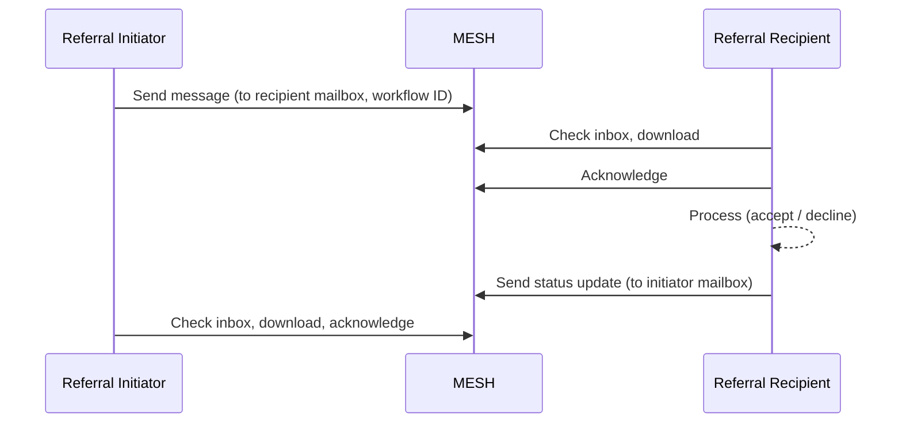
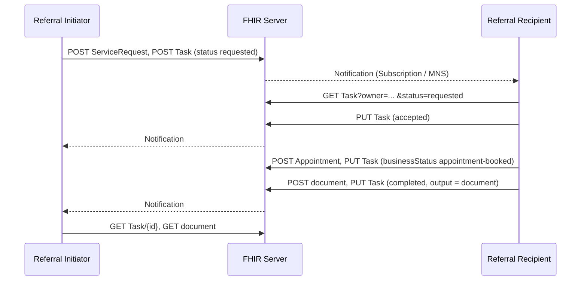

<b>Proof of concept.</b> This implementation guide is a demonstration only. It is
<b>not</b> an authoritative source, is not endorsed by NHS England, IHE or HL7, and
must not be used for implementation or clinical purposes.

360X sends every transaction as an IHE XDM package (ZIP over secure email) or,
optionally, by XDR or MHD. NHS systems mostly do not have that infrastructure, so this
guide defines the **content** of each interaction once and lets it travel by any of the
options below. The content is always a small **workflow message** (order or status) and,
for PCC-55, PCC-57 and PCC-59, a **clinical document**.

### References

- [IHE PCC 360X](https://www.ihe.net/uploadedFiles/Documents/PCC/IHE_PCC_Suppl_360X.pdf) PCC TF-1 X.2.2 (transport options), X.3 (actor groupings)
- [NW GMSA - Message Exchange](https://nw-gmsa.github.io/en/MQ.html), [Document Exchange (MHD)](https://nw-gmsa.github.io/en/MHD.html), [API Security](https://nw-gmsa.github.io/en/api-security.html)
- [FHIR Messaging](https://hl7.org/fhir/R4/messaging.html), [FHIR Workflow Management](https://hl7.org/fhir/R4/workflow-management.html)
- [MESH API](https://digital.nhs.uk/developer/api-catalogue/message-exchange-for-social-care-and-health-api)
- [EU Health Data API](https://hl7.eu/fhir/health-data-api/1.0.0-ballot/en/), [IHE MHD](https://profiles.ihe.net/ITI/MHD/index.html)

### Options

| Option | Workflow message | Document | Use when | 360X equivalent |
|---|---|---|---|---|
| [HL7 v2](#hl7-v2) | `OMG^O19`, `OSU^O51`, `SIU` (or `REF_I12`) | OBX type ED / RP, or `MDM^T02` | Within a trust or region, through the Trust Integration Engine | 360X payload, without XDM |
| [MESH](#mesh) | HL7 v2 or FHIR Message as the MESH payload | In the payload, or Kettering XML | Between organisations with no direct connection, especially to GP practices | XDM over Direct |
| [FHIR Messaging](#fhir-messaging) | `Bundle` type `message` with `MessageHeader` | FHIR Document in the message, or by reference | FHIR between organisations | - |
| [FHIR RESTful Task](#fhir-restful-task) | `ServiceRequest` and `Task` on a shared FHIR server | Referenced from `Task.output` | Shared care record or national API; Conversational Workflow | - |
| [Document Sharing](#document-sharing) | Any of the above | Published to a Document Access Provider (Health Data API / MHD) | Reports that others need to find later | MHD Option |
| [XDM / XDR](#xdm-and-xdr) | 360X as specified | 360X as specified | Only where XDS / XDR infrastructure exists | Base / XDR Option |
{:.grid}

All options **SHALL** carry the Referral ID and the patient identifier unchanged in
every message, and **SHALL** acknowledge receipt (HL7 v2 ACK, MESH acknowledgement or
FHIR response) separately from the business response (accept / decline).

### HL7 v2

The 360X HL7 v2.5.1 messages, sent over MLLP (or HL7 over HTTP) through the Trust
Integration Engine, using the [NW GMSA HL7 v2](https://nw-gmsa.github.io/en/hl7v2.html)
conventions for MSH, PID and PV1.

FHIR Message equivalents: [Referral Order (O19)](MessageDefinition-referral-order.html) and [Referral Order Status (O51)](MessageDefinition-referral-order-status.html); examples on [PCC-55](PCC-55.html#examples), [PCC-57](PCC-57.html#example) and [PCC-59](PCC-59.html#example).

| 360X | Message | ORC-1 / ORC-5 or trigger |
|---|---|---|
| Referral Request [PCC-55] | `OMG^O19^OMG_O19` | NW / - |
| Referral Accept [PCC-55] | `OSU^O51^OSU_O51` | OK / IP |
| Referral Decline [PCC-55], [PCC-56] | `OSU^O51^OSU_O51` | UA / CA (reason ORC-16) |
| Referral Outcome [PCC-57] | `OSU^O51^OSU_O51` + document | SC / CM |
| Cancel Request [PCC-58] | `OSU^O51^OSU_O51` | CA / CA (reason ORC-16) |
| Cancel Confirmation [PCC-58] | `OSU^O51^OSU_O51` | CR / CA |
| Interim Consultation Note [PCC-59] | `OSU^O51^OSU_O51` + document | SC / A |
| Appointment [PCC-60] | `SIU^S12`, `SIU^S13`, `SIU^S15` | new, reschedule, cancel |
| No-Show [PCC-61] | `SIU^S26` | RGS-2 D |
{:.grid}

**Alternative:** HL7 v2 `REF_I12` (patient referral) and `RRI_I12` (response) are the
v2 referral messages some UK systems support - see [Patient Referral [I12]](I12.html), with examples and FHIR Message equivalents; the
[NW GMSA Genetic Referrals](https://nw-gmsa.github.io/en/GeneticReferrals.html#referral-data-model)
page maps them. 360X uses the order messages instead, which match LTW and SWF.b.

**Documents:** the clinical document goes in the same message as an OBX of type ED
(base64 PDF or FHIR Document) or RP (pointer), or as a separate `MDM^T02` with the
Referral ID - see [Referral Outcome Reports](Reports.html#hl7-v2-report-messages).

### MESH

MESH is store-and-forward between mailboxes. It replaces 360X's ZIP over email:

The payload is an HL7 v2 message, a FHIR Message or a FHIR Document. MESH workflow IDs
identify the kind of message - **To confirm** which workflow IDs exist for referrals and
which would be needed. Kettering XML, used for most letters to GP practices today,
carries the document only, without the referral status.

### FHIR Messaging

Each interaction is a FHIR Message (`Bundle` type `message`), sent with
`$process-message` or over MESH, following [FHIR Messaging](https://hl7.org/fhir/R4/messaging.html). BaRS also uses FHIR Messaging, but this guide's message contents and events follow 360X, not BaRS - see the [BaRS assessment](NHSEngland.html#booking-and-referral-standard-bars).

POST [base]/$process-message 
Authorization: Bearer {accessToken} 
Content-Type: application/fhir+json

Message definitions: [Referral Order (O19)](MessageDefinition-referral-order.html) (focus `ServiceRequest`) and [Referral Order Status (O51)](MessageDefinition-referral-order-status.html) (focus `Task`) - the same FHIR Messages whether the HL7 v2 source is `OMG^O19` / `OSU^O51` or `REF_I12` / `RRI_I12`.

| 360X | MessageHeader focus | Contents |
|---|---|---|
| Referral Request [PCC-55] | `ServiceRequest` ([Referral Request](StructureDefinition-ReferralRequest.html)) | Patient, requester, supporting information (document) |
| Accept, decline, cancel, status [PCC-55] to [PCC-58] | `Task` ([Referral Task](StructureDefinition-ReferralTask.html)) | The Task, with `basedOn` the referral |
| Interim note [PCC-59], outcome [PCC-57] | `Task` | The Task, with `output` the document (included as a `Bundle` of type `document`, or a `DocumentReference`) |
| Appointment, no-show [PCC-60], [PCC-61] | `Appointment` ([Referral Appointment](StructureDefinition-ReferralAppointment.html)) | Appointment, with `basedOn` the referral |
{:.grid}

`MessageHeader.eventCoding` is the HL7 v2 trigger event (v2-0003 `O19`, `O51`), as in the NW GMSA messages. Whether finer 360X events (accept, decline, interim, outcome) need their own codes, rather than the Task status, is **Open**; BaRS events would be mapped to these.

### FHIR RESTful Task

Where both actors can reach the same FHIR server (a shared care record, a care
coordination platform or a national API), the referral is a conversation on shared
resources rather than messages - one of the
[FHIR Workflow Management Communication Patterns](https://hl7.org/fhir/R4/workflow-management.html) using Task.

GET [base]/Task?owner:identifier={odsCode}&amp;status=requested 
GET [base]/Task?based-on:identifier={system}|{referralId} 
PUT [base]/Task/{id}

The [HL7 Physical Activity IG](ReferralForms.html#hl7-physical-activity-ig) uses this pattern, including "light" recipients without their own FHIR server whose Tasks are held on the initiator's server.

Updates follow the DCP read-change-write rule with versioning (`If-Match`), see
[Dynamic Care Planning](DCP.html).

### Document Sharing

See [Document Sharing [MHD]](MHD.html) and [Query Existing Data [PCC-44]](QEDm.html).
Sharing data through an API is highly recommended - see [EU Health Data API](HealthDataAPI.html).
Reports (and referral letters) are published to a Document Access Provider so other
carers can find them, as described in
[Referral Outcome Reports](Reports.html#from-document-messaging-to-document-sharing).
360X's MHD Option groups the actors with MHD Document Source and Recipient; here they
are the Health Data API Document Publisher and Document Access Provider. Publishing
does not replace notifying the Referral Initiator.

### XDM and XDR

360X's required XDM grouping (Portable Media Creator / Importer with ZIP over Email)
and its XDR Option need XD* infrastructure that most NHS organisations do not have.
They are **optional** in this guide. Where they are used, follow 360X as specified,
with the content defined on the transaction pages.
