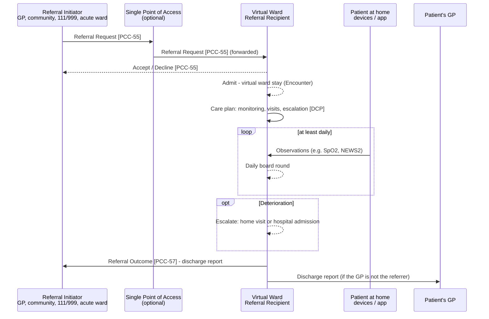

<b>Proof of concept.</b> This implementation guide is a demonstration only. It is
<b>not</b> an authoritative source, is not endorsed by NHS England, IHE or HL7, and
must not be used for implementation or clinical purposes.

A **virtual ward** (also known as **hospital at home**) is, in NHS England's words, "an
acute clinical service with staff, equipment, technologies, medication and skills" that
is "a substitute for acute inpatient hospital care". The patient is cared for at home,
including in a care home. In interoperability terms a virtual ward is the same closed
loop referral as an outpatient referral, with two additions: an **inpatient-like stay**
at the patient's home and a **shared care plan** with monitoring.

### References

- NHS England [Virtual wards](https://www.england.nhs.uk/virtual-wards/) and [Virtual wards operational framework](https://www.england.nhs.uk/long-read/virtual-wards-operational-framework/) (PRN01289, published 27 August 2024, updated 4 July 2025)
- [Virtually Healthcare - Clinical Process](https://virtually-healthcare.github.io/#clinical-process) - assessment, care plan, implement, evaluate in community care
- [IHE PCC Dynamic Care Planning (DCP)](https://www.ihe.net/uploadedFiles/Documents/PCC/IHE_PCC_Suppl_DCP.pdf) - see [Dynamic Care Planning](DCP.html)
- [HL7 Europe Hospital Discharge Report](https://hl7.eu/fhir/hdr/)

### Admission Routes

The operational framework describes two routes:

| Route | Framework | Referral Initiator | Code |
|---|---|---|---|
| **Step-up** | "a patient becomes acutely unwell and is offered the choice between being treated at home or in hospital" | Primary care, community care, care homes, NHS 111, 999, urgent community response (UCR), single point of access (SPoA), SDEC, ED, acute respiratory infection hubs | [step-up](CodeSystem-virtual-ward-admission-route.html) |
| **Step-down** | "a virtual ward can facilitate an earlier discharge or transfer from an inpatient ward" | Hospital ward (inpatient team) | [step-down](CodeSystem-virtual-ward-admission-route.html) |
{:.grid}

Both are a Referral Request [PCC-55] to the virtual ward service, with
`ServiceRequest.category` = SNOMED CT 729021000000108 |Referral to virtual ward|.

### Process

| Step | What happens | Interaction | FHIR |
|---|---|---|---|
| Refer | Initiator refers, with the ward's eligibility form ([Referral Forms](ReferralForms.html)); a single point of access may triage and forward | [PCC-55](PCC-55.html) | [Referral Request](StructureDefinition-ReferralRequest.html) |
| Accept / decline | Virtual ward team accepts, or declines (e.g. needs face-to-face hospital care) | [PCC-55](PCC-55.html), [PCC-56](PCC-56.html) | [Referral Task](StructureDefinition-ReferralTask.html) |
| Admit | The stay starts; the patient's home is the location | HL7 v2 ADT A01 / A04 - **To confirm** which event trusts use | [Virtual Ward Encounter](StructureDefinition-VirtualWardEncounter.html) |
| Plan | Monitoring, visits, medication and escalation plan, shared with the care team | [Dynamic Care Planning](DCP.html) | [Virtual Ward Care Plan](StructureDefinition-VirtualWardCarePlan.html) |
| Monitor | Readings from the patient or devices; at least daily review | Device / remote monitoring platform; FHIR `Observation` | Vital signs `Observation` |
| Update the referrer | Optional interim note (e.g. escalation, change of plan) | [PCC-59](PCC-59.html) | [Consultation Note](StructureDefinition-ConsultationNote.html) |
| Prescribe | Medicines for the patient at home | [EPS](NHSEngland.html#electronic-prescription-service-eps) (secondary / community care) - **To confirm** current practice | `MedicationRequest` |
| Discharge | The stay ends; discharge report to the referrer and GP, medicines to the GP and community pharmacy | [PCC-57](PCC-57.html), HL7 v2 ADT A03 | [Discharge Report](StructureDefinition-DischargeReport.html) |
{:.grid}

### Modelling the Stay

| Question | This guide | Status |
|---|---|---|
| Is the stay an inpatient encounter? | Yes - `Encounter.class` `IMP`, so the stay can end with an HL7 Europe Hospital Discharge Report (HDR only allows inpatient classes). The framework calls the service a "substitute for acute inpatient hospital care" and refers to "virtual ward admissions" | **To confirm** against the Virtual Wards SitRep / Minimum Data Set and trust PAS practice |
| Where is the patient? | `Encounter.location` = the patient's home (`Location.type` PTRES) | - |
| Step-up or step-down? | `Encounter.hospitalization.admitSource` from [Virtual Ward Admission Route](ValueSet-virtual-ward-admission-route-vs.html) | **To confirm** whether a national code set exists |
| Step-down - one spell or two? | `Encounter.partOf` the acute stay, if the trust treats it as one spell | **Open** |
| Which referral? | `Encounter.basedOn` the referral | - |
| Clinical responsibility | `Encounter.participant` - the accountable consultant, consultant practitioner or GP | - |
{:.grid}

### Care Plan and Monitoring

The virtual ward care plan is the plan the whole team works to: who visits, what is
monitored and how often, thresholds and escalation, medication. It is a `CarePlan`
([Virtual Ward Care Plan](StructureDefinition-VirtualWardCarePlan.html), from the HDR
CarePlan) with `category` SNOMED CT 960751000000107 |Remote health monitoring care
plan|, linked to the stay. Each activity references what carries it out: a referral
(e.g. to community nursing), a `Task`, an `Appointment` or a monitoring `ServiceRequest`.

The operational framework requires "at least daily monitoring of patients using tools
such as NEWS2" and says technology "should not be used to deliver virtual care where
face-to-face care is required". Remote monitoring readings are vital signs
`Observation`s; the monitoring platform is out of scope here.

### Records and Write Access

The framework asks for "access to information across all delivery partners" with
"read/write functionality". This guide does **not** follow that as written: giving each
partner write access to the others' records is not the general pattern, and it moves
the responsibility for what is in a record away from the organisation that holds it.
The general conventions are used instead:

| Need | General pattern | Standard |
|---|---|---|
| Send results and observations to the GP or another provider | Results messaging - the receiver's system files them | HL7 v2 `ORU^R01` (as for pathology and imaging); FHIR Message |
| Send the discharge report, clinic letter or interim note | Clinical documents | FHIR Document (HL7 Europe HDR, [Consultation Note](StructureDefinition-ConsultationNote.html)) or CDA; HL7 v2 `MDM^T02` |
| Read another provider's record (e.g. the GP record when triaging) | REST query APIs | FHIR REST / IHE QEDm, IHE MHD, EU Health Data API; nationally GP Connect Access Record |
| Workflow between providers (accept, decline, outcome) | Order status messages or shared `Task` | 360X `OSU^O51`; FHIR `Task` (REST) |
| A plan the whole care team works to | A shared care plan held by a Care Plan Service, which contributors update through its API - not by writing into each other's EPRs | IHE [Dynamic Care Planning](DCP.html) |
{:.grid}

Supplier write interfaces such as [IM1](NHSEngland.html#im1-interface-mechanism-1) may be
used to *file* a received document or result, but they are an implementation detail
inside the receiving organisation, not the interface between providers.

### Example

A GP refers Sansa MANCHESTER (an [NW GMSA test patient](https://nw-gmsa.github.io/en/testing.html#test-patients)), who has an exacerbation of COPD, to the respiratory virtual ward
instead of admitting her to hospital (step-up):

| Step | Example |
|---|---|
| Referral Request [PCC-55] | [GP to respiratory virtual ward](ServiceRequest-VirtualWardReferral.html) |
| Accept [PCC-55] | [Virtual ward accepted](Task-VirtualWardReferralAccepted.html) |
| Virtual ward stay | [Encounter](Encounter-VirtualWardStay.html) at the [patient's home](Location-PatientManchesterHome.html) |
| Care plan | [Remote monitoring care plan](CarePlan-VirtualWardPlan.html) |
| Monitoring | [SpO2 reading](Observation-VirtualWardSpO2.html) |
| Referral Outcome [PCC-57] | [Discharge report (HDR)](Bundle-VirtualWardDischargeReport.html), [completed](Task-VirtualWardReferralCompleted.html) |
{:.grid}

### Data Collection

Virtual ward activity is collected through the **Virtual Wards Situation Report**;
NHS England plans to "automate the flow of a new Minimum Data Set (MDS) via the
Federated Data Platform (FDP)" (operational framework). The stay, its admission route
and the discharge in this guide are the items such a data set would need - **To confirm**
when the MDS is published.
