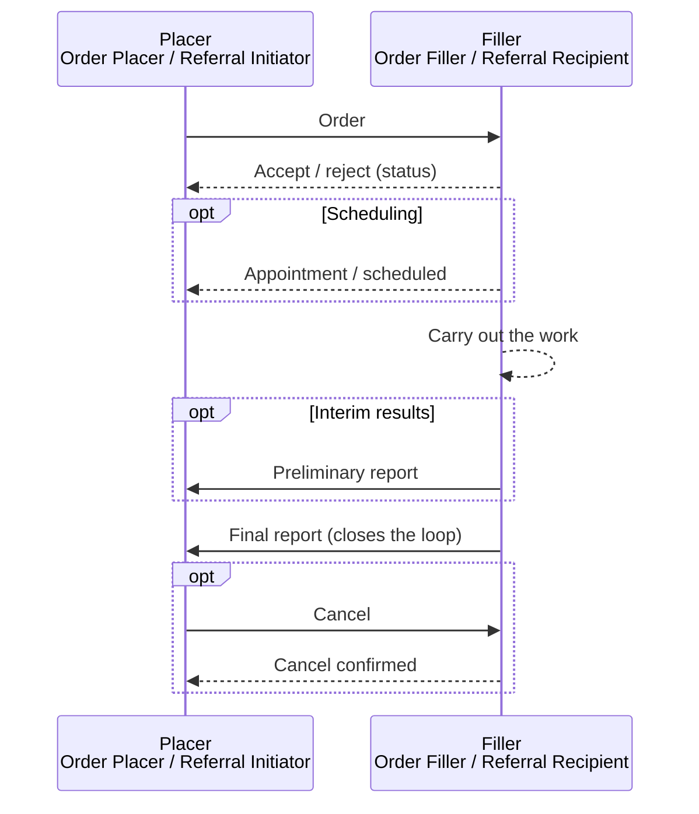
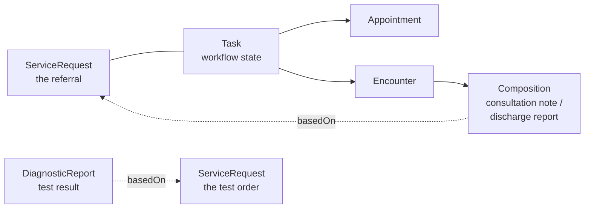
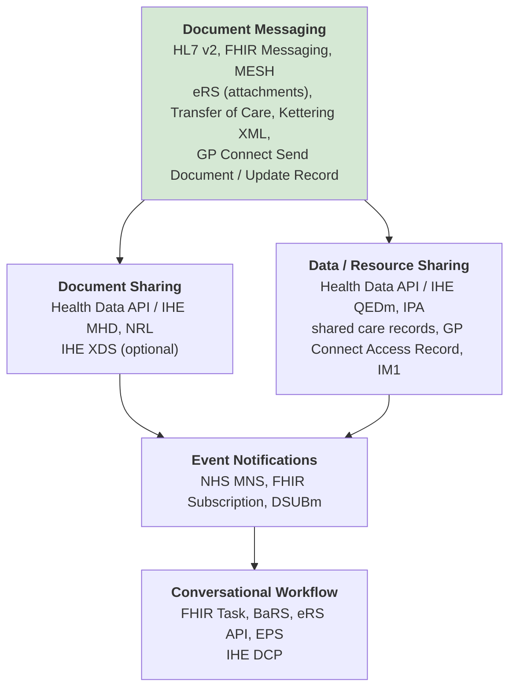

<b>Proof of concept.</b> This implementation guide is a demonstration only. It is
<b>not</b> an authoritative source, is not endorsed by NHS England, IHE or HL7, and
must not be used for implementation or clinical purposes.

A referral, a laboratory test and an imaging examination follow the same workflow:
the **placer** sends an **order**, the **filler** accepts it, does the work and sends a
**report**. IHE defines this pattern separately for each domain; this page shows
they are one pattern, so a referral can reuse what NHS trusts already run for
pathology and radiology.

### References

- [NW GMSA - Laboratory Testing Workflow (LTW)](https://nw-gmsa.github.io/en/LTW.html) and [Architecture - Enterprise Integration Patterns](https://nw-gmsa.github.io/en/exchange.html)
- [Cancer Pathology Report - LTW and ILW](https://kevinmayfield.github.io/CancerPathologyReport/LTW.html)
- [Enterprise Imaging - Radiology Scheduled Workflow (SWF.b)](https://kevinmayfield.github.io/Imaging/en/SWF.html)
- [IHE PCC 360X](https://www.ihe.net/uploadedFiles/Documents/PCC/IHE_PCC_Suppl_360X.pdf)
- [FHIR Workflow - Request, Event and Task](https://hl7.org/fhir/R4/workflow.html) and [Workflow Management Communication Patterns](https://hl7.org/fhir/R4/workflow-management.html)
- [IHE Medication Prescription and Delivery (MPD)](https://profiles.ihe.net/PHARM/MPD/index.html) and the [Electronic Prescription Service](https://digital.nhs.uk/services/electronic-prescription-service)
- [Enterprise Integration Patterns](https://www.enterpriseintegrationpatterns.com/patterns/messaging/index.html)

### One Pattern, Several Domains

| Step | Referral (IHE 360X) | Laboratory (IHE LTW) | Radiology (IHE SWF.b) | Prescription (IHE MPD / EPS) |
|---|---|---|---|---|
| Placer | Referral Initiator | Order Placer | Order Placer | Prescriber |
| Filler | Referral Recipient | Order Filler (LIMS) | Order Filler (RIS) | Dispenser (pharmacy) |
| Order | Referral Request [PCC-55] `OMG^O19` | Placer Order Management [LAB-1] `OML^O21` | Placer Order Management [RAD-2] `OMG^O19` | Submit Medication Order [PHARM-5]; EPS prescription |
| Accept / reject | Referral Accept / Decline [PCC-55] `OSU^O51` | [LAB-1] `ORL^O22` / [LAB-2] | Filler Order Management [RAD-3] `OMG^O19` | EPS release (download) / return |
| Later decline | Referral Decline [PCC-56] | Filler Order Management [LAB-2] | [RAD-3] | Not dispensed |
| Cancel | Referral Cancellation [PCC-58] | [LAB-1] (ORC-1 CA) | [RAD-2] (ORC-1 CA) | EPS cancellation |
| Schedule | Appointment Notification [PCC-60] `SIU^S12` | - | Procedure Scheduled [RAD-4] `OMI^O23` | - |
| Did not attend | No-Show Notification [PCC-61] `SIU^S26` | - | - | Not collected - **To confirm** |
| Interim report | Interim Consultation Note [PCC-59] | Order Results Management [LAB-3] (preliminary) | - | Partial dispense |
| Final report | Referral Outcome [PCC-57] | Order Results Management [LAB-3] `ORU^R01` | Send Imaging Result [RAD-128] `ORU^R01` | Submit Medication Dispense [PHARM-8]; EPS dispense notification |
| Correlation | Referral ID (ORC-2) | Placer order number (ORC-2), filler order number (ORC-3) | Placer order number, accession number | Prescription ID |
{:.grid}

360X uses the same HL7 v2.5.1 segments (ORC, OBR, OBX, TQ1) as LTW and SWF.b, so the
mappings already agreed in the [NW GMSA HL7 v2](https://nw-gmsa.github.io/en/hl7v2.html)
conventions apply. The difference is the report: a test returns results
(`DiagnosticReport` and `Observation`), a referral returns a clinical document
(consultation note, discharge report or care plan).

### FHIR Workflow

In FHIR the same pattern is a **Request** (`ServiceRequest`), the work done (`Task`,
`Encounter`, `Appointment`) and an **Event** (`DiagnosticReport`, `Composition`):

| | Order | Workflow state | Report |
|---|---|---|---|
| Referral | `ServiceRequest` ([Referral Request](StructureDefinition-ReferralRequest.html)) | `Task` ([Referral Task](StructureDefinition-ReferralTask.html)) | `Composition` ([Consultation Note](StructureDefinition-ConsultationNote.html), [Discharge Report](StructureDefinition-DischargeReport.html)) |
| Laboratory | `ServiceRequest` | `Task` (optional) | `DiagnosticReport`, `Observation` |
| Prescription | `MedicationRequest` | `Task` (optional) | `MedicationDispense` |
| Imaging | `ServiceRequest` | `Task` (optional), `ImagingStudy` | `DiagnosticReport` |
{:.grid}

In every case the report **references the order** (`basedOn`). This is the link that
closes the loop, and the one most often missing from NHS letters today.

### Integration Layers

The [NW GMSA enterprise integration](https://nw-gmsa.github.io/en/exchange.html) view
describes the layers NHS organisations build up. Referral workflow can be delivered at
each layer; the NHS England services sit at different layers:

| Layer | Referral | Referral outcome | Typical today |
|---|---|---|---|
| Document Messaging | HL7 v2 `OMG^O19` / `REF_I12` pushed to the recipient; eRS referral letter | HL7 v2 `MDM^T02` / `ORU^R01`, Transfer of Care, Kettering XML over MESH | Most trusts |
| Document Sharing | Referral letter published; recipient notified | FHIR Document published to a Document Access Provider; initiator queries or is notified | Shared care records, NRL |
| Resource Sharing | Recipient reads the ServiceRequest and clinical record | Initiator reads Conditions, CarePlans, results | Some regions |
| Event Notifications | Notify the recipient a referral exists | Notify the initiator a report exists | Emerging (MNS) |
| Conversational Workflow | Task-based: accept, decline, request information | Task completed, output references the report | eRS API, GOMS; BaRS (partial - see [assessment](NHSEngland.html#booking-and-referral-standard-bars)) |
{:.grid}

Sharing data through an API (Document and Resource Sharing, see
[EU Health Data API](HealthDataAPI.html)) is **highly recommended**: it significantly
reduces the data carried in messages and leaves messaging to focus on workflow.

This guide's interactions work at the **Document Messaging** layer first (HL7 v2 or FHIR
messages, see [Exchange Options](Transport.html)), because that is where most NHS
systems are, and show how they move to the other layers without changing the data.

### The Narrow Focus Problem

Each NHS England service implements part of the pattern for one setting:

| Service | Order | Status | Scheduling | Report | Link report to order |
|---|---|---|---|---|---|
| eRS | Yes (GP to consultant-led outpatients) | Yes (triage, accept, return to referrer) | Yes | No - clinic letters go by other routes | No |
| BaRS | Yes (mainly urgent and emergency care) | Yes | Yes | Limited - **To confirm** | Within BaRS |
| Transfer of Care | No | No | No | Yes (discharge, outpatient, ED letters) | No - **To confirm** |
| MESH + Kettering XML | No | No | No | Yes (documents to GP) | No |
| GP Connect | Clinical information (read GP record) | No | GP appointments | Yes (Send Document; Update Record from community pharmacy) | **To confirm** |
| IM1 | Supplier-specific | Supplier-specific | Supplier-specific | Supplier-specific write to the GP record - not the general pattern | Supplier-specific |
| EPS | Yes (prescription) | Yes (release, return, cancel) | No | Yes (dispense notification) | Yes (prescription ID) - but the prescriber looks it up in the tracker - **To confirm** |
| Pathology / imaging messaging | Yes (LAB-1, RAD-2) | Yes | Imaging only | Yes (LAB-3, RAD-128) | Yes (placer order number) |
{:.grid}

The [NHS England Referral and Report Services](NHSEngland.html) and
[NHS England Diagnostic Order Services](NHSEnglandDiagnostics.html) appendices assess each
of these against the 360X transactions. Where a national standard is narrower than the
general pattern, or under-specifies its data or process, the **general standard takes
precedence**: implementations follow IHE / HL7 / FHIR, and the national service is
mapped to it, not the other way round. eRS and EPS are well engineered within their
scope and can be used as references for referral triage and for prescribing.
