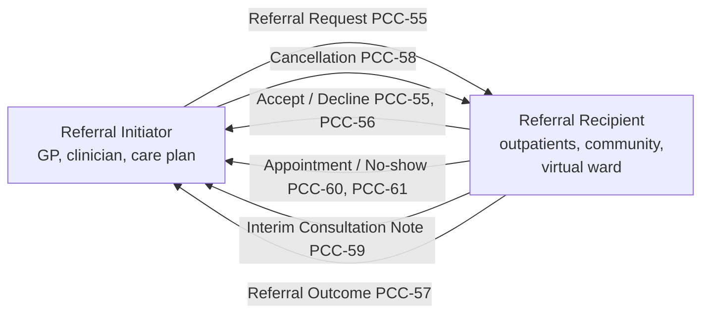

<b>Proof of concept.</b> This implementation guide is a demonstration only. It is
<b>not</b> an authoritative source, is not endorsed by NHS England, IHE or HL7, and
must not be used for implementation or clinical purposes.

This guide describes the **closed loop referral**: a clinician refers a patient to
another provider, the provider accepts (or declines) the referral, delivers care and
sends the result back, so the loop is closed and the referrer knows what happened.
It starts from IHE
[360 Exchange Closed Loop Referral (360X)](https://www.ihe.net/uploadedFiles/Documents/PCC/IHE_PCC_Suppl_360X.pdf)
and restates it for the NHS in England.

### Why a General Pattern

Referrals, test orders and imaging requests are the same workflow: **an order out and a
report back**. NHS England services each cover a narrow part of it:

| Part of the loop | NHS England service | What it covers |
|---|---|---|
| Order (referral) | [e-Referral Service (eRS)](https://digital.nhs.uk/services/e-referral-service) | GP to consultant-led outpatient referrals, triage, booking, advice and guidance |
| Order (referral) | [Booking and Referral Standard (BaRS)](https://digital.nhs.uk/services/booking-and-referral-standard) | Referrals and bookings between services, mainly urgent and emergency care |
| Report (outcome) | [Transfer of Care](https://digital.nhs.uk/services/transfer-of-care-initiative) | Discharge summaries, outpatient and emergency care letters as FHIR documents over MESH |
| Report (outcome) | [MESH](https://digital.nhs.uk/developer/api-catalogue/message-exchange-for-social-care-and-health-api) + Kettering XML | What most trusts actually use to send letters to GP practices |
| Both | [GP Connect](https://digital.nhs.uk/services/gp-connect) | Read the GP record when triaging; book GP appointments; Send Document and Update Record into the GP record |
| Both | [IM1](https://digital.nhs.uk/services/gp-it-futures-systems/im1-pairing-integration) | Supplier-specific read, bulk extract and write integration with GP systems (EMIS Web, SystmOne) |
| Order (prescription) and report (dispense) | [Electronic Prescription Service (EPS)](https://digital.nhs.uk/services/electronic-prescription-service) | Prescriptions from prescriber to dispenser in primary, secondary and community care; dispense notifications |
{:.grid}

None of these covers the whole loop, and none links the report back to the order it
answers. This guide uses one pattern - the same one used for laboratory tests in the
[NW GMSA IG](https://nw-gmsa.github.io/en/LTW.html), for cancer pathology in the
[Cancer Pathology Report IG](https://kevinmayfield.github.io/CancerPathologyReport/) and
for radiology in the [Enterprise Imaging IG](https://kevinmayfield.github.io/Imaging/en/SWF.html) -
so a national service can be shown as one implementation of a step, not as the whole design.
See [Order and Report Workflow Pattern](WorkflowPatterns.html).

### Principles

- **General standards take precedence.** IHE profiles, HL7 v2, FHIR (REST, messaging
  and documents) and CDA define the pattern. NHS England standards are **not assumed to
  be correct**: each is assessed against the general pattern, and where it under-specifies
  the data or the process the general standard is followed and the gap is recorded (see
  the [BaRS](BaRS.html) review). A national service is one possible implementation of a step, never the design.
- **HL7 v2 is the baseline.** Most NHS trust systems exchange orders and reports
  with HL7 v2 through a Trust Integration Engine. Every interaction has an HL7 v2
  equivalent, following 360X (HL7 v2.5.1) and the
  [NW GMSA HL7 v2 conventions](https://nw-gmsa.github.io/en/hl7v2.html).
- **IHE XDS is optional.** 360X carries its messages in IHE XDM or XDR packages.
  This guide does not assume an XDS registry or XDM/XDR transport; the
  [Exchange Options](Transport.html) page gives MLLP, MESH, FHIR messaging, FHIR REST and
  document sharing alternatives.
- **The referral identifier closes the loop.** Every message about a referral,
  in either direction, carries the Referral Initiator's Referral ID (PCC TF-1 X.1.3).
- **Share data through APIs; keep messages for workflow.** Sharing the record through
  an API ([EU Health Data API](HealthDataAPI.html): IHE QEDm and MHD) is highly
  recommended. It significantly reduces the data passed around in messages, leaving
  messaging to focus on workflow. This is the hoped-for outcome of the NHS England
  Single Patient Record; the referral and report exchanges are the core of what is
  often called "write back".
- **Reports are FHIR Documents.** Outcomes follow
  [HL7 Europe Hospital Discharge Report (HDR)](https://hl7.eu/fhir/hdr/), the likely
  successor to Transfer of Care, and are shared through the
  [EU Health Data API](https://hl7.eu/fhir/health-data-api/1.0.0-ballot/en/).
- **Care settings are not special cases.** A referral to a
  [virtual ward (hospital at home)](VirtualWards.html) or community service is the
  same workflow, extended by [Dynamic Care Planning](DCP.html).

### Contents

| Volume | Pages |
|---|---|
| Analysis and Design (Volume 1) | [Clinical Process](ClinicalProcess.html), [Closed Loop Referral (360X)](360X.html), [Referral Forms](ReferralForms.html), [Referral Outcome Reports](Reports.html), [EU Health Data API](HealthDataAPI.html), [Virtual Wards (Hospital at Home)](VirtualWards.html), [Dynamic Care Planning (DCP)](DCP.html), [Care Services Directory (mCSD)](mCSD.html), [Patient Identity (PDQm)](PDQm.html), [Patient Flags](PatientFlags.html) |
| Interactions (Volume 2) | [Exchange Options](Transport.html), [Referral Request [PCC-55]](PCC-55.html), [Patient Referral [I12]](I12.html), [Referral Decline [PCC-56]](PCC-56.html), [Referral Outcome [PCC-57]](PCC-57.html), [Referral Cancellation [PCC-58]](PCC-58.html), [Interim Consultation Note [PCC-59]](PCC-59.html), [Appointment [PCC-60] / No-Show [PCC-61]](PCC-60.html), [Query Existing Data [PCC-44]](QEDm.html), [Document Sharing [MHD]](MHD.html), [Find Matching Care Services [ITI-90]](ITI-90.html), [Patient Demographics [ITI-78] / [ITI-119]](ITI-78.html), [Audit [BALP]](BALP.html) |
| Data Models (Volume 3) | [Overview Model](DataModel.html), [Patient Administration](PatientAdministration.html), logical models ([Clinical Referral](StructureDefinition-Referral.html) and its [Domain Model](ReferralDomainModel.html), [Discharge Report](StructureDefinition-DischargeReport.html), [Patient Summary](StructureDefinition-PatientSummary.html), [Care Plan and Execution](StructureDefinition-CarePlanModel.html)), [Terminology](terminology.html), [Composition, Archetypes and Templates](Templates.html) |
| Appendices | [Order and Report Workflow Pattern](WorkflowPatterns.html), [NHS England Referral and Report Services](NHSEngland.html), [Booking and Referral Standard (BaRS)](BaRS.html), [NHS England Diagnostic Order Services](NHSEnglandDiagnostics.html) |
{:.grid}

### Related Guides

- [IHE PCC 360X Closed Loop Referral](https://www.ihe.net/uploadedFiles/Documents/PCC/IHE_PCC_Suppl_360X.pdf) (Rev. 1.2 Trial Implementation, 2021-04-14)
- [NW GMSA](https://nw-gmsa.github.io/en/) - laboratory workflow, enterprise integration patterns and the Health Data API; [Genetic Referrals](https://nw-gmsa.github.io/en/GeneticReferrals.html) applies the same closed loop to clinical genetics
- [Cancer Pathology Report](https://kevinmayfield.github.io/CancerPathologyReport/) and [Enterprise Imaging](https://kevinmayfield.github.io/Imaging/) - the same order and report pattern for pathology and radiology
- [HL7 Europe Hospital Discharge Report](https://hl7.eu/fhir/hdr/) (1.0.0 STU 1) and [EU Health Data API](https://hl7.eu/fhir/health-data-api/1.0.0-ballot/en/) (1.0.0-ballot)
- [HL7 Physical Activity IG](https://build.fhir.org/ig/HL7/physical-activity/workflow.html) - a recent FHIR referral workflow (ServiceRequest, Task, Observations, Subscription)
- [HL7 AU eRequesting](https://build.fhir.org/ig/hl7au/au-fhir-erequesting/) - a national FHIR order workflow using ServiceRequest and Task

