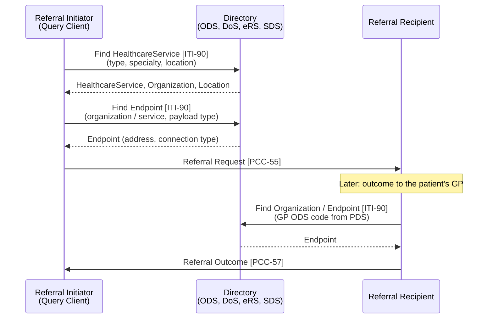

<b>Proof of concept.</b> This implementation guide is a demonstration only. It is
<b>not</b> an authoritative source, is not endorsed by NHS England, IHE or HL7, and
must not be used for implementation or clinical purposes.

IHE **Mobile Care Services Discovery (mCSD)** is a FHIR API for directories of
organisations, sites, services, practitioners and their technical endpoints. In care
coordination it answers the questions every referral starts with: **who can see this
patient, where, and how do I send them the referral** - and, at the end of the loop,
**where do I send the outcome** (usually the patient's GP).

360X leaves directories to the transport (Direct addresses in the US). In England there
are several national directories, each covering part of the problem - see
[NHS England Services](#nhs-england-services) below.

### References

- [IHE ITI mCSD](https://profiles.ihe.net/ITI/mCSD/index.html) 4.0.0 (2025-05-21) - [Volume 1](https://profiles.ihe.net/ITI/mCSD/volume-1.html)
- [Find Matching Care Services [ITI-90]](ITI-90.html) - this guide's Volume 2 page
- [NHS England API and integration catalogue](https://digital.nhs.uk/developer/api-catalogue) (checked 2026-11-02)

### Actors and Transactions

| Actor | Description | Transactions | In the closed loop |
|---|---|---|---|
| Directory | Holds the care services resources and answers queries | [ITI-90] R; [ITI-91] O (Update Option); [ITI-130] O (Feed Option) | ODS, Directory of Services, eRS service catalogue, SDS, a regional directory |
| Query Client | Queries the Directory | Find Matching Care Services [ITI-90] R | Referral Initiator choosing a service; Referral Recipient routing an outcome back |
| Update Client | Gets changes since its last refresh, to keep a local copy | Request Care Services Updates [ITI-91] R | Trust Integration Engine or EPR caching ODS and service data |
| Data Source | Sends creates, updates and deletes to the Directory | Care Services Feed [ITI-130] R | Provider maintaining its own service profile (e.g. DoS Ingest API) |
{:.grid}

Options: **Location Distance** (find `Location` by distance - "nearest service"),
**Update** and **Feed** ([mCSD Volume 1](https://profiles.ihe.net/ITI/mCSD/volume-1.html)).

### Resources

mCSD covers Organization, Location (including facilities and jurisdictions),
HealthcareService, Practitioner, PractitionerRole, OrganizationAffiliation and Endpoint.

| mCSD resource | This guide | Master record in England | Use in the closed loop |
|---|---|---|---|
| Organization | [Organization](StructureDefinition-Organization.html) (ODS code) | **ODS** | Referral Initiator and Recipient; `MSH-4` / `MSH-6`; identifier assigners |
| Location (facility) | [Location](StructureDefinition-Location.html) (ODS site code) | **ODS** (sites); wards and clinics in the trust PAS | Where the patient is seen |
| HealthcareService | [HealthcareService](StructureDefinition-HealthcareService.html) | **Directory of Services**, **eRS** (eRS services) | The service referred to (`ServiceRequest.performer`) |
| Practitioner | [Practitioner](StructureDefinition-Practitioner.html) | Professional regulators (GMC, NMC, HCPC); **SDS** for Care ID holders | Requester, owner, author |
| PractitionerRole | [PractitionerRole](StructureDefinition-PractitionerRole.html) | **SDS** (role profiles); eRS users | Practitioner acting for an organisation (requester, performer) |
| OrganizationAffiliation | - (core) | **ODS** relationships (e.g. practice to ICB) | Commissioning; networks a provider belongs to |
| Endpoint | - (core) | **SDS** (Spine), **DoS** endpoints, **MESH** mailboxes, BaRS Endpoint Catalogue | Where the referral and status messages are delivered |
{:.grid}

### Process Flow

Directory lookups are usually made **before** the referral (choosing the service) and
**when routing** (finding the endpoint). Many systems keep a local copy of ODS and their
partners' services and refresh it (the Update Client).

### Use Cases

Messages and documents identify people and organisations by **code**, not by full
resource (see [BaRS](BaRS.html)). The receiver looks the code up in a directory when it
needs the details - to display the name, check the organisation is active, or find who to
reply to. The examples use the [cardiology referral](ServiceRequest-CardiologyReferral.html)
participants.

| Code | Example | Identifies | Master record | mCSD query [ITI-90] | NHS England service today |
|---|---|---|---|---|---|
| ODS organisation code | `P89020`, `R0A` | Organisation (GP practice, trust) | ODS | `Organization?identifier=https://fhir.nhs.uk/Id/ods-organization-code|R0A` | [ODS](#organisation-data-service-ods) Organisation Data Terminology API - **live** |
| ODS site code | `R0A01` (fictitious) | Site | ODS | `Location?identifier=https://fhir.nhs.uk/Id/ods-site-code|R0A01` | ODS Organisation Data Terminology API (sites are returned as `Organization`) |
| GMP code (GP practitioner) | `G1234567` | A GP **at a practice** | ODS (GP practitioner data) | `PractitionerRole?practitioner.identifier=https://fhir.hl7.org.uk/Id/gmp-number|G1234567&_include=PractitionerRole:organization` | No FHIR API - ODS bulk download (Data Search and Export) |
| GMC number | `7654321` | Doctor (registration) | General Medical Council | `Practitioner?identifier=https://fhir.hl7.org.uk/Id/gmc-number|7654321` | No NHS England search API |
| SDS user ID | (Care ID) | NHS user (smartcard holder) | SDS | `Practitioner?identifier=https://fhir.nhs.uk/Id/sds-user-id|...` | [Healthcare Worker FHIR API](#spine-directory-service-sds) |
{:.grid}

#### Organisation from an ODS Code

*A trust receives a Referral Request [PCC-55] with `MSH-4` / `ServiceRequest.requester`
organisation `P89020`, and an outcome needs routing to the GP practice `P89020` taken
from PDS.*

GET [base]/Organization?identifier=https://fhir.nhs.uk/Id/ods-organization-code|P89020

- **NHS England:** the [Organisation Data Terminology FHIR API](https://digital.nhs.uk/developer/api-catalogue/organisation-data-terminology)
  answers the same query (`identifier` "can also explicitly include the CodeSystem ... `ods-organization-code`"),
  or `GET /Organization/P89020` (the resource id is the ODS code). It returns name,
  address, active status, roles (e.g. NHS Trust, GP practice) and relationships
  (`OrganizationAffiliation`, e.g. the practice's ICB).
- **Check `active`.** A closed practice or merged trust is still returned - a referral or
  outcome **SHOULD NOT** be routed to an inactive organisation.
- **Endpoints are not in ODS.** Use the DoS Search API (`_revinclude=Endpoint`), SDS
  (Spine / GP Connect) or MESH lookup to find how to send to it.
- Cache: ODS changes slowly; a local copy refreshed by `lastChangeDate` is the Update
  Client pattern [ITI-91].

#### GP from a GMP Code

*A GP referral (HL7 v2 `ORC-12` / `PV1-8` referring doctor, or a Kettering / Transfer
of Care document) names the referrer as `G1234567`; the trust needs the GP's name and
practice.*

GET [base]/PractitionerRole?practitioner.identifier=https://fhir.hl7.org.uk/Id/gmp-number|G1234567&_include=PractitionerRole:practitioner&_include=PractitionerRole:organization

- **A GMP code identifies a GP at a practice**, not the person: "in the event of a
  GENERAL MEDICAL PRACTITIONER running more than one practice, a spurious code will be
  assigned to the Practitioner for each additional practice" (NHS Data Dictionary,
  [GENERAL MEDICAL PRACTITIONER PPD CODE](https://archive.datadictionary.nhs.uk/DD%20Release%20June%202026/attributes/general_medical_practitioner_ppd_code.html)).
  So the lookup is a `PractitionerRole` (practitioner + practice ODS code), as in
  [Dr Allen at HT PRACTICE](PractitionerRole-GPAllenRole.html).
- **NHS England:** GMP codes are published by ODS as a bulk report (Data Search and
  Export, practitioner reports "egpcur" - **To confirm** report name and columns), not
  through a FHIR API. The usual pattern is to load the report into a **local / regional
  mCSD Directory** (Update Client) and query that.
- The GMC number is the better identifier for the person; the GMP code is kept because
  GP systems and HL7 v2 messages use it.

#### Clinician from a GMC Number

*A Referral Outcome [PCC-57] is authored by a consultant identified by GMC number
`7654321`; the GP system wants the name, specialty and trust.*

GET [base]/PractitionerRole?practitioner.identifier=https://fhir.hl7.org.uk/Id/gmc-number|7654321&_include=PractitionerRole:practitioner&_include=PractitionerRole:organization

- **No NHS England API searches by GMC number.** The [Healthcare Worker FHIR API](https://digital.nhs.uk/developer/api-catalogue/healthcare-worker-fhir)
  returns professional registration IDs on a `Practitioner` found by SDS user ID - "we've
  only included them in this API if the data is of sufficient quality" - and "cannot ... search by professional codes,
  such as GMC or RNC code".
- The master record for registration is the regulator (GMC, NMC, HCPC, GPhC); whether
  any offers an API for NHS systems is **To confirm**.
- The **role** (specialty, trust) is not in the GMC register. It comes from the employing
  organisation - a trust or regional mCSD Directory built from the trust's staff master
  (e.g. `MFN^M02`), or carried in the message as a `PractitionerRole` (practitioner GMC
  number + organisation ODS code), as in [Dr Brown, Cardiology, MFT](PractitionerRole-CardiologistBrownRole.html).
- Do not reject a message because a GMC number cannot be resolved; display the name
  sent with it.

### HL7 v2

HL7 v2 has no directory query in common use. Master file messages carry directory data
between systems (indicative): `MFN^M02` (staff / practitioner) and `MFN^M05` (locations);
there is no v2 master file for services or endpoints. In 360X v2 messaging the
organisations are coded in `MSH-4` / `MSH-6` (ODS code) and practitioners in `ORC-12` /
`PRD`; routing is configured in the integration engine.

### NHS England Services

<b>No single national directory.</b> NHS England has several directories, each the
master record for one thing. A Query Client will usually call more than one. Some are
<b>specific to a national service</b> (eRS, BaRS, NHS 111, MESH) and are only useful
within it - marked below.

Status and capability are as published in the API catalogue and OpenAPI files on the
date checked (2026-11-02).

| Question | NHS England service | mCSD equivalent | Scope |
|---|---|---|---|
| Who is this organisation? (ODS code to name, address, role, relationships) | [ODS](#organisation-data-service-ods) - Organisation Data Terminology FHIR API | `Organization`, `OrganizationAffiliation` [ITI-90]; sync [ITI-91] | General |
| Which service can see this patient? | [Directory of Services](#directory-of-services) - DoS Search API (FHIR), UEC DoS | `HealthcareService` [ITI-90] | General, but data and search are mainly urgent and emergency care (NHS 111) |
| Which eRS service can I refer to? | [eRS](#e-referral-service-ers) - `$ers.searchHealthcareServicesForPatient` (A010), `HealthcareService` (A033 / A035) | `HealthcareService` [ITI-90] | **eRS only** |
| Where is the BaRS receiver? | [BaRS Endpoint Catalogue](#booking-and-referral-standard-bars) (via the BaRS Proxy) | `Endpoint` [ITI-90] | **BaRS only** |
| Which Spine system / endpoint does this organisation use? | [SDS](#spine-directory-service-sds) - Spine Directory Service FHIR API | `Endpoint` (and `Device`) [ITI-90] | Spine messaging, GP Connect |
| Who is this healthcare worker, what roles do they hold? | [SDS](#spine-directory-service-sds) - Healthcare Worker FHIR API | `Practitioner`, `PractitionerRole` [ITI-90] | Care ID (smartcard) holders |
| Which MESH mailbox do I send to? | [MESH](#mesh-mailbox-lookup) - Look up MESH address | `Endpoint` [ITI-90] | **MESH only** (Transfer of Care, GP Connect messaging) |
| Which public services are near the patient? | [Directory of Healthcare Services (Service Search)](#directory-of-healthcare-services-service-search) | `HealthcareService`, `Location` (Location Distance) | Public (NHS website) data |
| Which pharmacy can dispense? | [EPS Directory of Services](#directory-of-services) | `HealthcareService`, `Location` | **EPS only** |
{:.grid}

#### Organisation Data Service (ODS)

ODS is the **master record for organisations and sites** - the ODS code is the assigning
authority in every identifier in this guide ([Organization](StructureDefinition-Organization.html),
[Location](StructureDefinition-Location.html)).

- [Organisation Data Terminology - FHIR API](https://digital.nhs.uk/developer/api-catalogue/organisation-data-terminology):
  `GET /Organization` (search by `identifier`, `name`, `address-postalcode`, `roleCode`,
  `active`, `lastChangeDate`), `GET /OrganizationAffiliation` (relationships, by
  `primary-organization` / `participating-organization`). The closest NHS England API to
  an mCSD Directory. A `lastChangeDate` search supports a local copy, like
  Request Care Services Updates [ITI-91].
- [Organisation Data Service - ORD API](https://digital.nhs.uk/developer/api-catalogue/organisation-data-service-ord):
  the full ODS dataset (non-FHIR), including "a list of organisations that have been
  modified since a specific date to synchronise data locally". Not designed for high
  volume ("below 5 requests per second").
- **Tips:** cache ODS locally; reference organisations by ODS code rather than sending a
  full `Organization` in each message (see [BaRS](BaRS.html)); ODS sites are
  `Location`s, not `Organization`s, in this guide.

#### Directory of Services

The NHS England Directory of Services (DoS) is the **master record for services** in
urgent and emergency care, used by NHS 111 and NHS Pathways, and increasingly for other
services.

- [Directory of Services Search API](https://digital.nhs.uk/developer/api-catalogue/directory-of-services-search-api)
  (FHIR R4, `/dos-search/FHIR/R4`, application-restricted): `GET /Organization?identifier={ODS}&_revinclude=Endpoint`
  is available; `GET /HealthcareService` (by ODS code or service ID) and
  `$search-by-triage-code` (NHS Pathways codes) are "published but not yet available
  for use". Returns `HealthcareService`, `Location`, `Organization` and `Endpoint`
  resources - an mCSD Directory in all but name. Its roadmap replaces the UEC DoS SOAP
  and REST APIs and the EPS DoS API "over 2026 and 2027". Its `Endpoint`s carry NHS 111
  ITK CDA payload types and connection types `itk`, `email`, `telno`, `http` - so today
  they are mainly **NHS 111 post-event message** routes.
- [DoS - Urgent and Emergency Care - SOAP API](https://digital.nhs.uk/developer/api-catalogue/directory-of-services-urgent-and-emergency-care-soap)
  (in production): search on "the patient's age, sex, and current location, the
  patient's clinical need, and the timeframe". **UEC / NHS 111 specific.**
- [DoS - Urgent and Emergency Care - REST API](https://digital.nhs.uk/developer/api-catalogue/directory-of-services-urgent-and-emergency-care-rest):
  by service type, service ID or ODS code; "deprecated on the 31st of May 2026" in favour
  of the FHIR API.
- [Directory of Services Ingest API](https://digital.nhs.uk/developer/api-catalogue/directory-of-services-ingest-api):
  providers send service availability, contact and referral information to DoS - the
  mCSD **Data Source** and Care Services Feed [ITI-130].
- [EPS Directory of Services API](https://digital.nhs.uk/developer/api-catalogue/electronic-prescription-service-directory-of-services):
  dispensers for a patient's location and urgency; deprecated 31 May 2026 for the FHIR
  API. **EPS specific.**
- **Tips:** use the DoS Search API for new work - it is FHIR and close to mCSD; profile
  a service as [HealthcareService](StructureDefinition-HealthcareService.html) with
  `providedBy` (ODS), `location` and `endpoint`; NHS Service Finder is the professional
  web front end to DoS. Whether DoS will hold planned-care and community services
  (beyond eRS) is **To confirm**.

#### e-Referral Service (eRS)

eRS has its **own service catalogue**: providers publish eRS services (bookable or
triage, with clinic types and referral criteria), identified by an eRS service ID
(`http://fhir.nhs.net/Id/ers-service` in the API examples). **eRS specific** - these
services are only reachable through eRS.

- [eRS FHIR API](https://digital.nhs.uk/developer/api-catalogue/e-referral-service-fhir)
  1.58.0: Patient service search A010 `POST /STU3/HealthcareService/$ers.searchHealthcareServicesForPatient`
  ("find services that meet the referral needs of a patient", referring clinician roles;
  the patient identified first "via PDS"); Retrieve / search healthcare service A033 /
  A035 `GET /R4/HealthcareService`; user business functions A030 `GET /R4/PractitionerRole`.
- **Tips:** A010 is a clinical search, not a plain directory query - it applies eRS
  commissioning rules for the referring organisation and the patient. Keep the eRS
  service ID as a `HealthcareService.identifier` alongside the ODS code of the provider.
  eRS is a good reference for what a referral directory needs (service criteria,
  bookable vs triage) - see [NHS England Referral and Report Services](NHSEngland.html).

#### Booking and Referral Standard (BaRS)

"Every service receiving messages through BaRS will need their ServiceId and endpoint
added to the BaRS Endpoint Catalogue. This enables the BaRS Proxy to direct messages to
the service" (BaRS implementation guidance, [NHSDigital-FHIR-BookingAndReferrals PR #527](https://github.com/NHSDigital/NHSDigital-FHIR-BookingAndReferrals/pull/527)).
Receiving services first "identify or create a service profile in a national or
proprietary Directory of Service".

- **BaRS specific.** The Endpoint Catalogue is not a public API; senders address the
  target service (e.g. a DoS service ID) and the BaRS Proxy routes it.
- **Tips:** the target is a `HealthcareService` found through DoS (or another
  directory); the Endpoint Catalogue is the mCSD `Endpoint`. Which directory BaRS
  service IDs come from for each use case is **To confirm** - see [BaRS](BaRS.html).

#### Spine Directory Service (SDS)

SDS holds **accredited systems, Spine messaging endpoints and healthcare workers**
(people with a Care ID / smartcard).

- [Spine Directory Service - FHIR API](https://digital.nhs.uk/developer/api-catalogue/spine-directory-service-fhir)
  ("in production, beta"): `GET /Device` (accredited system, ASID, party key) and
  `GET /Endpoint` ("routing and reliability details" - endpoint URL, MHS party key), by
  `organization` (ODS) and `identifier` (interaction ID, party key). Used to find a
  **GP Connect** provider endpoint and Spine messaging routes. It cannot "search for
  organisations" or "search for people".
- [Healthcare Worker FHIR API](https://digital.nhs.uk/developer/api-catalogue/healthcare-worker-fhir)
  (beta): `GET /Practitioner?identifier={SDS user ID}&_revinclude=PractitionerRole` -
  professional details and national RBAC roles (identifiers
  `https://fhir.nhs.uk/Id/sds-user-id`, `https://fhir.nhs.uk/Id/sds-role-profile-id`). It
  cannot "search by professional codes, such as GMC". Not needed for the signed-in user:
  CIS2 Authentication user info gives the same.
- [Spine Directory Service - LDAP API](https://digital.nhs.uk/developer/api-catalogue/spine-directory-service-ldap):
  deprecated, not open to new integrations, retired by 30 September 2028.
- **Tips:** SDS is the master record for the NHS **user** (requester, author) and their
  role profile; the clinician's professional registration (GMC, NMC) is the better
  identifier to share in messages. SDS endpoints are Spine-specific (GP Connect, Spine
  messaging), not a general referral endpoint directory.

#### MESH Mailbox Lookup

[MESH API](https://digital.nhs.uk/developer/api-catalogue/message-exchange-for-social-care-and-health-api)
`GET /messageexchange/endpointlookup/{ods_code}/{workflow_id}` - "search for the mailbox
of the organisation you want to send data to, using their unique ODS code ... and the
agreed workflow identifier". **MESH specific**: the mCSD `Endpoint` for Transfer of Care
and other MESH-based routes (see [Exchange Options](Transport.html)).

#### Directory of Healthcare Services (Service Search)

[Directory of Healthcare Services API](https://digital.nhs.uk/developer/api-catalogue/directory-of-healthcare-services)
(previously "Service Search API", version 3; earlier versions deprecated 2 February
2026): organisations providing services "listed in NHS services near you" - GP
practices, pharmacies, hospitals, dentists. **Public-facing** data from the NHS website,
useful for patient choice and contact details, not for routing referrals.

### Gaps

- No national directory answers "which service, and where do I send the referral" for
  planned and community care outside eRS. DoS Search is the closest; its endpoints today
  are NHS 111 routes.
- Endpoints are held in four places (SDS, DoS, MESH, BaRS Endpoint Catalogue), each for
  one transport. mCSD models them all as `Endpoint` on the `Organization` or
  `HealthcareService` (mCSD endpoint discovery, 1:46.8).
- A provider maintains its services in eRS and DoS separately - **To confirm** whether
  the DoS Ingest API is intended to cover planned care.
